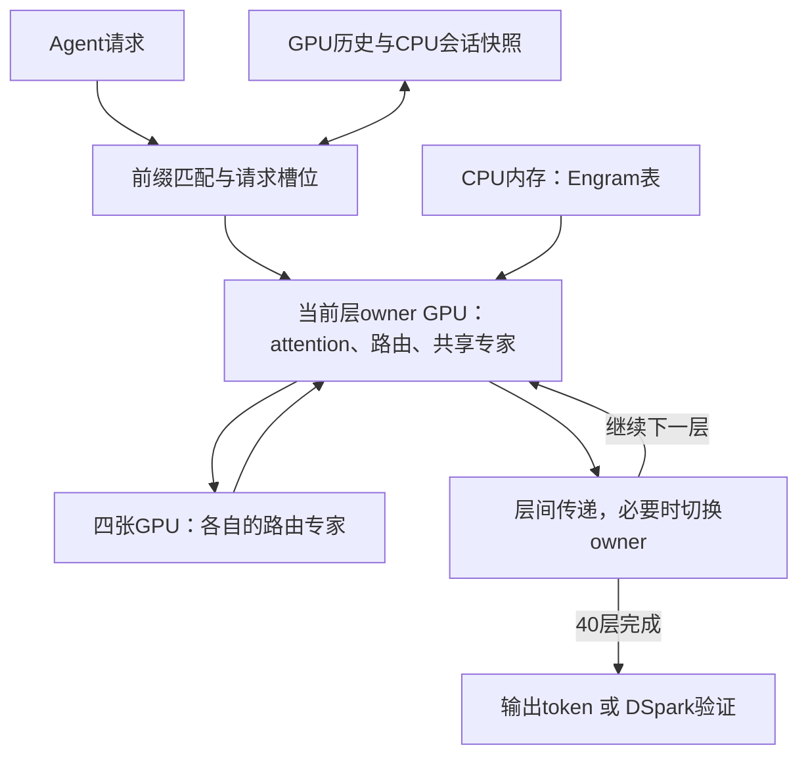

# DeepSeek 在 A100 上的移植优化与 vLLM 对照

**2026年10月14日修订。** 研究对象为[shi3z/deepseekv4.1-A100-custom](https://github.com/shi3z/deepseekv4.1-A100-custom/tree/580568edd6f84537ff042ded4ee842b892bf3ff4)，源码固定在9月20日版本。

这个项目的价值在于较早完成DeepSeek-V4.1-Flash的A100适配，并围绕作者的机器优化算子、通信和会话状态。原生低位权重、CED、共享KV和DSpark来自模型；并行、CUDA Graph和前缀缓存也是成熟引擎已有的方法。评价项目的增量贡献，要看它怎样实现这些能力，以及相对可运行的vLLM适配版改善了什么。

**公司方案采用modified vLLM作为A100部署主线，shi3z项目作为工程学习和局部优化参考。** 公开的vLLM适配结果已覆盖相近的单路速度和较高的多路吞吐；硬件与负载各有不同，目前没有建立这个独立runtime的同机领先优势。引擎选择还要考虑调度、接口、监控和后续维护。

## 一 项目介绍与整体架构

### 1.1 作者的headline与开发目标

作者9月12日的文章主打“A100从33提升到673 token/s，并超过官方API”。公开正文同时出现早期六卡33 token/s、单路峰值165 token/s，以及并行和大batch吞吐1,000／1,467 token/s。673对应的完整测试配置没有在可访问段落中展开。这是一篇记录自身实现迭代的开发文章，标题中的提升不是对同配置vLLM的测速结论。[9月12日原文公开部分](../sources/TECH-088/shi3z-0912-public.md)

9月17日续文解释了最初的负载：为游戏开发，对同一个prompt大量生成不同结果，因此先集中优化decode。接入真实Coding Agent后，长输入、前缀缓存和状态恢复成为主要问题。项目从批量生成走向多轮Agent使用，这个过程比一个峰值数字更值得学习。[9月17日续文公开部分](../sources/TECH-088/shi3z-0917-public.md)

### 1.2 四张卡和主机内存怎样分工

DeepSeek-V4.1-Flash主干有40层，每层384个路由专家，每个token选择6个。项目把每一层的专家分散到四张GPU，attention、路由器和共享专家等部分按层指定一张owner GPU。当前层先在owner卡上处理attention与路由，再由各卡计算自己保存的专家，汇总后进入下一层。

CPU内存保存约203GB的Engram表。每次按token组成的索引取出所需行，再送入GPU。GPU显存主要保存其余权重、用户历史和临时计算数据。

这套布局是**专家并行加按层放置**。其主要机器为四张A100 80GB PCIe，代码针对“两组NVLink卡对、组间PCIe”的拓扑优化。常规专家分片为92／95／99／98；加入草稿网络时改为100／100／100／84，给最后一卡腾出空间。[加载器](../sources/TECH-077/files/dsv41/load.py) · [并行执行](../sources/TECH-077/files/dsv41/ep.py)

### 1.3 一次Agent请求怎样运行

首次读入材料时，系统分块处理输入并建立历史状态，这一步称为prefill。随后进入decode，生成思考、答案或工具调用。工具返回后，服务匹配已有前缀、恢复状态，再处理追加的内容。

因此，长Agent的体验同时取决于第一次读入、后续续跑、生成速度，以及其他用户加入时的排队。作者早期的大batch decode实验与这一完整工作流程分别记录。

## 二 推理速度与项目贡献

### 2.1 先分清模型能力与引擎实现

| 能力 | 来源 | 这个项目做了什么 | 与vLLM比较时看什么 |
|---|---|---|---|
| 原生FP4专家、FP8稠密权重 | 官方制品 | 保持紧凑存储，提供A100执行内核 | 同矩阵形状下与Marlin等后端比较 |
| CED、跨层共享KV、层级索引 | DeepSeek模型架构 | 实现相应前向与状态管理 | 是否正确、充分地利用模型结构 |
| DSpark推测解码 | 模型提供的草稿机制 | 接入候选生成与验证 | 相同输入下的接受长度与每步耗时 |
| 专家并行、按层放置 | 通用并行方法 | 为四卡机器设计具体分工 | 计算负载、通信量与GPU利用率 |
| CUDA Graph、算子融合 | 通用引擎优化 | 录制设备执行图，减少零散启动 | 捕获范围、融合程度及剩余CPU开销 |
| 前缀缓存、分块prefill | 通用服务能力 | 实现复杂模型状态的保存与续跑 | 热等待、状态恢复和混合负载调度 |

官方模型卡已经说明CED、CSA2与DSpark；vLLM已有完整CUDA Graph、Engram主存卸载和SM80的MXFP8 Marlin路径。上述能力提供了合理的比较起点。[官方模型](../sources/TECH-079/original.md) · [vLLM Graph](../sources/TECH-088/vllm-cuda-graphs.md) · [Marlin源码](../sources/TECH-088/vllm-marlin-mxfp8.py) · [Engram](../sources/TECH-080/docs__features__engram.md)

### 2.2 有特色的实现是如何安排这四张卡

项目把主干执行录成每张GPU一张CUDA Graph，卡间通过设备端标志通知输入和结果已就绪。针对两组NVLink卡对，大消息先跨PCIe传到对侧的一张卡，再由它通过NVLink分发；返回时先在卡对内合并。小消息用低延迟P2P写入，大消息用复制引擎。

这些是可以单独检查的实现选择：一次通信传多少字节、是否重复经过慢链路、同步需要多久。源码注释中的16路路由广播对照为553微秒降到76微秒，描述的是该操作在两种传输方式下的变化。[ep.py](../sources/TECH-077/files/dsv41/ep.py)

它的适用对象很明确：作者的四卡PCIe拓扑。换成NVSwitch服务器后，应按新的互联选择并行与通信方式。CUDA Graph和设备通信的概念本身并非项目独有。

### 2.3 低位算子与合批改善了什么

A100没有原生FP4／FP8矩阵乘指令。项目将压缩权重读入寄存器后展开成BF16，随即执行Tensor Core计算。这样可以保留原生权重的紧凑格式，避免额外存储整份展开权重。vLLM的Marlin采用同类W4A16／W8A16路线；两者之间的优势应由相同形状的算子与整模型测试确定。[项目FP4内核](../sources/TECH-077/files/dsv41/cuda/fp4_tc.cu) · [vLLM适配实现](../sources/TECH-088/backport-readme.md)

合批则把发往同一专家的token放在一起，复用读取的权重，并提高矩阵计算利用率。项目的`GroupedPairs`在GPU上整理路由信息，减少了早期实现的CPU往返。README报告的一段同步等待从5.5秒降到4毫秒，是自身旧路径的局部优化结果。[分组代码](../sources/TECH-077/files/dsv41/moe_kernels.py)

一个算例可以说明专家复用的贡献：64个token各选6个专家，共384次调用；若独立均匀地从384个专家中选择，预计涉及约244个不同专家，理想权重复用约1.57倍。作者约9.45倍的引擎峰值增长还包含矩阵利用率、调度及测试条件的变化，不能全部归给专家复用。[算例](data/deepseek-a100-project-2026-10-12/mechanism-analysis.json)

### 2.4 模型自带设计怎样减少工作量

CED让长输入主要经过前半部网络，后半部只处理末尾一段。该定制实现将层与token的执行量由`40S`改为`21S＋19W`；长输入时约减少47.5%。这是实现模型架构带来的收益，vLLM也已有decoder bounded replay路径。[项目模型代码](../sources/TECH-077/files/dsv41/model.py) · [vLLM模型代码](../sources/TECH-080/vllm__models__deepseek_v41__nvidia__model.py)

DSpark用一轮验证保留多个token。作者短输入实验中，普通生成每轮15.8毫秒、产出1token；三候选路径每轮31毫秒、平均产出2.53token，复算约81.6 token/s，比其普通路径快约29%。这个例子说明推测解码如何摊薄每个token的成本，比较基线是同项目关闭MTP的路径。[作者记录](../sources/TECH-077/original.md)

模型结构与执行实现还可能存在差距。该版本`decode.py`先计算整份历史的索引分数，再应用候选mask；因此候选范围变小，并没有同步消除前面的全历史评分。长历史是否真正省下计算，需要沿代码的实际执行顺序检查。[索引器](../sources/TECH-077/files/dsv41/decode.py)

### 2.5 公开性能与modified vLLM对照

下表分别保留硬件、计时与负载，用于观察各条路线已达到的性能范围。

| 实现与硬件 | 单路相关结果 | 多路相关结果 | 测试条件 |
|---|---|---|---|
| shi3z，4×A100 80GB PCIe | 代码HTTP请求约50–53 token/s；短输入MTP表约82–93 token/s | 64路端到端167.5 token/s，峰值decode 475.6 | 64路配置上限8K；不同表的输出长度与计时范围不同 |
| modified vLLM，keplerzip历史TP8，8×A100 80GB SXM／NVSwitch | DSpark5：off为139.80、high为109.95 decode token/s | C32：off为1,379.01、high为1,039.91总输出token/s | 短输入，每请求1,024输出；操作者回传，历史256K配置 |
| modified vLLM，Tokha233，8×A800 80GB SXM | C1持续总输出115.01 token/s | C32为1,459.17；C128为3,039.88 | TP4×DP2＋EP8、DSpark5；78–90输入、1,024输出，独立cache salt，完整180秒计时 |

来源：[shi3z README](../sources/TECH-077/original.md)、[A100性能记录](../sources/TECH-088/kepler-performance.md)、[A800性能与方法](../sources/TECH-088/tokha-readme.md)。

**modified vLLM已经有百token/s级单路、千token/s级系统输出的公开结果，shi3z项目没有展示出独占这一性能范围的优势。** 八卡SXM与四卡PCIe的结果不是同机排名；目前也不能把它们写成“速度完全相等”。仓库中的`bench_vllm.sh`测的是Qwen27，尚缺DeepSeek的成对对照。[该脚本](../sources/TECH-088/shi3z-bench-vllm.sh)

更适合分析增量贡献的是同机消融。Tokha233在同一台八卡A800、同一组C128请求上，保留Marlin、DSpark5、CUDA Graph等基础能力后，逐项加入两项优化：

| 配置 | 总吞吐 两次均值 | 相对上一档 |
|---|---:|---:|
| 已适配基线：Marlin dense＋NCCL EP8 | 2,842.48 token/s | — |
| 大batch稠密层改走BF16 GEMM | 2,926.08 | +2.94% |
| 再加入定制EP8通信 | 2,970.50 | +1.52% |

两项合计约4.5%。这张表把已有能力放在基线里，再量出新增改动的收益；它比“用了CUDA Graph所以很快”更能指导引擎选择。[两次结果与开关](../sources/TECH-088/tokha-ablation.md)

### 2.6 值得学习的思路与整体评价

最值得学习的是三件事。首先，沿数据流找瓶颈：专家若每个token都要经PCIe搬运，优先改变放置与执行位置。其次，根据具体拓扑设计通信，检查哪里重复传输、哪里等待。最后，把缓存恢复与执行图一起设计，处理地址变化、压缩器状态、局部窗口和续跑边界。

**项目在早期适配和个人工程实现上有价值，算法新颖性与相对成熟引擎的性能优势并不突出。** 它把已有方法应用到新模型和旧硬件，提供了可读的代码与优化过程。对本项目，合适的用法是学习具体实现、挑选可测量的改动，而不是围绕其全部服务栈重建公司部署。

## 三 从原生制品计算显存

### 3.1 正确起点是官方510GB制品

官方DeepSeek-V4.1-Flash制品已经使用FP4专家与FP8稠密权重。按已归档的权重索引和Engram维度计算：

| 部分 | 字节容量 |
|---|---:|
| 官方原生权重制品 | 510.286GB |
| Engram表及尺度，放在主机内存 | 202.758GB |
| 其余权重 | **307.528GB，约286.408GiB** |
| 理想均分四张卡 | **约71.602GiB／卡** |

这解释了四张80GB卡为什么可以容纳权重。四卡运行还要安排每卡的加载副本、草稿、KV和工作区。显存分析以原生制品为基线，不再把假设的全BF16展开体积当成项目节省的显存。[官方索引](../sources/TECH-079/model.safetensors.index.json) · [复算](data/deepseek-a100-project-2026-10-12/mechanism-analysis.json)

Engram卸载也是vLLM已有的能力，当前文档默认将大表放在锁页主存并安排预取。项目实现的价值是把这些路径在A100上接通，具体空间差异来自权重重排、缓冲、分片和缓存布局。[vLLM Engram](../sources/TECH-080/docs__features__engram.md)

### 3.2 专家分片决定每张卡剩多少空间

原生FP4格式下，全部主干路由专家约288.8GB。常规92／95／99／98分片使各卡仅专家权重约占64.43／66.54／69.34／68.64GiB；稠密部分和其他状态还要分配到具体卡上。

MTP配置将最后一卡从98个专家减到84个，约腾出9.81GiB专家空间，由另外三张卡承接这些专家。它改变各卡余量，总权重字节数保持相同。[加载与分片](../sources/TECH-077/files/dsv41/load.py)

### 3.3 用户历史是随人数增长的一笔显存

模型本身用四份全局KV来源跨层共享，其中三份按2:1压缩、一份保留原长度。该项目以BF16保存512维KV和128维索引键，在每张GPU上保留镜像。单会话每卡约需：

\[
(3C/2+C)\times(512+128)\times2\approx3200C\text{字节}.
\]

| 每人context | 单槽位每卡 | 1人＋输入处理槽 | 20人＋输入处理槽 |
|---:|---:|---:|---:|
| 131K | 0.391GiB | 0.781GiB | 8.203GiB |
| 262K | 0.781GiB | 1.563GiB | 16.406GiB |
| 512K | 1.563GiB | 3.125GiB | 32.813GiB |
| 1M | 2.980GiB | 5.960GiB | 62.585GiB |

表内是全局KV与索引键，另有局部状态、权重和临时空间。20人各1M时，仅这部分缓存就占每卡62.6GiB；四卡能装下模型，与四卡能服务20个长会话，是不同的容量问题。modified vLLM的缓存精度、分页和并行布局按所选实现另算。[缓存分配](../sources/TECH-077/files/dsv41/load.py) · [容量数据](data/deepseek-a100-project-2026-10-12/cache-capacity.csv)

### 3.4 项目进一步节省的是临时空间与快照

长输入prefill中的索引器若同时保存32头分数，会产生巨大张量。以64个查询、百万历史键和FP32为例，全部头约8.19GB；逐头计算并累加后，单头分数表约256MB。这是对一次性生成完整分数张量的改进，使该路径能够处理更长输入；它没有减少相同比例的历史扫描工作。[索引器实现](../sources/TECH-077/files/dsv41/model.py)

会话快照还可以将四份相同GPU镜像合并成一份CPU备份，减少这部分75%的主存快照空间。动态缓存增长、只保存实际使用的行、约束Graph预分配，则避免保存或分配无用容量。这些方法解决的是该实现的分配与恢复问题，收益应分别记在临时显存或主机内存上。[状态恢复](../sources/TECH-077/files/dsv41/engine.py)

## 公司A100方案采用modified vLLM

公司部署选择**固定版本的vLLM加经过验证的SM80适配与必要补丁**。已有框架提供连续批处理、分页缓存、标准接口、监控指标与模型服务生态，团队重点维护模型特有的算子和少量适配，便于压测、升级和回退。

这里选择的是一条可以持续维护的框架路线；具体采用哪个fork、哪些补丁，依据目标机器和任务验证固定。现有公开速度已经达到可比较的范围，采用shi3z整套runtime没有明显的性能收益依据，却会额外承担独立调度器、缓存系统和接口的维护。

公司方案的核心要求仍是每用户131K／262K基础档、512K／1M长历史，以及目标并发下的生成与热续跑体验。A100先以modified vLLM建立可运行基线，再对真实瓶颈做有对照的局部改动。其八卡SXM预算及与H100／H200的容量比较见[公司部署方案](scenario-3-company-agent-2026-09-23.md)。

## 技术附注与来源

- 项目代码固定版本`580568edd6f84537ff042ded4ee842b892bf3ff4`；官方权重结构版本`5254448103b6254fc646dacbca1cbbf20e9216c1`。[TECH-077](../sources/TECH-077/metadata.json)保存源码；[TECH-088](../sources/TECH-088/original.md)保存新增文章、框架与对照结果。
- 多个项目脚本优先选择本地Abliterated目录；作者各次运行的具体checkpoint未附。表中数值保留作者报告身份。
- CED有限重放是经过模型训练适配的近似。项目21／19切分、尾128／最后chunk两种范围，以及旧SWA状态的边界见源码审查；decoder仍可读取全局KV。
- 定制项目默认MTP长输入回退门限为65,536；其多槽位chat路径进入普通批处理worker，MTP在另一生成路径。主流框架的DSpark支持按自身实现确认。
- 当前定制worker先完成等待请求的prefill再推进decode，chat接口先完成整段生成再发送内容。这些实现行为直接影响长Agent交互。
- 项目固定树没有仓库根LICENSE，直接复用代码需明确授权；设计学习与重新实现分别处理。
- [机制复算脚本](data/deepseek-a100-project-2026-10-12/explain_mechanisms.py)保留原生制品容量与局部算例；旧BF16展开例仅作数据类型教学参照，已退出项目显存收益与选型比较。
