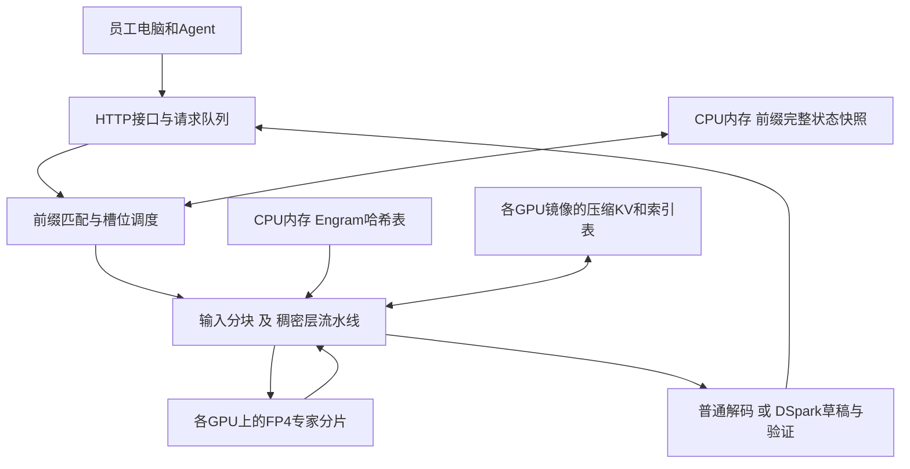

# DeepSeek 在 A100 上的定制推理项目分析

**研究日期：2026年10月12日。项目：shi3z/deepseekv4.1-A100-custom。** 固定代码版本为`580568edd6f84537ff042ded4ee842b892bf3ff4`，最近提交日期为2026年9月20日。原文与代码归档为[TECH-077](../sources/TECH-077/metadata.json)，[上游固定版本](https://github.com/shi3z/deepseekv4.1-A100-custom/tree/580568edd6f84537ff042ded4ee842b892bf3ff4)。

这个项目的价值，是把DeepSeek-V4.1-Flash的模型结构、A100的BF16算力、CPU大内存和多卡互联结合起来，让较早一代GPU承载新的大规模MoE模型。它提供了实际的模型加载、定制CUDA内核、专家并行、长输入分块、前缀恢复和HTTP服务代码，值得作为场景3的工程案例。

**对本周方案最有用的结论：**FP4专家常驻、Engram放在主机内存、GPU直接通信和完整状态缓存，都是可以逐项分析的优化；131K到1M的容量需要按源码重新计算。公开性能证据主要集中在短提示词生成和作者自报的长输入prefill。20名用户各保持1M历史，会首先遇到该实现的全量缓存镜像和请求调度约束。Jev的“约13,000 token/s”又属于另一类任务，而且README对应的默认benchmark使用模拟计时，不能作为硬件实测输入。

## 1 项目做什么及其优点

| 能力 | 用户能获得什么 | 主要实现 |
|---|---|---|
| 在A100上运行DeepSeek-V4.1-Flash | 复用已有GPU，运行一个具备工具调用和长上下文结构的大模型 | 将低位权重解码为A100可计算的BF16片段；保留紧凑权重存储 |
| 多卡协作生成 | 单请求也能使用多张卡的专家存储和计算能力 | 稠密层按层放置，所有层的专家按卡分片，GPU间直接收发激活与部分结果 |
| 处理很长的输入 | 将大材料切成小块处理，降低临时张量峰值 | 分块prefill、逐索引头累加、动态缓存增长 |
| 多轮Agent复用历史 | 后一轮只处理变化的尾部，减少重复读入 | GPU槽位LCP匹配、CPU完整状态快照、增量重放 |
| 提升生成步进速度 | 草稿被主模型接受时，一个验证步骤产生多个token | DSpark三层草稿头与MTP验证 |
| 固定类别结构化输出 | 多个字段同时选取候选，直接组装JSON | Jev字段并行评分；适用于枚举和布尔判断等任务 |

上述能力是不同执行路径：普通文字生成、MTP、长输入prefill和Jev，需要分别配置、计时和验证。特别是“可以接API”与“用户在长任务中持续收到流式结果”，分别由HTTP层、调度器和模型引擎决定。

## 2 模型和硬件身份

### 2.1 确认到的配置

| 项目 | 固定版本中能确认的内容 |
|---|---|
| 模型家族 | DeepSeek-V4.1-Flash；40层主干、384路由专家，每token选6个；DSpark有3层 |
| 实际启动权重 | 多个`run_*.sh`优先选择本地`DeepSeek-V4.1-Flash-Abliterated`目录，不存在时退回`DeepSeek-V4.1-Flash`，也允许环境变量覆盖 |
| 作者实验制品revision | 未随结果提供；README的模型名不足以区分官方权重与修改权重 |
| 主要硬件 | 作者报告4×A100 80GB PCIe；早期前缀重放表使用5卡EP |
| 4卡常规专家分片 | `92,95,99,98`，相加384；稠密层通常每卡10层 |
| 4卡MTP分片 | `100,100,100,84`，为最后一张卡的草稿头腾空间 |
| 5卡历史分片 | `77,77,77,77,76`；不能与4卡profile直接合并 |
| 40GB或SXM证据 | 当前README主表没有A100 40GB或A100 SXM的独立结果；卡数相同也不能沿用80GB PCIe数值 |
| 内存、驱动及完整拓扑 | 没有可供复核的整机环境记录；源码针对4卡两组NVLink对、组间PCIe的通信方式做了优化 |

结构计算采用[官方inference配置](../sources/TECH-077/official-inference-config.json)，revision为`5254448103b6254fc646dacbca1cbbf20e9216c1`。它是本报告的结构参照，作者运行时的checkpoint配置仍需另行对应。[启动脚本](../sources/TECH-077/files/run_server_batched.sh)、[加载器](../sources/TECH-077/files/dsv41/load.py)。

### 2.2 FP8和FP4在这里怎样运行

A100缺少原生FP8／FP4矩阵计算指令，项目把**存储精度与计算精度分开**：

- 稠密权重以FP8字节和块尺度常驻GPU；默认`DSV41_W8=1`。
- MoE专家以打包FP4字节和每32元素的尺度常驻GPU。
- 定制内核将正在使用的权重片段转换为BF16，再执行BF16 Tensor Core矩阵乘，使用FP32累加。
- 激活在参考模型规定的位置进行低位舍入，再以BF16参加计算；这不是把原始模型全部恢复成高精度模型。
- 大批次路径优先拆为定制内核支持的块，异常回退时可能临时反量化整块权重并使用cuBLAS。

这种做法同时节约显存和权重读带宽，又能使用A100已有的计算单元。代价是维护模型专用内核、编译环境和精度对照。源码顶层注释仍有“加载时全量反量化”的旧说明，应以当前`load._dense`、`W8`和CUDA内核为准。[FP8加载](../sources/TECH-077/files/dsv41/load.py)、[W8调度](../sources/TECH-077/files/dsv41/w8.py)、[FP8内核](../sources/TECH-077/files/dsv41/cuda/fp8_tc.cu)、[FP4内核](../sources/TECH-077/files/dsv41/cuda/fp4_tc.cu)。

## 3 软件和内存架构

### 3.1 专家并行和稠密层流水线

每层的attention、归一化、路由和共享专家由一张owner GPU执行。路由后的激活及专家编号发给其他卡，各卡只计算自己保存的专家，再把部分结果送回owner。进入下一组稠密层时，残差和attention状态也移动到下一个owner。

解码采用每卡CUDA Graph与设备侧标志同步，减少40层每一步反复往返CPU的开销。小消息走P2P store，大消息可走复制引擎；两组NVLink对之间通过PCIe中继，减少重复跨组发送。这里是**模型定制的EP加按层放置**，不能仅用一个“TP4”标签描述。[`ep.py`第1–130行](https://github.com/shi3z/deepseekv4.1-A100-custom/blob/580568edd6f84537ff042ded4ee842b892bf3ff4/dsv41/ep.py#L1-L130)。

### 3.2 主机内存中的Engram

Engram表根据token组成的n-gram查找记录，不必每步扫描整张表。代码将两张FP8表及尺度保存在CPU内存，只把命中的行传给GPU。按官方维度计算：

\[
M_{Engram}=(384006168+384016682)\times(256+8)
=202,758,032,400\text{ bytes}=188.83\text{ GiB}.
\]

这笔容量来自模型权重，和用户的KV缓存是两个项目。CPU内存还需容纳前缀快照、加载过程、服务进程与操作系统。约189GiB不能直接当作整机RAM要求。解码使用的CPU查表、锁页和PCIe路径也会影响实际延迟。[`engram.py`](../sources/TECH-077/files/dsv41/engram.py)。

### 3.3 专家常驻显存的复算

按当前加载器的FP4打包格式，一个专家在一层中的三块矩阵与尺度占：

\[
3\times5120\times2304\times(1/2+1/32)=18,800,640\text{ bytes}.
\]

同一专家编号跨40层约0.7004GiB。因此常规4卡分片`92/95/99/98`，仅路由专家约占**64.43／66.54／69.34／68.64GiB**。稠密权重、embedding、输出头、KV和临时空间还要另外计算。

把最后一卡从96个专家减到84个，按该公式释放约**8.40GiB**。README的“释放15.4GiB”未能从当前维度与分配代码重现。这会影响草稿头到底能否放下，应按逐GPU完整分配核对，不能只使用README的余量表。[复算结果](data/deepseek-a100-project-2026-10-12/audit-results.json)。

## 4 131K至1M的真实缓存预算

当前加载器为四个KV owner在**每张GPU**上建立完整镜像。owner为`2/8/14/20`，压缩比为`2/2/2/1`；缓存内容是BF16压缩KV向量512维及索引键128维。每槽位、每GPU的这两张表占用为：

\[
M(C)=\sum_{r\in\{2,2,2,1\}}(\lfloor C/r\rfloor+1)\times(512+128)\times2
\approx3200C\text{ bytes}.
\]

以下是**源码维度计算，不含权重、SWA环形缓存、RoPE、CUDA Graph、工作区和MTP**。运行脚本额外保留一个prefill scratch槽，所以N个活动请求对应N+1个分配槽。

| 每人总context | 单个槽位 每GPU | 1活动＋scratch 每GPU | 8活动＋scratch 每GPU | 20活动＋scratch 每GPU |
|---|---:|---:|---:|---:|
| 131,072 | 0.391GiB | 0.781GiB | 3.516GiB | **8.203GiB** |
| 262,144 | 0.781GiB | 1.563GiB | 7.031GiB | **16.406GiB** |
| 524,288 | 1.563GiB | 3.125GiB | 14.063GiB | **32.813GiB** |
| 1,000,000 | 2.980GiB | 5.960GiB | 26.822GiB | **62.585GiB** |

结合上一节每GPU约64–69GiB的专家权重，**现有4×80GB配置不能承载20人各1M，也不能承载20人各512K**；20人262K在最重卡上仅专家加这两张缓存表就已经超过80GiB。20人131K还需继续计算稠密权重和运行峰值，容量表本身尚不能确认通过。

两个实现细节决定了扩容方式：

1. **加GPU不会自动把每人缓存再除以GPU数。** 专家权重可以分散，全镜像缓存仍在每一卡各放一份。副本和减少镜像是不同的扩容路径。
2. **动态增长对所有已分配槽位统一扩维。** 同一个缓存张量形状为`[max_seqs, rows, dim]`。某个会话推动rows增加时，其他槽位的物理行容量也会增加；这和逐请求分页分配不同。

README将131K标为约1.56GiB／slot、1M标为约12.5GiB／slot，恰好接近上述数值的**四GPU总量**（1M若用1,048,576即12.50GiB全机）。另一些段落却写成“每GPU”，口径混用。正文和采购测算统一使用上述逐卡公式。[`load.py`分配代码](https://github.com/shi3z/deepseekv4.1-A100-custom/blob/580568edd6f84537ff042ded4ee842b892bf3ff4/dsv41/load.py#L286-L421)、[30组容量CSV](data/deepseek-a100-project-2026-10-12/cache-capacity.csv)。

## 5 长输入prefill和CED优化

### 5.1 分块和逐头累加

长输入被切成约2,048-token的小块，按设备上连续层形成流水线。索引器还将查询拆成较小块，逐个index head计算分数并累加。它避免一次生成`[batch, queries, 32 heads, all keys]`的大临时张量。

这项优化主要减少**中间张量峰值**。索引仍需扫描历史键，query和key数量增长仍会增加时间与空间；“256MB”只对应特定batch、查询块和历史长度。源码默认查询块64，在batch=1、1M键时，单个FP32分数张量约256MB，循环还同时存在当前head分数等张量。[`model.py`第638–735行](https://github.com/shi3z/deepseekv4.1-A100-custom/blob/580568edd6f84537ff042ded4ee842b892bf3ff4/dsv41/model.py#L638-L735)。

### 5.2 作者报告的长输入结果

| 实际输入token 作者表格 | 冷prefill时间 | 累计吞吐复算 | 本周用途 |
|---|---:|---:|---|
| 131,072 | 361.48秒，6.02分钟 | 362.60 token/s | 最低长历史基线 |
| 262,144 | 841.28秒，14.02分钟 | 311.60 token/s | 第二基线 |
| 524,288 | 2,156.68秒，35.94分钟 | 243.10 token/s | 半百万首次读入成本 |
| 1,000,000 | 5,729.20秒，95.49分钟 | 174.54 token/s | 百万输入容量与等待时间 |

作者报告1M时各卡峰值为79.11／76.00／78.86／77.38GiB。时间除法可以复算，但对应的逐chunk日志、模型revision、实际完成输出和CED对照未包含在固定仓库树中。因此这组表保留为**作者报告的prefill测量**，不给它补上满1M的持续decode或质量结论。

另有一处计数错误：README写488个2,048-token块加最后496token；算术结果是999,920。1,000,000的正确余数为576。代码通过实际输入张量长度分块，文字中的尾块错误不自动等同于运行少算80token；原始输入长度日志可解决该问题。[README长输入表](../sources/TECH-077/original.md)、[prefill复算CSV](data/deepseek-a100-project-2026-10-12/readme-prefill.csv)。

### 5.3 CED节省了什么，近似重放怎样理解

该项目的CED路径让前21层处理全部输入，后19层只处理尾部。顺序路径默认尾部128token；流水线路径只让最后一个chunk经过后19层。按layer-token数量，`40S`变为`21S+19W`，当S很大时减少约47.5%。不同层、attention及MoE耗时不同，该比例是算子覆盖量估计。

**窗口重放本身是模型设计中的有意近似。** 官方技术报告第9页§2.2和第20页§3.2.2明确：精确恢复多层SWA需要更长重放，Decoder SWA Bounded Replay只处理提示末尾128token，并将SWA注意范围截断到重放段；恢复状态与完整forward不数学等价。作者报告质量影响很小，并在后训练阶段模拟同样重放进行适配。因此，出现局部状态差异本身符合这条设计，不能据此判定CED失效。[官方技术报告，PDF第9、20页](../models/deepseek-v4.1-flash/technical-report/DeepSeek_V41_Tech_Report.pdf)、[书中8.3.3说明](../sources/TECH-078/upstream/manuscripts/08-推理优化.md)。

对定制项目需要分开核对三件事：

- **README的架构表述。** 它称后19层只有SWA；实际`compress_ratios`在20–39层为1，`Attention.__call__`在`if self.ratio`分支继续拼入全局KV。ratio=1表示不下采样，仍会读取owner20的历史状态，索引器层24／28／32／36也继续执行。官方报告第22页同样说明decoder包含全局稀疏attention及局部SWA。
- **与论文的实现对应。** 论文按20层encoder＋20层decoder描述；定制实现为方便生成owner20状态，把第20号层也纳入全序列路径，因此是21／19的代码切分。顺序路径尾128与流水线路径最后一个chunk的执行范围不同。还需要核对SWA边界是否按论文限制在重放起点之后：当前`_window_kv`多token continuation会先取旧环形缓存中的`win−1`行，CED调用点没有显式传入重放起点。这是应核对的路径差异，实际读到什么状态及质量影响需要执行证据。
- **本项目的质量证据。** 官方报告对其训练与推理组合给出的质量结论，不自动覆盖修改权重、不同量化算子和定制状态恢复。该项目的任务正确率、长距离引用及多轮状态连续性，仍需在对应配置下核对；验收目标应为正确实现所选近似机制及可接受的任务质量，而非强制与关闭CED的logits逐位相等。

多层依赖可以用一个小算例说明：两个窗口为2的因果平均层，输入`[1,2,3,4]`完整计算最后值为3.00，只重放尾部`[3,4]`为3.25。它解释为何论文将重放定义为近似，不是DeepSeek质量测试，也不是发现模型失效的证据。按定制路径19层SWA计算，最后位置的理论输入依赖可达`1+19×127=2,414`；有效依赖及可接受重放长度则是模型训练和评测的问题。

仓库有压缩器、索引器分块、前缀状态恢复和标量／块重放测试；未发现当前定制CED路径在长输入下的完整任务对照。47%的layer-token节省可以在工程分享中解释，正式配置需补重放边界检查和质量验收。关闭／开启CED的logits差异可用于定位实现问题，但是否有差异不能单独作为通过或失败标准。[CED顺序路径](https://github.com/shi3z/deepseekv4.1-A100-custom/blob/580568edd6f84537ff042ded4ee842b892bf3ff4/dsv41/model.py#L2349-L2407)、[流水线路径](https://github.com/shi3z/deepseekv4.1-A100-custom/blob/580568edd6f84537ff042ded4ee842b892bf3ff4/dsv41/model.py#L2517-L2550)、[测试源码](../sources/TECH-077/files/dsv41/test_long_prefill.py)。

## 6 普通生成和高并发吞吐

### 6.1 先分清三种速度

| 指标 | 计时范围 | 能回答的问题 |
|---|---|---|
| HTTP端到端输出吞吐 | 请求发送至完成，含排队、prefill、decode与接口开销 | 用户完成任务的速度 |
| 引擎decode速度 | 生成阶段或引擎滑动窗口 | 生成步本身有多快 |
| 输入prefill／prefix replay速度 | 处理输入或新增历史的时间 | 第一token或下一轮开始需要等多久 |

`bench_decode_throughput.py`以非流式HTTP请求的总时间除输出token，所以README“单流生成36.5–47.8 token/s”实际包含prefill。代码任务表约51.9–53.1 token/s也使用HTTP完成时间。它们使用十几至百词级提示，不是把131K或1M实际历史填满。[单流benchmark](../sources/TECH-077/files/examples/benchmarks/bench_decode_throughput.py)、[代码benchmark](../sources/TECH-077/files/examples/benchmarks/bench_code_generation.py)。

### 6.2 高并发表格的实际条件

| 活动流数 | 配置窗口上限 | 作者端到端总输出token/s | 作者峰值引擎decode token/s | 峰值÷流数，仅算术均分 |
|---|---:|---:|---:|---:|
| 1 | 1,048,576 | 50.3 | 50.3 | 50.3 |
| 2 | 1,048,576 | 70.7 | 78.2 | 39.1 |
| 4 | 65,536 | 86.8 | 98.4 | 24.6 |
| 8 | 131,072 | 119.2 | 119.9 | 15.0 |
| 16 | 32,768 | 127.4 | 269.3 | 16.8 |
| 24 | 32,768 | 141.4 | 321.9 | 13.4 |
| 32 | 16,384 | 159.8 | 376.5 | 11.8 |
| 64 | 8,192 | 167.5 | 475.6 | 7.4 |

**配置窗口上限与实际输入长度是两列信息。** 随库的并发脚本发送“给出三条软件工程建议”式短提示，默认输出32token；表格未附每组实际命令与usage日志，也可能使用另一份代码生成脚本。以上可用于介绍批量专家复用的趋势，不能代入20×1M的性能表。

峰值指标来自最近10分钟样本、最近10秒计数器与活动slot速率；取最大值的范围和所有请求共同decode的平均区间不同。计数器还会在EOS判断前记录本轮活动行数。末列只是帮助理解吞吐分摊，不是每个用户的实测速率或尾延迟。[并发脚本](../sources/TECH-077/files/examples/benchmarks/bench_concurrency.py)、[指标实现](https://github.com/shi3z/deepseekv4.1-A100-custom/blob/580568edd6f84537ff042ded4ee842b892bf3ff4/dsv41/stats.py#L403-L449)。

历史表的1,972／2,331／2,415 token/s分别使用batch256／512／1024与cache2,048／1,024／512。它们展示大batch的引擎潜力，负载远小于本周每用户131K／262K的基线。较大吞吐不是长Agent服务容量的替代指标。

### 6.3 调度和前台体验

当前worker先逐个完成等待请求的prefill、复制到空槽，再对活动槽执行一次批量decode。它具备固定槽位的动态接入和释放，但没有看到按小token预算交织长prefill与decode的调度。若新来一个百万输入，已有输出可能在其prefill期间等待。[worker源码](https://github.com/shi3z/deepseekv4.1-A100-custom/blob/580568edd6f84537ff042ded4ee842b892bf3ff4/dsv41/engine.py#L4415-L4574)。

`/v1/chat/completions`即使`stream=true`，也先调用阻塞的`generate_text`，结束后才发送内容；等待中发送的是keep-alive注释。`/v1/completions`的stream路径另用`generate`迭代器。接入Agent时必须按实际endpoint测第一内容块时间，不能用dashboard decode速度解释前台逐字体验。[HTTP实现](https://github.com/shi3z/deepseekv4.1-A100-custom/blob/580568edd6f84537ff042ded4ee842b892bf3ff4/dsv41/serve.py#L237-L267)。

## 7 MTP及多轮缓存的实际路径

### 7.1 MTP

DSpark利用主模型37–39层的隐藏状态，在三层草稿网络中同时提出最多5个候选，再由主模型验证。收益取决于平均接受长度、草稿计算、验证batch和通信，并随任务内容变化。

README自报：关闭MTP约63.3 token/s；K=3约81.7；K=5约84.7–93.0。33ms一步、平均接受1.79草稿的算术结果为`2.79/0.033≈84.55 token/s`，可解释下沿；93.0需要另一组接受率或步耗时。Python提示下32序列623 token/s属于另一个批量实验，原始输入、cache长度和日志未随表提供。

当前默认长提示门限为65,536；普通生成路径超门限会卸载草稿并转回普通decode。**131K／262K／512K／1M的本周主表不能沿用64K MTP profile速度。**

还需核对API路径：`generate_text`在`max_seqs>1`时进入批调度，所读worker使用普通`rt.step`，没有调用DSpark；MTP出现在另一条`generate → _generate_mtp_locked`路径。`run_mtp_4gpu.sh`设`max_seqs=2`，因此通过chat API使用该profile时，不能仅凭启动参数确认正在进行推测解码。[MTP脚本](../sources/TECH-077/files/run_mtp_4gpu.sh)、[DSpark](../sources/TECH-077/files/dsv41/dspark.py)、[engine](../sources/TECH-077/files/dsv41/engine.py)。

### 7.2 缓存需要保存完整状态

项目的普通前缀快照保存SWA环形KV、压缩KV、索引键、压缩器环形状态、Engram历史及DSpark相关状态。恢复时重新建立各设备缓存，这比只保存token列表完整。CPU快照把GPU上的同一owner镜像合并为一份；4个相同镜像降为1份可以减少这部分75%的快照空间，整个快照的节约率还受其他状态影响。

README记录16,264token前缀追加134token，replay约0.972秒；完整请求prefill约0.999秒。对应约134token/s的**新增处理速度**与约16,410token/s的**含复用历史有效速度**是两个分母。缓存的价值在于省掉旧历史的重算。

公开的多轮示例主要覆盖约1.4K及16K历史；128K历史追加500token约2秒是说明性主张，没有配套长历史逐请求日志。512K／1M下快照拷贝、CPU传输、逐出与恢复的实际时间，是将这个机制用于我们场景3时最需要补的证据。[快照实现](../sources/TECH-077/files/dsv41/engine.py)、[状态测试](../sources/TECH-077/files/dsv41/test_prefix_state_units.py)、[标量／块重放测试](../sources/TECH-077/files/dsv41/test_prefix_replay.py)。

## 8 Jev高吞吐的来源与实现边界

Jev把一个枚举提取任务拆成多个字段。例如先判断“情绪：正／中／负”，再判断“是否需要人工”。字段查询并行运行，Python直接组装JSON，省掉模型逐token生成字段名、引号和标点的时间。这是一种值得分享的**任务专用计算方式**。

### 8.1 README数字如何产生

README说明运行`python3 -m dsv41.bench_jev`得到benchmark表。固定版本的实际调用链是：

`__main__ → main → run_jev_simulation_or_direct(prompt, schema)`。

`main`的两处调用都没有传`jev_engine`，进入模拟分支。该分支设定：

\[
t_{ms}=0.08+11.4+\lceil\text{fields}/32\rceil\times12.5.
\]

| 字段数 | 源码固定公式ms | README组装输出token | 输出token÷公式时间 | README对应值 |
|---|---:|---:|---:|---:|
| 3 | 23.98 | 22 | 917.43 token/s | 917.4 |
| 10 | 23.98 | 78 | 3,252.71 token/s | 3,252.7 |
| 30 | 23.98 | 238 | 9,924.94 token/s | 9,924.9 |
| 100 | 61.48 | 798 | 12,979.83 token/s | 12,979.8 |

四行完全对应。真实HTTP请求只查询最多前10个字段，后面的字段直接取第一个候选或默认值；这些请求的真实耗时没有纳入上述公式。普通JSON无法解析时，该脚本还会把一致率设为100%。因此**该表应登记为模拟计时结果，不能作为实测加速或准确率证据**。README顶部“30字段2,854倍”和后文约408倍也不一致。[默认分支](https://github.com/shi3z/deepseekv4.1-A100-custom/blob/580568edd6f84537ff042ded4ee842b892bf3ff4/dsv41/bench_jev.py#L196-L293)、[main调用](https://github.com/shi3z/deepseekv4.1-A100-custom/blob/580568edd6f84537ff042ded4ee842b892bf3ff4/dsv41/bench_jev.py#L302-L378)、[本项目公式复算](data/deepseek-a100-project-2026-10-12/jev-formula.csv)。

### 8.2 实际实现与真实HTTP测试仍然存在

`serve → Engine.jev_inference → JevEngine.process_request`会运行模型；`examples/benchmarks/bench_jev_structured.py`也确实对`jev:true`发HTTP请求并测wall time。该脚本先用相同prompt和schema预热，再测缓存命中的调用，应该作为**热路径提取测试**。固定仓库中没有这条路径的原始结果来支撑上面的23.98／61.48ms。

实际`JevEngine`还有几项重要特征：

- 候选只比较其**首token**的log-probability；多token候选没有逐tokenteacher forcing。首token相同的候选会发生不可区分的评分。
- 没有候选的自由字符串只取一个greedy token；跨字段`depends_on`被解析但未见在评分流程中落实。
- `restore_kv`向多个已分配batch行复制前缀，存在物理缓存容量和拷贝成本；并非通用的共享分页KV。
- 这套Jev快照保存window KV、compressed KV、index键和Engram历史；它比普通engine完整状态快照简化，压缩器持续状态恢复需另验。
- 字段batch受实际`max_seqs`限制。模拟固定32字段一批，在常规`max_seqs=3`的服务上并不成立。

因而Jev适合在分享中说明“固定选项分类可以改变计算路径”，下一步验证应选择真实业务字段、完整候选评分、冷／热两种输入、独立正确标签及端到端延迟。[真实HTTP benchmark](../sources/TECH-077/files/examples/benchmarks/bench_jev_structured.py)、[评分实现](https://github.com/shi3z/deepseekv4.1-A100-custom/blob/580568edd6f84537ff042ded4ee842b892bf3ff4/dsv41/jev.py#L505-L544)、[实际请求实现](../sources/TECH-077/files/dsv41/jev.py)。

## 9 对场景3的落地含义

| 本周决策问题 | 该项目提供的依据 | 方案中的处理 |
|---|---|---|
| A100能否运行此类模型 | 紧凑权重＋BF16内核＋CPU Engram实现；作者4×80GB运行报告 | 把A100列为定制runtime候选，和主流框架路径分别核算 |
| 每人131K／262K能否作为基线 | 可复算缓存公式；作者单次prefill表 | 先逐卡核算，再补满历史decode和响应数据 |
| 20人各1M需要什么 | 当前4卡仅专家＋镜像缓存就无法容纳 | 比较更多GPU、多个服务副本、减少镜像或主流分页缓存；费用随服务目标重算 |
| 512K／1M是否仍能20token/s | 尚无相同长历史、普通生成与共同decode窗口的可核对数据 | 性能表保留待验证，不能拿短prompt50token/s外推 |
| 多轮Agent能否一直流畅 | 有前缀完整状态恢复机制；当前长prefill串行阻塞、chat输出缓冲 | 热续跑、并发干扰和第一内容块时间要成为验收主项 |
| 高达数百／数千token/s怎样理解 | 多种batch、cache、峰值和任务专用计时 | 只把同一context和同一指标放入容量／性价比比较 |
| 工程维护工作量 | 专用内核、模型特定缓存、拓扑假设、修改权重及未锁定环境 | 主稿说明实现依赖；成熟路径与定制路线的维护成本分开 |

**当前可带入场景3的数值是代码推导的容量和明确标注的作者prefill报告。** 暂时不能据该项目给出20×1M的每路速度保证。A100的采购／存量复用、H100／H200主流路径比较另见部署方案研究；本专项不从作者GPU数量推断整机价格或境内采购条件。

## 10 周四两页分享的讲述框架

### 第一页 A100怎样承载新的大模型

讲三个容易理解的设计：

1. **把模型以紧凑格式放下。** 权重低位存储，计算时按块展开，节省显存和带宽。
2. **把适合查表的部分放在CPU内存。** Engram约189GiB，按需要取行，而非整块复制到GPU。
3. **减少反复执行的工作。** GPU直接通信、批量专家计算和完整历史缓存，分别减少同步、重复读取与重复prefill。

配图采用第3节架构，旁边放131K／262K／512K／1M的逐卡缓存增长。

### 第二页 吞吐数字怎样回到实际使用

左侧对照“64路8K峰值475.6”与“1M冷prefill95.5分钟”；右侧展示“20人1M每卡仅缓存约62.6GiB”。结论落在我们要购买的服务能力：**每人能保留多长历史、同时有多少人在生成、下一轮等多久**。

Jev放一个小框介绍固定类别任务的特殊路径；约13,000token/s标成源码中模拟计时的例子，避免它占据通用Agent性能结论。CED近似机制与实现对应、流式输出和混合调度的源码检查放讲述提示或附录。

## 11 证据覆盖和复核记录

| 证据类别 | 当前状态 |
|---|---|
| 上游身份与revision | 2026年10月12日`ls-remote`核对HEAD，浅克隆固定版本 |
| 原文／代码 | 43个所选文件与原文附件，保留英文及原格式，SHA256校验 |
| 作者原始GPU日志 | 固定tree中只有`results/route_stats.pt`；未取用或反序列化。README所引dated logs目录未入库，gitignore排除了这些日志 |
| 本项目执行 | 只运行自写Python标准库审计：AST调用链、公式、30组容量及数值表；未导入上游模块、编译CUDA、启动模型或访问其服务 |
| GPU性能复现 | 未执行 |
| 完整模型正确性 | 代码／测试审阅；CED按论文声明的近似重放理解，定制实现边界、长上下文质量和MTP服务路径待实际验证 |
| 人工复核 | pending；不能以agent源码检查代替使用者或工程团队复核 |
| 代码许可 | 固定tree未见仓库根LICENSE；`.agents`内技能的许可证不覆盖整个推理项目 |

本次还发现一个上游比较脚本含credential-like默认值，已排除出可跟踪来源包；没有使用该值。研究临时clone位于忽略目录`.research-workspace/repos/deepseekv4.1-A100-custom`，可引用证据均另存TECH-077。

### 文件入口

- [英文README原文](../sources/TECH-077/original.md)及[来源元数据](../sources/TECH-077/metadata.json)
- [本项目审计脚本](data/deepseek-a100-project-2026-10-12/audit.py)及[结果JSON](data/deepseek-a100-project-2026-10-12/audit-results.json)
- [逐卡缓存CSV](data/deepseek-a100-project-2026-10-12/cache-capacity.csv)、[prefill复算](data/deepseek-a100-project-2026-10-12/readme-prefill.csv)、[并发口径表](data/deepseek-a100-project-2026-10-12/readme-concurrency.csv)、[Jev公式表](data/deepseek-a100-project-2026-10-12/jev-formula.csv)

## 12 需要优先补齐的验证

1. 明确官方或修改权重的准确revision、配置、依赖版本和GPU拓扑，固定同一基准环境。
2. 对齐论文声明的近似CED重放与代码边界，做长距离引用和任务质量对照；关闭／开启的logits差异用于诊断，不以精确相等为验收目标。
3. 分别测131K／262K／512K／1M接近满历史，预留8,192输出；记录普通生成和MTP真实调用路径。
4. 测缓存驻留下追加1K／8K，以及逐出／恢复；记录各用户p50／p95与首个内容块时间。
5. 测20请求及新增长prefill干扰，以共同decode计数和逐请求时间为主，保存原始usage、状态和日志。
6. 对Jev只采用真实HTTP或真实engine计时，拆分冷／热路径，并用独立正确标签评估完整候选与跨字段一致性。

这些验证项与[第7周计划](../../weekly/week-07-plan.md)的context、并发和体验口径一致，可以交给未来有设备窗口的实验执行；本周先用已归档的源码和计算完成方案比较。
