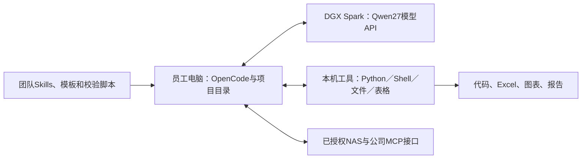

# 场景一：DGX Spark＋Qwen27的个人／小组Agent

> **2026-10-20最新研究入口：**[统一配置与容量](final-configurations-2026-10-20.md) · [三年TCO](tco-analysis-2026-10-20.md) · [制品、许可、采购与服务条件核验](final-source-refresh-2026-10-20.md)。下文保留原日期研究记录。

**当前研究：2026年10月12日。硬件已选DGX Spark 128GB，模型暂定Qwen3.8-27B。** 本轮围绕131K／262K基线、512K候选日常窗口与1M长任务窗口，分析一人独占、三会话驻留和三人同时工作的差别。9月24日四硬件比较及PDF为发布快照，见[历史选型](scenario-1-speed-target-review-2026-09-24.md)。

Spark负责模型推理，员工电脑负责文件和工具。现有测试中，约100K输入时生成速度为20 token/s，约500K时降到15 token/s；500K第一次读入需要约25分钟。长会话的重点因此是保留已处理的历史，让后续每轮从新增内容接着算。

比较两种缓存精度：**FP8权重＋BF16 KV**沿用原配置要求；朋友的测试采用**FP8权重＋FP8 KV＋MTP3**。FP8将每个token的KV载荷减半，因此能保留更多历史。

## 1. 员工怎样使用

模型节点在Spark；文件权限、工具执行和产物在员工自己的环境。这样大表格计算、Office转换和浏览器不会挤占Spark统一内存。三人共享时，各自保留会话、工作目录和账号。服务器同时检查正在生成的人数与所有会话的缓存占用；缓存接近上限时，新长任务进入队列。[现有Harness分析](harness-survey-2026-09-17.md)

主讲入口采用**OpenCode**：兼容模型API、项目工具、Skills与MCP集中在一个操作界面；Pi保留为较轻的代码Agent对照。OpenCode当前文档已有自定义provider、模型context／output上限及MCP配置。不同版本的配置键有变化，部署时固定程序版本并使用同版schema。Pi的自动压缩默认在`contextWindow-reserveTokens`后触发，默认reserve为16,384；因此模型的1M配置要同步到Harness的模型元数据与压缩阈值。[TECH-083](../sources/TECH-083/original.md)

三类具体任务：

| 任务 | Agent执行过程 | 获得的成果 |
|---|---|---|
| 代码／数据处理 | 读项目→修改脚本→运行测试→检查差异 | 可重跑脚本、代码改动、测试记录 |
| 财报与Excel比较 | 读两期文件→对齐期间／单位→计算→复核 | Excel、图表、带引用的解释 |
| 研究材料整理 | 检索→摘录来源→对比→组织报告 | 文稿、证据表、待人工判断事项 |

## 2. 固定软件链路与窗口

| 层次 | 需要固定的内容 |
|---|---|
| 模型 | Qwen3.8-27B-FP8的官方revision；纯文本模式，权重与原生MTP头 |
| 服务 | ARM64／GB10兼容的vLLM镜像digest、CUDA／驱动、FlashInfer及启动参数 |
| Context | 131,072／262,144／524,288／1,000,000；每档计入8,192输出预留 |
| 长度对齐 | target和MTP draft均设置相同上限；262K以上对齐官方YaRN配置 |
| Harness | 声明同样context；工具结果、思考和输出均纳入预算；记录压缩／截断触发点 |
| 缓存 | 先复现朋友的关闭前缀缓存配置，再另开热续跑配置；两组分别记录 |
| 维护 | 保存已验证镜像、权重revision、启动参数与任务样本；新版本先在独立端口检查，保留回滚镜像 |

Qwen包含48层线性注意力和16层全注意力。继续旧会话时，服务要同时恢复长历史的KV，以及线性层处理到当前位置的状态。两类状态都准备好，下一轮才能从新增内容接着算。vLLM的`mamba-cache-mode=align`按块保存状态检查点；块尺寸、额外前缀检查点和MTP配置决定可以从哪里恢复。[TECH-082](../sources/TECH-082/original.md)

现阶段按配置清单对齐各层；待补齐朋友记录的环境文件与启动脚本后，固定镜像、模型revision和复现命令。已取得数据见[TECH-076](../sources/TECH-076/original.md)。

## 3. 单人长窗口：已测事实与四档推算

### 3.1 实际设备证据

| 实际输入＋输出 | 单请求decode | 冷TTFT | 证据 |
|---|---:|---:|---|
| 50,000＋2,048 | 21.01 token/s | 63.1秒 | 2次稳定请求均值 |
| 100,000＋2,048 | 20.11 | 144.8秒 | 2次稳定请求均值 |
| 300,000＋2,048 | 17.23 | 658.9秒，约11分钟 | 1次稳定请求 |
| 500,000＋2,048 | 14.82 | 1,470.1秒，约24.5分钟 | 1次稳定请求 |
| 999,936＋64 | 9.83，短输出附带值 | 4,815.8秒，约80.3分钟 | 1M容量验证 |

配置全部为**FP8 KV＋MTP3、无前缀缓存、随机token输入**。MTP草稿上限修正后300K恢复正常接受率；故障样本5.80 token/s单列诊断。自然语言、代码及真实工具循环的接受率与质量尚未测量。[外部测试完整分析](dgx-spark-qwen27-external-benchmark-2026-10-12.md)

### 3.2 四档窗口的等待与生成速度

用已有长输入测试估算四档窗口，输入长度取总context减8,192。第一次处理全部历史；历史和线性层状态命中后，只处理新增部分。下表分别列出两种等待。

| 总context | 输入历史预算 | 估算生成速度 | 首次输入处理时间 | 历史命中后新增1K／8K的输入处理时间 |
|---:|---:|---:|---:|---:|
| **131K** | 122,880 | **19.7 token/s** | 189秒，3.1分钟 | 2.0／16.1秒 |
| **262K** | 253,952 | **17.7** | 514秒，8.6分钟 | 3.0／24.1秒 |
| **512K** | 516,096 | **14.7** | 1,548秒，25.8分钟 | 5.0／40.1秒 |
| **1M** | 991,808 | **11.2，外推** | 4,731秒，78.9分钟，外推 | 8.7／69.1秒，外推 |

计算方法：冷prefill按`T(N)=aN+bN²`拟合；生成速度按每token时间拟合；热续跑取`T(N)−T(N−Δ)`，假设精确命中和相同有效算力。表中续跑时间只含输入处理，首输出另加恢复、排队和第一步生成。1M生成速度为外推，64token容量样本未加入拟合。BF16 KV的生成速度另测。

512K会话每轮新增1K时，处理新输入的估算时间约5秒；新增8K则约40秒。生成每个新token仍要查询长历史，所以缓存复用主要缩短下一轮开始前的等待。

## 4. 能驻留多少会话

朋友提供的启动记录为模型与drafter **28.47GiB**、KV池 **59.73GiB**、共享池 **1,806,907 tokens**。这来自FP8 KV、0.80引擎预算、关闭前缀缓存的配置；真实重新启动、启用checkpoint或调整并发后，以新的启动池为准。

完整精度KV原始载荷为65,536 B/token；FP8为32,768 B/token，另外还有递归状态、页与工作区。以已报告的FP8池为参照，完整精度采用“token池减半、非token开销不变”的工程近似。两者均留**10%的token容量**供会话增长。BF16行是估算；预分配池本身继续占用原来的物理内存。

| KV配置 | 131K单人／三会话 | 262K单人／三会话 | 512K单人／三会话 | 1M单人／三会话 |
|---|---|---|---|---|
| FP8，实测池容量外推 | 可／可 | 可／可 | 可／可，余量较小 | 可／不足 |
| BF16，池减半近似 | 可／可 | 可／可，余量较小 | 可／不足 | 原59.73GiB池不足／不足 |

三人各512K合计1,572,864 tokens，在FP8池的90%预算1,626,216内，剩余约53K；三人各262K在BF16近似池的90%预算813,108内，剩余约27K。共享前缀只在实际完全相同且有缓存命中时扣重；不同员工的长历史按三份计算。

**1M完整精度的门槛：**仅full-attention KV就65.536GB，超过原59.73GiB池约64.134GB；提高内存预算会同时减少系统和工具余量，需要以重新加载后的峰值验证。1M FP8 KV容量完成已取得设备证据。

## 5. 三人共用：分别看驻留与同时生成

| 状态 | 资源使用 | 使用安排 |
|---|---|---|
| 一人独占 | 一份长历史，一路decode | 用上面单人数据与四档分析 |
| 三会话驻留、一人生成 | 三份缓存，一路decode | FP8可研究三人各512K轮流用；切换时保留各自前缀；容量不额外带来单路提速 |
| 三人同时生成 | 三份缓存，三路decode及可能交错prefill | 已有50K／100K实测；131K／262K／512K／1M共享体验留待匹配负载 |

三路100K的共同decode窗口为**52.41 token/s总吞吐、17.47每路**；整段每请求decode均值降至12.45，反映其他请求prefill的干扰。4／8路131,072输入的引擎共同窗口分别58.66／83.91总token/s，分摊14.66／10.49；这些精确输入另加8,192输出，比本轮131K总窗口更长。

由此，三人共享初始运行方式适合“一路交互优先、长prefill排队／后台准备”，另设并行批处理档。请求队列同时看活跃数和总缓存tokens；单纯`max_num_seqs=8`没有表达三人各1M所需的工作集。

## 6. 缓存续跑、恢复与调度怎样落地

1. **同一用户回到同一实例。** 保存稳定的系统提示、工具定义与历史序列，新增内容追加在尾部；路由粘性减少因换实例产生的重算。
2. **工具等候期间保留前缀。** 普通工具返回等待与大文件冷加载分开排队，观察GPU池占用和每用户驻留配额。
3. **冷材料后台准备。** 512K／1M首轮预加载有明确等待提示，产物准备完成后再进入交互；首次加载时间单独记录。
4. **控制长prefill片段。** 对1K／4K／16K chunk分别观察decode干扰；小chunk减少单次阻塞，大chunk增加prefill效率。Spark单GPU的prefill与decode共享算力。
5. **按缓存丢失程度恢复。** 精确命中走热续跑；部分命中只补缺失后缀；服务重启或全部逐出按冷输入重新处理。SSD中的聊天记录用于恢复内容，GPU缓存丢失后需要重算。
6. **保留上下文而非静默截断。** Harness若压缩历史，记录压缩前长度、保留文件索引和任务状态，供用户识别1M窗口中的真实保留信息。固定8K输出预留也要容纳思考与工具参数。

运行档位的候选定位：**131K／262K为所有任务基础档，512K为个人长窗口，1M为独占／后台长任务。** 是否将512K设为默认，要由约15 token/s折中是否可接受及热续跑验证共同决定；512K约15 token/s，距离单人20+目标仍有差距。

## 7. 费用与投入

2026年10月12日，NVIDIA美国官方商城的128GB／4TB DGX Spark标价**6,950美元**，页面显示缺货。按汇率7.00及下列税费、运输和支持准备，国内交付预算约5.8–6.2万元。[TECH-085](../sources/TECH-085/original.md) · [官方商城](https://marketplace.nvidia.com/en-us/enterprise/personal-ai-supercomputers/dgx-spark/)

| 项目 | 人民币预算与性质 |
|---|---:|
| 美国页面价按USD/CNY=7.00情景汇率 | **48,650元**，境外未税换算；汇率是预算参数 |
| 13%税费准备＋5%／10%渠道、运输准备＋1,000／2,000支持准备 | **58,407／61,840元**，D中国交付估算，取整到元，约**5.8–6.2万元** |
| 首次个人配置、版本固定、工具与验收 | **1–2万元**，4–8人天×2,500元的历史D人工假设 |
| 三人共享实施 | **2–3.75万元**，8–15人天历史D假设；与个人实施二选一 |
| 复用已有Spark | 新增机器采购为0；实施及维护另计 |

官方240W电源随机器提供，SoC TDP140W；不再另加一只必购电源。额外存储、NAS和员工电脑按现有资源复用。三年耗电可由`平均墙插kW×运行小时×电价`直接填入，例如0.10–0.24kW、每天8小时、每年250天、0.8元/kWh，对应三年约480–1,152元；全天运行约2,102–5,046元。这是功耗与电价情景，尚无本机墙插测量。[官方硬件说明](https://docs.nvidia.com/dgx/dgx-spark/hardware.html)

本轮个人新增总投入约**6.8–8.2万元**，共享实施总投入约**7.8–9.9万元**；长期维护工时和任何企业软件订阅单列。

## 8. 后续测试与计算资料

- 取得朋友的environment.json、模型revision、launch.sh、逐请求usage与计数器；固定可复现的运行环境。
- 同一设备、同一自然语言／代码样本，测四档完整历史，每次输出8K；保留MTP真实接受率。
- 对比完整精度KV与FP8 KV；比较长距离引用、数字及工具参数的正确性。
- 热续跑分别追加1K／8K，记录KV与递归状态命中、TTFT分布、三人混合负载和缓存逐出恢复。
- 保留低频异常机器与正常机器的温度／频率／功耗记录，驱动变更前后分别测量。

[计算脚本](data/week7-deployment-2026-10-12/calculate.py)与[24行Spark矩阵](data/week7-deployment-2026-10-12/spark-matrix.csv)可复算；[全部参数、拟合残差和结果](data/week7-deployment-2026-10-12/results.json)保留完整计算过程。
