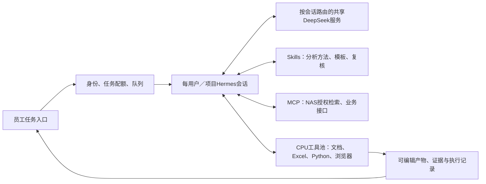

# 场景三：DeepSeek共享模型、通用工具链与公司Agent

**当前研究：2026年10月12日。模型暂定DeepSeek-V4.1-Flash，研究A100／H100／H200。** 每人131K／262K为基础档，512K为中间档，**20名活跃用户、每人1,000,000总tokens**为主目标。本文已按DeepSeek官方结构、当前引擎源码与公开启动日志重算；9月24日MiMo版本和PDF保留为历史快照，原计算仍在[历史数据目录](data/scenario-3-agent-2026-09-23/)。

公司方案以20个人各保留1M上下文为目标，集中比较八卡H200的两种用法：一个模型实例使用八张卡，或分成两个四卡实例、每组服务十人。两种方式的缓存容量都能覆盖这个目标，差别在单请求能用多少卡、队列怎样分组，以及要保存几份模型和Engram表。

四卡H200适合20人512K或更少的1M用户；已有H100可以按缓存容量安排规模；A100采用modified vLLM适配路线。下面先看系统如何分工，再看历史容量、响应和费用。

## 1. 业务流程与交付分工

沿用Hermes＋Skills／MCP主结构。集中运行时，每名员工／项目有独立实例、工作目录、会话与凭据；桌面运行时，Hermes及文件工具在员工电脑，共享模型在服务器。NAS权限随用户身份传给场景二的检索工具，工具返回授权片段及引用，Agent继续分析与生成文件。[TECH-072](../sources/TECH-072/original.md)

代表任务是一份财报／Excel研究：读入项目代码与口径→提取文件→运行计算→检查单位与加总→查证差异→生成表格和文稿。历史逐轮增长至131K、262K、512K和1M；工具结果追加在尾部。模型GPU负责推理，CPU工具池负责表格、代码和文件生成，等待工具的会话仍需保存可恢复状态。

本轮8,192输出预留包含思考、工具调用及回答；若允许一轮更长思考，要相应减少输入历史预算。Harness需要声明完整窗口并检查自动压缩阈值，服务端1M、客户端仍按128K压缩会改变实际工作方式。

## 2. 模型真正占用什么资源

内存主要分三块：GPU上的模型权重、主机中的约203GB Engram查找表，以及随用户数与历史增长的缓存。双TP4是两个独立实例，需要分别保存模型和查找表。模型参数与文件组成如下。[官方制品](../sources/TECH-079/original.md)

| 部分 | 已核信息 | 部署含义 |
|---|---|---|
| Backbone | 552B，40层；20层因果encoder＋20层decoder | prefill约8B激活、decode约16B激活；以真实CED路径计算 |
| MoE | 每层384 routed experts，top-6＋1 shared | batch增大时访问更多不同专家，按整批请求的专家集合计算读取量 |
| 官方权重 | FP8 dense＋FP4 experts，BF16 embedding/head，另有尺度 | 模型名中的FP8配置标签不等于全部权重8-bit |
| 制品总字节 | **510,286,023,000 bytes，510.29GB** | 为磁盘tensor总量；加载后的GPU布局、重复权重及workspace另计 |
| Engram | 两表合计**202,758,032,400 bytes，188.83GiB**，含尺度 | 默认／可选host offload能节省大量GPU空间；一份模型至少准备这部分pinned RAM |
| 非Engram制品 | **307.53GB** | 不等于GPU总量可以直接除卡数；实际加载日志为准 |
| Context | 官方配置1,048,576；本项目主比较1,000,000 | 1M含输入、工具、思考与输出；不另外在1M上再加8K |
| 草稿 | DSpark三层、训练block为5 | 正式服务采用真实接受／拒绝；GPU图、草稿与SWA状态进入预算 |

Engram容量由`(384006168+384016682)×(256+8)`得到，其中256为FP8数据、8为每32值的尺度。单实例一份表约203GB；**双TP4独立实例按两份约405.52GB主存**准备，除非实际引擎证明可跨实例共享映射。CPU NUMA、固定页、权重加载缓存及工具进程还要另外留空间。

A100没有原生FP8／FP4矩阵指令；低位权重可以保持压缩存储，再由支持的kernel转换后执行。A100的速度按其BF16计算内核与缓存路径分析。当前vLLM V4.1 sparse-MLA源码支持SM90／SM100，Ampere特性跟踪仍开放；A100专项代码结论见[项目研究](deepseek-a100-project-review-2026-10-12.md)。

## 3. 模型加载后 还能保存多少历史

### 3.1 每张卡需要保存多少历史

当前H100／H200实现中，一个1M会话的全局缓存约占每卡1.827GB，20人合计约36.54GB。各GPU保留相同的历史，所以需要逐卡检查模型加载后还有多少空间。缓存的精度、对齐和多卡复制共同决定这个数值；完整推导放在文末。

### 3.2 公开配置留下的缓存空间

从InferenceX公开API取得220条V4.1结果，筛出50条H100／H200 AgentX记录，三组代表profile的原始启动片段已归档。[TECH-084](../sources/TECH-084/original.md)

| 公开profile | 模型加载／每GPU | KV分配／每GPU | 共享token池／整个实例 | Context参数 |
|---|---:|---:|---:|---:|
| **8×H100，TP8，20会话profile** | 49.20GiB | 12.36GiB | **6,435,008** | 1,048,576 |
| **4×H200，TP4，32会话profile** | 81.21GiB | 35.16GiB | **18,326,608** | 1,048,576 |
| **8×H200，TP8，32会话profile** | 49.61GiB | 62.86GiB | **29,497,836** | 1,048,576 |

镜像均为`vllm/vllm-openai:nightly-cd10ed6f9f6b37a8ace9cf380007e66fe12ec0c3`；Engram CPU offload、纯文本、FP8 MLA／index缓存、DSpark5。这些是9月运行的记录，10月12日读取归档。

**实际profile与配置的内存比例也有差别。** graph捕获后日志提示：若严格回到0.92预算，H100应把KV降至10.34–10.36GiB，H200 TP4降32.49GiB，H200 TP8降60.20GiB。下表首先描述已分配池的token准入；另列严格预算敏感性。token池内留10%空间不会自动释放已预分配显存。

## 4. 在相同context下可容纳多少用户

### 4.1 20名活跃用户的四档基线

以下按用户历史完全不同、每人实际接近满窗口、所有人均有驻留缓存，预留10%token工作集余量。公开profile的并发是AgentX活动会话数，下表按其**启动池容量**计算能同时保存多少历史；活动生成的速度另在性能节讨论。

| 硬件与部署 | 20×131K | 20×262K | 20×512K | 20×1M | 每人容量上限，已分配池＋10%余量 |
|---|---|---|---|---|---:|
| **8×H100 TP8** | 可 | 可，较紧 | 不足 | 不足 | **289,536** |
| **4×H200 TP4** | 可 | 可 | 可 | 不足 | **824,640** |
| **8×H200 TP8** | 可 | 可 | 可 | 可 | **1,000,000**，模型主比较上限 |
| **8×H200，2×TP4** | 可 | 可 | 可 | 可 | **1,000,000**，每组10人 |
| **A100 80GB** | modified vLLM另测 | modified vLLM另测 | modified vLLM另测 | modified vLLM另测 | 按选定SM80版本测量缓存池 |

两TP4的本表每实例使用16会话profile的19,482,125 token池；两份模型占用8卡，一份约203GB Engram主存各自计。**它的价值是按会话分流、减少每个实例的竞争并增加全机可保留缓存；整体速度仍取决于CPU、NUMA和GPU拓扑。**

### 4.2 并发变化时的容量边界

| 配置 | 1活跃 | 5活跃 | 20活跃 | 30活跃 | 50活跃 |
|---|---:|---:|---:|---:|---:|
| 8H100 TP8 | 1M | 1M | 289,536 | 未取得相应profile | 未取得相应profile |
| 4H200 TP4 | 1M | 1M | 824,640 | 549,760 | 293,952 |
| 8H200 TP8 | 1M | 1M | 1M | 884,928 | 499,584 |
| 8H200双TP4 | 1M | 1M | 1M | 1M | 659,712 |

表内给出缓存容量，保留10%空间供会话增长。计算选取同拓扑、会话数不小于目标人数的公开配置，所以相邻档位可能跳变。H100公开配置最高到28会话，30／50列留空。

固定1M、采用上述选profile方法，8H100、4H200、8H200单TP8、8H200双TP4的缓存筛选上限分别约**6、16、26、32人**。512K分别约**11、31、47、62人**。这些人数用于缓存分配；同时生成的体验在下一节讨论。

### 4.3 严格0.92预算，以及“等待工具”的额外会话

对三份日志的post-graph建议KV容量做线性缩放，再留10%tokens：20人时H100约**242K**、四H200约**762K**，八H200单TP8仍覆盖1M。双TP4按32会话profile的严格预算，每组10人也仍覆盖1M。重新启动后的分配对齐与峰值以实际日志复核。

若20人正在生成、另20人在等待工具且保持同样历史，缓存要按40份计。8H200单TP8的29.50M池在10%token余量下可均分约**664K／人**；双TP4按每组20驻留、10活跃可均分约**876K／人**。因此，20路活跃×1M的服务还要规定等工具、暂时离开和重新回来时怎样保存与恢复会话。

## 5. 性能证据：共享服务已有怎样的参照

以下公开AgentX测试回放多轮工作：平均输入约140K–157K，约95%的前缀命中缓存，每次输出约千tokens。测试采用**合成DSpark接受长度3.51**，按预设接受行为比较服务表现。

| 配置与回放会话 | 平均输入 | GPU前缀命中率 | 回放端到端总输出token/s | 平均TTFT／p95 | 每请求交互速率中位数 |
|---|---:|---:|---:|---:|---:|
| H100 TP8，20 | 140,896 | 93.8% | **718.48** | **2.05／6.98秒** | 109.8 token/s |
| H200 TP4，16 | 138,189 | 95.1% | **614.76** | **0.83／3.03秒** | 134.0 |
| H200 TP4，32 | 149,855 | 95.2% | **922.61** | **1.47／5.12秒** | 71.2 |
| H200 TP8，16 | 146,517 | 95.5% | **661.15** | **0.65／2.14秒** | 168.6 |
| H200 TP8，32 | 156,951 | 95.7% | **1,052.18** | **0.85／2.63秒** | 91.7 |

每请求交互速率描述个人体验，全系统输出描述这段回放中机器的总产出。对应记录为442505／442757／442751／442750／442758，配置和计时定义见[原始数据](../sources/TECH-084/benchmarks.json)。

**网站上的数万tokens/s/GPU怎样组成：**同一H200 TP4、32会话结果总token吞吐35,314.95/GPU，其中输入35,084.29、输出230.65；很多输入已缓存。真正端到端总输出为230.65×4＝922.61。这个例子适合在汇报中说明prefill、cache-read、decode与总tokens的区别。

回放中p95输入约340K–504K。20人各用满1M、采用真实草稿接受率的速度和等待，是下一轮性能对照的重点。

## 6. 冷读入、热续跑与恢复

| 状态 | DeepSeek上主要工作 | 指标与配置重点 |
|---|---|---|
| 1M首次读入 | 主要执行encoder、构建global KV，末尾重建decoder局部窗口 | 冷TTFT、引擎prefill、峰值workspace；同时到达20份1M须计20M输入 |
| 精确前缀命中，追加1K／8K | 复用global KV，处理新增部分及SWA有限重放 | 新增prefill、真实接受率、每路decode、p95热TTFT |
| GPU逐出但CPU有缓存 | 传回全局KV及状态，再有限重放 | host RAM、有效PCIe／NUMA带宽、重复rank传输、恢复TTFT |
| 全部缓存丢失 | 从历史文件重建KV | 冷路径时间及用户等待；磁盘聊天记录保证内容而非热缓存 |
| 长prefill与decode混合 | 两类请求共享kernel、GPU与通信 | chunk大小、排队策略、decode干扰及公平性 |

SWA Bounded Replay保留global KV、在下一轮重放最近窗口，形成存储与重算交换。它在模型设计中是近似恢复；vLLM实现依赖V2 runner的slot处理，SGLang对应选项有不同兼容条件。沿用同一服务实例并复用稳定前缀能提高缓存命中；更换模板、工具schema、图片编码或路由实例会改变命中范围。[TECH-080](../sources/TECH-080/original.md) · [TECH-081](../sources/TECH-081/original.md)

Hopper当前global KV每人1M约1.827GB/rank。若恢复TP4的四份重复缓存，主机到GPU传输载荷约7.31GB；在合计有效12／24／48GB/s的假设下，光数据传输预算约0.61／0.30／0.15秒，另有pinned搬移、恢复及重放。20个会话一起恢复约146GB，合计24GB/s时约6.1秒纯传输。不同引擎能否存一份再广播、是否保存SWA，以及并行拷贝拓扑会改变这个数字，因此host offload主要解决“留住多少会话”，不会自动保证p95。

### 同一8卡H200的两种用法

| 用法 | 主要收益 | 资源与行为 |
|---|---|---|
| **TP8单实例** | 一个共享调度器，单个长prefill可以使用8卡 | 一份Engram；KV复制到8个rank；统一大图与通信 |
| **2×TP4独立副本** | 将20用户分成两组10人，缓存和请求竞争按组隔离 | 两份权重与Engram，按用户粘性路由；两组同时读host须验证NUMA带宽 |
| TP／EP组合 | 专家分片、token派发可改善大batch专家利用率 | 引擎已验证组合与互联相关；20活跃时未必值得跨节点all-to-all |
| PD分离 | 分开长输入与交互生成的排队和GPU竞争 | 两套模型资源、KV传输、更多软件与网络；作为混合负载确实受限后的扩展 |

本轮优先比较同机TP8与双TP4。四卡H200 NVL与八卡SXM/NVSwitch不同；公开H200池和性能来自对应测试机器，NVL采购方案先比较显存容量，其速度还取决于对应整机的时钟和互联。

## 7. 软件发布状态与可维护性

截至本次固定源码：

- **vLLM**官方V4.1 recipe为nightly路线，列H100 TP8与H200 TP4；H100通过Engram host offload、4096 batched tokens等控制资源。README中的约36GiB/H100粗略值与实际49.20GiB加载日志不同，本轮优先具体日志。
- **SGLang**常规V4.1 NVIDIA cookbook仍指定`dev-dsv41` preview；同时10月12日AgentX索引已提供固定镜像的H100 TP8／H200 TP4或TP8提交。较旧简单硬件列表与新AgentX列表的覆盖不同，应按具体commit／image／profile读取。
- **A100公司部署采用modified vLLM。** 固定可运行的SM80适配版本，再维护经过验证的算子与必要补丁。社区适配已有A100运行报告及A800同机消融，记录在[对照研究](deepseek-a100-project-review-2026-10-12.md)。具体缓存池与满窗口性能按选定版本和机器测量。

这项引擎选择独立于最终卡型：即使复用A100，也沿用vLLM的请求调度、分页缓存、接口和监控。shi3z项目用于理解硬件适配和局部优化；目前的公开结果没有建立足以抵消整套独立runtime维护成本的性能优势。modified vLLM的已公布短输入吞吐与我们的20人长历史目标分别记录，见[TECH-088](../sources/TECH-088/original.md)。

正式试运行固定镜像digest、CUDA／驱动、模型revision及模型编码器；保留上一版镜像与可重复任务、工具调用和长前缀检查样本。试验端口完成验证后再替换入口。真实服务不带合成接受率；推理、reasoning及DSML工具解析器使用V4.1对应模式。

## 8. 人民币预算与同目标成本

价格读取[10月12日硬件台账](data/hardware-prices-2026-10-12.json)与[TECH-087](../sources/TECH-087/original.md)。表内为**D中国交付情景预算**，包含GPU节点自己的CPU／RAM／SSD等；境外商品价、税费准备、运输与支持输入均在台账，尚不是中国供方报价。

| GPU节点 | 完整主机RAM／形态 | 人民币预算估算 | 使用位置 |
|---|---|---:|---|
| 8×A100 80GB | 翻新HGX/SXM、1TB RAM、4TB NVMe | **91–102万元** | modified vLLM下的存量复用与成本比较 |
| 8×H100 80GB | SXM／NVSwitch、1,536GB RAM | **285–298万元** | 有现成机器时优先复用；20人1M需多实例扩容 |
| 4×H200 141GB | NVL、1TB RAM | **161–283万元** | 小规模1M或20人512K；另核NVL互联 |
| 8×H200 141GB | SXM／NVSwitch、1,536GB RAM | **291–304万元** | **20人1M的容量主候选；TP8／双TP4二选一比较** |

这些条件仍受中国境内可交付渠道和出口／再出口手续约束，采购状态统一由[服务器采购研究](server-gpu-procurement-2026-09-21.md)及本周TECH-087维护。已有境内设备复用与新增采购分别比较。

### 相同人数与context的扩容含义

- **20人512K：**四H200的公开TP4池可容纳；H100按现有pool曲线与10%token余量，需要两台8卡副本，共16卡，预算约570–596万元。
- **20人1M：**八H200单TP8或双TP4容量可覆盖。H100原profile曲线零额外token余量约需3台8卡，留10%token工作集余量约需4台，共24／32卡，预算约855–894／1,140–1,192万元；严格post-graph内存上限可能进一步缩小每台容量，需重启核池。
- **同样一台新8卡：**本次境外整机挂牌H100与H200价格接近，H200的大显存减少为长历史增加节点的需要。因此按相同context和体验要求比较整套服务器投入。

GPU模型节点的主机CPU与RAM已含在上表。另设集中工具CPU节点时，加历史D预算**12–26万元**；员工电脑执行则复用终端。场景二已有的身份、NAS和检索服务不重复购买。

八H200按20人的目标方案分摊，购机预算约**14.55–15.20万元／人**。后续每项任务成本再结合实际完成量和服务表现计算。电费和人员纳入后续三年TCO，机房改造与专业软件授权按真实报价补入。

A100预算对应八卡SXM翻新整机，专项项目的主要速度来自四卡PCIe。采购形态与执行拓扑分别核对，八卡预算不会自动获得四卡测试吞吐的两倍。

## 9. 将10／20 token/s与热等待转成验收条件

20人每人10／20 token/s分别需要**200／400总decode token/s**，测量窗口必须是20路共同decode，或逐请求完整token时间序列；输入tokens和缓存读取不计入生成吞吐。三十人则需要300／600，五十人需要500／1,000。

每个四档context均保存：实际输入及输出、驻留与活动数、冷TTFT／prefill、热追加1K和8K的TTFT p50／p95、每路decode、总体输出、抢占／等待、KV命中、接受率及任务质量。暂用新增1K后p95为5／10秒两档作为待讨论的体验目标。

**优先要补的证据：**同一8H200整机，TP8与双TP4各跑20路×512K和20路×1M，真实DSpark接受率、稳定前缀与1K／8K工具结果；另插入一条冷1M请求观察正在生成用户的变化。工具等待时额外驻留会话按20→40增加，并测逐出后的恢复。

八卡H200的缓存空间使20人1M成为可具体讨论的方案。确定日常窗口时，再把每人的生成速度、下一轮等待和任务完成质量一起考虑。

## 10. 数据与证据入口

- [可复算脚本](data/week7-deployment-2026-10-12/calculate.py)、[280行公司容量矩阵](data/week7-deployment-2026-10-12/capacity-matrix.csv)、[完整结果与输入hash](data/week7-deployment-2026-10-12/results.json)。
- [TECH-079：官方制品／config／index](../sources/TECH-079/original.md)；[TECH-080：vLLM及源码](../sources/TECH-080/original.md)；[TECH-081：SGLang cookbook及AgentX profile](../sources/TECH-081/original.md)。
- [TECH-084：InferenceX公开原始API与启动日志](../sources/TECH-084/original.md)；[TECH-087：采购与完整价格](../sources/TECH-087/original.md)。
- [A100定制项目审查](deepseek-a100-project-review-2026-10-12.md)；[AI Infra Book精读](ai-infra-book-reading-2026-10-12.md)。

9月MiMo分析、历史任务轨迹和单机560 token/s等数字继续作为旧配置记录，不参与本轮DeepSeek主表。

## 附录 缓存布局与逐页计算

### 模型格式与引擎格式

- **论文／书中生产格式：890 B/token。** 四个global KV owner为第2、8、14、20层，压缩比2、2、2、1；FP4 main每条288B＋index68B，合计`(3/2+1)×356=890`。
- **本轮vLLM Hopper路径：未对齐1790 B/token。** main为584B、FP8 index为132B，合计`2.5×716=1790`；该单latent及index在TP各rank持有，不能把它们再除以TP。
- **Hopper block64逐页对齐载荷：1827 B/token/rank。** 每页以576B对齐。它还不是完整引擎池的最终分配量；hybrid分组、草稿、SWA、graph与工作区进入启动profile。

| Owner／压缩比 | 64输入tokens对应main页 | index页 | 小计 |
|---|---:|---:|---:|
| 2／2 | 19,008B | 4,608B | 23,616B |
| 8／2 | 19,008B | 4,608B | 23,616B |
| 14／2 | 19,008B | 4,608B | 23,616B |
| 20／1 | 37,440B | 8,640B | 46,080B |
| **合计** | | | **116,928B／64＝1827B/token** |

代码定位：`attention.py`的`_indexer_k_cache_head_dim`、`_use_v41_mxfp8_kv_record`、`get_kv_cache_spec`；Hopper的`indexer_sparse_logits=false`，SM100专用的额外sparse-logit stride分支不启用。源文件为[TECH-080/attention](../sources/TECH-080/vllm__models__deepseek_v41__attention.py)，固定vLLM `a281ad32f0368caa2c6ebe38a0e59a75b3f22392`。

**20人×1M在这个Hopper布局下，global KV逐页载荷约36.54GB／GPU rank**。SWA128窗口、草稿、allocator和中间缓冲随后加入。将全机总显存除以890会同时忽略实际缓存精度和TP复制。
