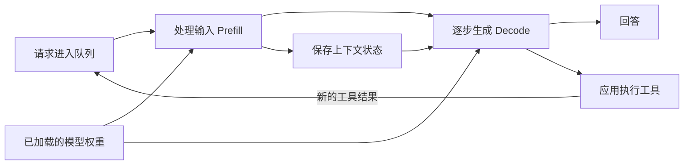

# C 版阅读体验反馈与修订任务书

2026-10-22。给用户及原 C 作者。

本轮重新完整阅读了 [initial-draft.md](initial-draft.md) 与 [extended-draft-c.md](extended-draft-c.md)。以下按原 C 页码定位，暂不改正文。此任务书以用户最新反馈为最高优先级；上一轮审查中关于保留正文限定语的处理，以本轮具体要求为准。

用户要求整场像 initial draft 一样自然、流畅，全面避免“X是Y，不代表Z”“这是X，不是Y”及语义相同的防御性话术。**修订目标是让同事顺着当前解释理解下一步，而不是让每一页完成一次证据答辩。** 模型选型、infra、性能和成本的研究深度继续保留。

## 一、这次需要改到什么程度

需要重写页面的叙述组织，不能只替换几个连接词。

目前常见的阅读节奏是：先抛出概念，放一张列满数据的表，最后提醒听众这些数据不能说明什么。读者刚形成一点认识，页面就撤回到适用边界；下一页再重新开始另一张表。多个局部解释虽然相关，连续阅读却像在检查研究记录。

另一个问题是，页尾经常承担作者自我评价或抽象概括：“这是有证据的实施起点”“优化应对准实际耗时”“两种布局都值得比较”。这些话没有增加可理解的事实，却占据了每页最显眼的收尾位置。**很多末句应直接删除，删除后无需补写一句新的。**

必须同时完成四项修改：

1. **正文全面清除防御性解释。** 包括藏在表格单元格、图注和标题中的“不能当作”“不等于”“尚不能承诺”“不构成排名”，以及先肯定后反复削弱的同类表达。逐句按含义判断，不能以没出现关键词为通过。
2. **把事实条件放到它所限定的对象上。** “外部随机 token 测量”“全注意力 KV 载荷”“容量估算”“三年预算情景”可以直接作为标题、列名或图注。随后讲具体结果，不在尾部继续反驳假想误读。
3. **减少重复的页面结构。** 过程用过程表达，资源组成用组成表达，真实比较保留表格。纯文字可以是一张完整 slide。没有必要给每页配表、配图或配总结。
4. **重排解释内部的先后。** 先让听众理解一个对象，再给它的数字；先说明测试在做什么，再解释结果。需要后文概念才能读懂的前页内容，应移动或改写，不能靠跨页引用解决。

准确性仍是要求。删掉防御句后，必须同步检查标题、图轴、表头和正文是否留下过强结论。例如，“完整恢复耗时5.46秒”需要改成“SSD读取载荷算例：32.768GB÷6GB/s≈5.46秒”，而不能只删除脚注。非上屏证据可以详细记录未取得日志、版本条件、未覆盖的负载与验证状态。

## 二、全场的连续阅读应怎样推进

保留整体顺序，重做以下局部连接。

| 段落 | 听众到这里需要理解什么 | 修订的连接方式 |
|---|---|---|
| 01–04 用途与公司环境 | LLM参与哪些工作；这些工作为何涉及内部资料和公司环境 | 用具体岗位动作建立认识，04页直接承接资料来源，结束在公司的本地部署研究问题 |
| 05–10 任务与选型维度 | 模型已有的能力、本次输入、窗口、分析质量和等待如何相连 | 财报任务只在入口展开；此后沿概念连续推进，07页结束在窗口组成，08页自然接能力和速度，09页解释资源取舍 |
| 11–15 模型比较 | 模型结构影响资源；三类任务证据分别回答什么；当前为何选这些模型 | 每张评测页先提出它实际检查的能力，表后最多保留一个具体观察；15页用连贯文字形成选择理由 |
| 16–19 推理运行 | 输入处理、生成、状态、调度如何组织成服务 | 先给一次请求流程，再解释重复读取与缓存；框架名字接在已理解的职责之后 |
| 20–23 Spark性能 | 长输入的等待、草稿验证、多人共享、缓存续用怎样影响体验 | 用现象进入机制，22页解释调度，23页解释下一轮如何继续；暂不插入尚未定义的DeepSeek TP8数字 |
| 24–27 共享服务 | 大模型资源怎样分配，八卡如何分组，速度证据处于什么负载，适配怎样增加性能 | 24页先定义每卡资源，25页再比较实例布局；26页清楚区分一个公开回放和一组服务目标；27页只展开一个可理解的增量案例 |
| 28–32 成本 | 改硬件增加什么能力，完整任务消耗什么资源，三年成本怎样随用量变化 | 28页结束在硬件投入，29页进入多轮工作量，30页看成本构成，31页看扩容，32页讨论已有设备与人工时间 |
| 33–35 使用入口与收束 | 同事怎样取资料、用工具和接收产物；研究形成了什么选择 | 33页不再插入一套新硬件容量；35页简洁收回本地部署需求 |

11–15页和24–27页最容易再次变成连续评审表。作者必须连起来读，确认每页新增的概念已经被上一页或本页开头解释。尤其先处理 BF16/FP8、TP/rank、共同生成窗口、前缀复用，再出现相应精细数字。

## 三、逐页必须修改的内容

下面的替代文字是可采用的局部写法，不是要求每页照抄或补齐成同一种结构。可以删除更多重复内容，但不能改变数据身份。

### 01｜封面

- 当前：“让公司在可控环境中使用大模型，首先需要选到合适的模型，再把它运行成可用的服务。”
- 这句话自然，内容也与研究相符，可以保留。封面不再增加背景、三点价值或结论。
- **末句处理：保留现有引题，后面不追加总结。**

### 02｜LLM怎样参与我们的工作

- 当前表格把“阅读、分析、形成结果”拆成三个抽象环节，各行又重复“材料、要求、产物”。紧接着03页又是一张输入—工作—产出表，两页阅读感接近。
- 建议本页改成短段落，用“读一份公告，提取金额和日期；比较两期财报，整理变化与依据；按要求写出处理数据的代码”说明能力，03页再讲真实机构。也可以保留其中一个例子及对应产物，不必保留三行分类。
- “一份有用的结果，需要材料支持……”没有事实错误，但开场不必在每次介绍能力后马上转为验收要求。将检查数字和来源放到05页任务中更具体。
- **末句处理：删除现有末段，或只保留与具体产物直接相连的一句，勿另写人机分工口号。**

### 03｜金融机构已经怎样使用大模型

- 必删：“不能直接当作本公司的效率收益。”页面没有给效率数字，这句回应了读者尚未提出的问题。
- 三个案例可以各写成两句短叙述，以前台／中台／后台作小标题。每段按“谁处理什么 → 模型做哪一步 → 交付什么”展开，比四列表更便于线性阅读。例如：

> 鹏华的投研资讯助手整理公告、新闻和券商研报，为信息添加事件标签，再形成个股舆情要点与摘要。基金经理和研究员据此筛选值得继续分析的材料。

- 其余两例使用已经核对的事实，不增加效果承诺。来源可简写为“机构公开披露”。无需给三个案例各加一句总结。
- **末句处理：整段删除。03页以最后一个案例的具体产物结束，04页自然接资料与环境。**

### 04｜本地部署来自对使用环境的要求

- 当前：“模型放在本地以后……仍然需要设计。”这段有回应“本地就自动解决一切”的姿态，而读者尚未提出此假设。
- 前两段可以保留并顺写为：“这些工作既会使用公开资料，也会使用内部研究、业务文件和制度。公司需要安排资料由谁访问、模型在哪里运行，以及工具怎样接入现有系统。”然后进入本地部署需求与本次研究。
- 当前图与前后几页重复介绍“任务—资料—模型—结果”。本页可以用两段自然文字讲完，不必保留图。
- **末句处理：用“这次研究围绕模型选择、运行框架、性能和成本展开”结束即可；不另补权限尚待设计的告诫。**

### 05｜一次财报分析任务

- 任务本身清楚。当前三条交付标准加末句，把一个实际工作讲成了验收条目。
- 可先保留任务原话，再写一段具体的阅读动作：“模型要找到收入和利润的比较数字，读到分部披露与管理层解释，把变化原因和原文位置一起整理出来。”期间、单位、合并口径可以随对应数字说明。
- 财报重述小例子是可选增强，放在本页替换部分清单即可：120、本期；90、上期原披露；100、重述后可比数；据此增长20%。明确“教学示例”。不要把整场改成反复回到该例的叙述。
- **末句处理：当前最后一句可缩为引出06页的实际问题，或直接删除。不得再加“模型能回答不等于分析正确”。**

### 06｜参数保存能力，上下文提供这次任务的材料

- 必改：“把一份财报交给模型阅读，通常不会因此更新模型权重。”这是在解释完对象后补一个否定式防误读。
- 前两段已经足够区分训练与本次推理。可直接写：“训练形成的参数保存在权重文件里。本地运行时，设备加载这些权重，再接收本次财报和问题，逐步生成分析。”
- 删除重复定义的三行表，改用下面的关系图或保留简短文字。若用图，节点只承担已解释的关系：


- **末句处理：删除，无需替代。**

### 07｜上下文窗口限制一次能带入多少信息

- 必改：“不宜固定换算成多少页财报。”改为直接描述计量：“token是模型处理内容的单位，数量随文本、符号和分词方式变化。”
- 四档预算是有用数据，但本页首先要让人理解窗口里装什么。可以采用一个完整等式加一个算例：

```text
任务指令 + 财报材料 + 对话历史 + 工具结果 + 本轮输出 = 本次总上下文

262,144 tokens 总窗口
＝253,952 tokens 材料与历史 + 8,192 tokens 输出预留
```

- 131K/262K/512K/1M四档仍可紧凑列出；精确减法表保留到证据。下一页将讨论能力和速度，本页不必先把那两项总结一遍。
- **末句处理：保留“长窗口让我们保留更多原文和工作历史”即可，后面“还要确认……”整句删除。**

### 08｜能力和速度决定材料能否变成有用结果

- 必删：“单一排行榜分数不能覆盖这三项要求。”本页应继续解释使用体验，而不是评价别人的选型方法。
- 能力的四个检查项可以用一句自然话连接。速度表确实是“体验—指标”映射，可以保留；不要再给表后总结。
- 当前“因此，模型选型围绕……”重复已建立的主题。可直接结束在表格，09页进入固定资源下如何兼顾这些要求。
- **末句处理：删除整个末段。**

### 09｜固定硬件下的取舍

- 必改：“这有‘不可能三角’的直觉，但……”以及“能力也不随参数规模单调增长”。这两句把工程解释收成了概念争辩。
- 可以直接在开头限定：“在这次比较采用的模型、硬件和运行方式下，内存、算力和带宽共同限制了上下文与速度的组合。”再说明保留更多材料、改变模型或增加请求的实际代价。
- 若保留比喻，写为“固定资源下的这组取舍，可以借‘不可能三角’来理解”，随后给具体资源关系。新架构与优化改善组合的事实可自然写入解释中，避免再讲“它不是定理”。
- 当前“换用另一种模型”一行过空，无法看出选择产生什么影响；没有具体例子就删去该行。降低精度在11页解释后再展开。
- **末句处理：删除现有末段；不强行换一个‘三者兼顾’的口号。**

### 10｜选型采用的工作要求

- 必删：“这些是研究要求与资源情景……尚未形成公司业务验收结果。”将身份直接放进标题或表头：“本轮比较的资源情景与服务目标”。
- “先固定……价格在……之后比较”是作者对目录的说明。可以改为“个人使用从一台Spark展开，共享长任务以八卡H200作为分析配置”，然后列实际要求。
- 目前“20个活跃请求”“10/20两档目标”可以保留，但需用自然话说明“以同时使用人数和每路生成速度来设定服务目标”。主讲可先选20一档，10作为较低目标留表内。
- **末句处理：删除；表头已经说明目标身份。**

### 11｜候选模型的结构与资源差别

- 必改：“却不代表只需保存那一部分权重”“不能据此排列运行显存或速度”。
- 可采用：“MoE保存多组专家，每一步选其中一部分参与计算。整套权重决定装载规模，每步使用的部分影响计算量。”随后解释B、BF16/FP8，给表格建立读法。
- 表格确实用于候选比较，可以保留。列名用“权重文件体量及格式”，让不同格式随数字可见。实际部署采用Qwen FP8，应在该行或旁边直接标出；无需让听众从BF16表倒推。
- “Engram”此时只作为模型标签且没有解释作用，可暂从结构栏去掉，24页再正式引入。少念一组品牌和体量，比在尾部反复解释不可比较更有效。
- **末句处理：删除防御句；单位、格式和主方案标注保留在对应对象上。**

### 12｜文档提取支持从Qwen27起步

- 必删：“结果不等于同条件纯模型排名，也不等于中文金融实体识别成绩。”
- 开头直接说清研究对象：“ExtractBench比较从英文企业文档提取指定字段的完整流程。F1同时反映字段值是否正确、内容是否有遗漏。”
- 表格的核心观察是Qwen流程与长文完整性，可以保留四行，也可主讲Qwen两行与长度变化。若继续四行，API/自托管、图片/原文件等关键条件放在行标或短注，证据中保留完整输出预算。
- 不要把配置差异写成半页执行参数后再否定排名。本页以一个具体观察结束即可：“Qwen27的短文组为94.68，超过50页的20份文档组为38.45。”这是组间观察，不加“长度导致”的因果归因。
- **末句处理：删除；‘支持从字段与列表提取起步’若标题已表达，正文不再重说。**

### 13｜长材料问答和完整提取是不同能力

- 必改：“但问对一个问题与完整列出所有字段不同”“也不会自动把约100K的质量成绩延伸到1M”。
- 用测试任务直接接上一页：“完整提取要求找齐字段。另一类工作是在多份材料中回答一个问题，AA-LCR用约100K tokens的材料考察这种能力。”随后给结果。
- 本页可以保留简洁的模型—分数比较，或用标明数据的条形图；只强调与选型有关的模型。100题、每题3次、约100K放同一短注。权重SHA披露状态放证据。
- **末句处理：整个末段删除。测试范围已在开头写清，不补一段对1M的告诫。**

### 14｜金融研究任务需要保留有力的对照模型

- 必改：“但接近的分数不足以确认显著胜负”“更大的模型也没有在每项任务上取得更好的结果”。
- 本页先用一句解释工具任务：“模型要找到财报、调用计算工具，再把依据组织成回答。”评分方法用一句普通话说明关键项与部分分。
- 题目可直接改为“金融研究与工具任务”，避免标题预先替听众宣布应保留什么模型。表中保留实际候选和原版/1017身份。推理强度与权重修订披露不足详列证据。
- 如果要留下选型观察，最多一句“GLM Flash和MiMo Flash也进入共享任务的比较范围”，然后15页统一讲选择。不要把“最高分”写成确定最优。
- **末句处理：删除现有末段中的显著性和规模争辩；允许直接结束在结果表。**

### 15｜当前模型选择与接受的取舍

- 必改：“这是有证据的实施起点。真正把这些能力变成日常体验……”是典型作者自评与空泛转折。
- 当前四列表把每个选择拆成依据和待验事项，连续第三四张表后阅读疲劳明显。建议改为两段选择理由：先说个人Qwen为何适合当前起步，再说共享DeepSeek已有怎样的能力与运行研究，GLM/MiMo怎样作为对照。
- 用具体条件代替每行“尚缺／尚未”的尾巴：“个人速度依据来自约100K随机输入外测”“共享方案按20份1M历史做容量规划”。公司同题验证留到结尾统一说明。
- 1017许可和静态索引细节可以移证据；如正文提1017，明确它是升级候选即可，历史速度页继续标原版。
- **末句处理：删除现有末段。以选择理由结束；16页标题本身已能带入运行过程。**

### 16｜一次请求经过的本地运行过程

- 图比表适合此页，但当前“Prefill→推理引擎→Decode”容易把引擎误读成单独计算阶段，工具返回回路也少了执行节点。
- 可采用下面的完整关系。框架的职责写在图旁一句话里，不必另外重复各个节点：



- **末句处理：删除“工作方式不同，因此瓶颈……不同”。17页会具体解释，当前无需先总结。**

### 17｜首次等待与持续生成消耗不同资源

- 必删：“优化应对准实际耗时。增加容量可以避免放不下，能提高多少生成速度还要测量。”这不是当前解释的进一步展开。
- 用两个相连段落说明prefill/decode；删泛化资源表，加入真正解释合批的一段：“多个请求一起计算，可以分摊模型权重的读取；各自的历史状态仍随请求处理。请求增多时，系统每轮产生更多输出，每一轮也会占用更多时间。”
- 此处可给一个简化公式，前缀说明“同一稠密模型、各请求历史独立时”：`每个输出token分摊的读取量≈权重读取量÷批内请求数＋本请求历史读取量`。若公式需要太多解释，就保留文字。
- **末句处理：删除，无需替换为‘因此要找瓶颈’。**

### 18｜上下文缓存怎样占用内存

- 必改：“未含……”“FP8缓存节省载荷，但其质量需要……”的末尾防御结构。
- 数据范围直接写在图表标题：“Qwen27全注意力KV载荷”。再在资源组成中正面列出：“完整运行预算还包括递推/卷积状态、草稿、分页和临时空间。”不要把这串对象都放在句末排除项里。
- 四档精度比较可以保留。表后不必再说“因此内存预算要……”，可以用组成关系表达：`运行内存＝权重＋会话状态＋计算与调度空间`。若前页已给出同一关系，此处也省略。
- 质量检查放到证据和结尾的业务验证，不逐页提醒。
- **末句处理：删除现有末段；最多留下确有解释作用的资源组成。**

### 19｜推理框架围绕服务需求选择

- 必改：“支持列表证明有实现入口……是否可用，需要运行记录确认。”这种结尾让框架介绍变成审核要求。
- 按已建立的运行职责讲：vLLM怎样管理请求、缓存和多卡；SGLang作为哪一类服务的对照；A100用固定适配版本。MLX/llama.cpp一行交代设备路线即可。
- 可以用短段落代替大表，或者保留三列真正有区别的信息。删“模型制品、镜像、驱动、精度、并行与调度参数”这类操作清单；它属于实施记录。
- v0.32.0日期可以作为简短版本注。旧测试条件随测试页标注。
- **末句处理：整段删除，不补‘成熟框架也需要验证’。**

### 20｜Spark的长输入首先拉长了等待

- 必删：“尚不能据此承诺日常1M分析体验”。“完整版本与原始日志待补，未测回答质量”移到证据。
- 用标题或数据注说明“朋友设备的外部随机token测量；FP8权重/缓存、MTP3、前缀缓存关闭”。这就是本页对象。
- 50K–500K可画两组共用输入长度标签的图，一组TTFT、一组生成速度。1M的64输出放独立“容量测试”记录，避免用一条连续生成速度曲线把它和2048输出样本连起来。原始数值继续在Markdown完整列明。
- 将秒换成便于感知的分钟可以帮助阅读，例如100K约2.4分钟，500K约24.5分钟；精确秒数保留数据注。
- **末句处理：标题已说明趋势，表后可直接结束。若保留一句，只观察100K与500K的具体差别。**

### 21｜草稿解码的收益取决于接受率和实现

- 必删：“不能解释为正常开启与关闭MTP的加速比”“随机输入也不能代表……”及末段检查清单。
- 本页组织为一个故障故事：草稿先提出候选→主模型验证；300K请求超过草稿262K上限→接受率0%；修正草稿上限至1M→接受率99.4%、速度17.23。
- 表头直接写“同一外部随机输入测试中的草稿长度故障与修正”，两行就保持了准确身份。没有正常on/off对照，就不写正常开关加速结论。
- 平均每步长度沿来源标为“平均每步接受长度”，确切定义留证据。正文不需要再教大家怎样记录实验日志。
- **末句处理：删除两个末段，用修复后的结果结束。**

### 22｜多人共享需要同时看驻留与生成

- 必改：“能保留三份历史，还不代表三个人能各自维持单人速度。”直接转入实际生成数据即可。
- 先用共享池份额说明容量；三份512K应标为“总窗口”，与前面输出预留口径一致。再给100K三请求的数据，保留共同窗口与完整阶段的实际定义。
- 建议删50K这一行，腾出空间解释调度。可以完整表达为：

```text
长输入集中处理： [一整段输入计算] → [已有请求继续生成]
长输入分块处理： [输入块1] → [已有请求生成] → [输入块2] → [已有请求生成]
```

- 配一句“分块让正在交互的请求更早得到下一次生成机会；块的大小也影响长输入处理效率”。这是直接解释现象，比“实际配置应控制……”更自然。
- **末句处理：删除现有建议式末段，以机制图结束。**

### 23｜缓存复用减少重复阅读，也引入恢复成本

- 必改：“不能把CPU内存再算成额外一层容量”“不用于设备排名”“均未计……”以及末段一长串组合验证条件。
- 本页最需要的是解释下一轮如何继续。先写“相同前缀仍在缓存时，服务复用旧状态，只处理新增问题和工具结果”，再写闲置状态怎样存放。可采用三个连续状态：

```text
第一次：完整输入 → 建立状态 → 生成
继续时：已有状态 + 新增输入 → 生成
离开后返回：读回保存的状态 → 处理新增输入 → 生成
```

- 写清“已有状态帮助省去重复输入处理；生成阶段继续使用这些历史状态”。这是运行过程，避免写成“缓存不等于提速”的反驳。
- Spark正面说明：“CPU/GPU共用128GB，近期状态留在统一内存，较久不用的状态可保存到NVMe。”独立GPU服务器再用GPU—主存—SSD图说明，图名写清对象。
- 移走本页DeepSeek TP8数字，TP/rank尚未解释。载荷恢复算例可留证据，或在24/25页已有定义后只保留一个。LMCache组合状态移证据，正文用“拟采用的缓存保存路线”表明研究身份。
- **末句处理：删除现有末段。避免在刚讲清缓存用途后收成一段支持矩阵。**

### 24｜DeepSeek的资源要分成权重与会话状态

- 必改：“与每个用户的上下文缓存不同”“不能再次除以TP数”。用资源各自的作用直接说明区别。
- Engram用“模型权重中的查表结构，放在主存；每个会话另外保存当前资料的计算状态”。第一次出现rank时直接写每卡，技术标签可以括号附上。
- 本页更适合资源组成图，完整数字可以这样表达：

```text
DeepSeek权重：510.286GB
├─ Engram表与尺度：202.758GB，安排在主存
└─ 其余权重：307.528GB，分配到GPU

Hopper实现中，每张参与推理的卡保存global KV副本：
20份 × 1,000,000 tokens × 1,827字节/token
＝36.54GB/卡

运行预算另计局部状态、草稿和计算空间。
```

- 最后一句“最终仍由……决定”把说明收成审计原则。可以直接讲下一步需要根据加载后空间分配会话，但无需在本页另总结。
- **末句处理：删除现有末段；25页直接接缓存池和布局。**

### 25｜同一八H200机器可以怎样组织服务

- 必改：“不会把两个GPU缓存池合成一个”。直接写“两个副本各自管理KV池”。
- 先用八卡分组解释TP8与双TP4，再列容量结果。一个队列、两组队列，以及Engram一份／两份是实际比较；28.250M、16.935M等中间精细数留证据。
- 保留DP共享方案时，用一句“同服务的两个四卡副本，在满足共享条件时可共用一份主存Engram；各自管理会话缓存”。状态属于方案，就在该行标“方案”，避免“仍需重新启动确认”的尾巴。
- “40份历史”前加具体情景：“20项正在生成，另20项等待工具返回，共保留40份历史。”不要先抛数字再让听众猜含义。
- **末句处理：删‘两种布局都值得比较’；队列区别直接放图中，不再写末段总结。**

### 26｜共享服务已有速度参照，满窗口仍需单测

- 标题应改成直接内容名，如“共享服务的公开回放与容量目标”。当前标题先给自己补验证条款。
- 必删：“活跃会话也不等于始终同时生成”“它们不能当作20路各1M的速度”“这是反推门槛，尚非设备实测结果”。
- 公开回放用正面描述：“会话在模型生成与工具等待之间交替；平均输入约140K–157K，前缀命中约94%–96%。”表头保留“公开回放”。
- 目标区明确标“20路、每路1M的服务目标”，写200/400总输出与13.65/6.83分钟。如此两个对象自然分开，无需否定关联。可主讲H200一行和20 token/s一档，完整其他行进证据。
- 十五分钟冷输入反推移证据，或者以“15分钟完成首轮输入处理所需吞吐：22,040 token/s”作独立算例，勿再写结果免责。
- **末句处理：没有保留末尾总结的必要。**

### 27｜A100的研究重点是适配和可测量的增量

- 当前以“A100没有原生FP4/FP8矩阵乘指令”开头，是具体硬件事实，但可以更顺地从工作方式讲起：“A100适配保留低位权重存储，在计算时展开为相应计算格式，再优化算子和卡间交换。”
- 必删：“不能推广到长窗口”“不构成同机排名”。本页只展示八A800同机短请求消融，并在标题/图注标明设备与负载。
- 表中技术名先翻成动作：“大批次使用BF16矩阵计算”“定制八卡专家数据交换”，Marlin/NCCL/EP8放括号或证据。可以画从2842.48到2926.08再到2970.50的三步增量，数据含义完整。
- shi3z项目若不展开，其名字在末段突然出现会打断阅读。建议移证据；公司采用固定modified vLLM的选择已在19页说过，不在此重复。
- **末句处理：删除现有末段，以同机增量结果结束。A100整页作为可选压缩位，不能借此删去其他infra机制。**

### 28｜硬件投入改变的是可支持的工作规模

- 必改：“不是本机构含税交付报价”“未覆盖20×262K”。预算身份放在表名：“10月12日基线、10月20日复核的人民币整机分析预算”。H100直接列“20份时每份约242K”。
- 开头“前面的……现在……”是讲稿提示，可改成具体问题：“增加硬件投入，可以扩大模型和会话的运行空间。下面比较各配置的预算与支持范围。”也可以直接进入比较。
- 四H200 NVL报价与另一四卡容量来源分开，报价行不要直接对应762K；需要更精确数据的来源在证据解释，正文保留该配置的预算身份。
- “含台账准备”太内部。写清预算含税费、交付与支持准备，完整比例留证据。
- **末句处理：删除‘设备形态、互联和软件组合需要对应’。工具CPU另计12–26万属于本页金额范围，作为短注保留。**

### 29｜三年成本先固定同一份工作量

- 必改：“但历史提交量仍然存在”“1.10倍轨迹不代表实测成功率”。
- 这页适合用递增过程说明输入账，而不再放六行记账表：

```text
第1轮：100K输入 → 2K输出
第2轮：100K历史 + 2K上轮输出 + 8K新增内容 = 110K输入
第3轮：120K输入 → …… → 第8轮：170K输入 + 2K输出

8轮合计：输入1.08M，输出16K
每项任务另加10%轨迹预算，用于重跑和修改。
```

- 工作量、增长率、服务时段继续保留，但以“本次三年预算采用……”引入。加入本地历史90%／API95%可复用前缀命中假设，或在31页对应计算前说明。
- 同题质量状态放证据，正文对象始终称预算情景，不称实绩或合格任务已测成本。
- **末句处理：整个末段删除。**

### 30｜中等工作量下，本地成本主要来自固定投入

- 必改：“未假定整个内部NAS可以外发”“相同任务质量仍待验证”。正文直接说明“API情景处理符合服务条款的获准资料”。
- 保留总额与公司成本构成，二者确实有比较任务。可以总额用条形图、分项用紧凑表，也可只保留一张分项表，个人总额用旁边一句话交代。
- 所有图的标题写“三年预算”。技术人工2500元／人日、已有NAS/身份/检索按复用、额外RAG建设单列，应以简明预算输入说明，不变成免责声明。
- “本地约76%来自GPU采购”是具体读图提示，有信息价值；可以放在图旁标注，不强制作为每页统一结尾。
- **末句处理：删证据防御句；费率日期、峰时占比和预算汇率按对应短注保留。**

### 31｜使用量增加后，还要支付扩容成本

- 必改：“尚未得到该任务的实测确认”“成本不会沿单机曲线一直下降”“不能据此推算1M日常任务产能”。
- 开头直接说“以8000未缓存输入token/s、400输出token/s作为容量预算，每项8轮任务约占78.16秒机时”。同时带出90%本地历史复用假设及100K–172K任务范围。
- 表格可改成两条年份序列：中量25K→31.25K→39.06K，对应1→1→1；高量50K→75K→112.5K，对应1→2→2。旁边列三年本地/API总额，扩容时点就直观了。
- 缓存全部失效的敏感性可以留证据。若保留，直接标“全冷输入情景”及它对应的节点变化，避免在末尾再否定原结果。
- **末句处理：删除当前两段；以扩容带来的具体预算变化结束。**

### 32｜成本判断需要真实的任务收益

- 必改表中“不能填入H200速度”；删除“下一步最有价值的数据是……”这类抽象收尾。
- 本页把已有设备、新购设备、提高用量、业务工时四种不同变量放进同一表，读者要频繁切换比较对象。建议改成两个短段落：先说明存量A100复用与新购预算；再说明业务侧怎样记录净人工时间。
- 复用预算名称准确写“已有设备复用情景的三年新增与运行预算”，原设备历史成本与替代用途放相邻注或证据。资源能力仍写为这项方案的后续测量任务，不赋予H200能力。
- 357.42万未测工时价值建议移证据；正文留下“准备、操作、复核、返工、无法并行的等待”怎样进入净时间。现金变化可以直接写“减少外包、加班或新增招聘支出时，释放的时间会反映到现金费用”，无需‘工时不是现金’对立句。
- **末句处理：删除。33页直接进入同事怎样使用方案。**

### 33｜知识库把获准资料送入模型

- 过程图可以保留，平台对照用两句短文即可。
- 必移：三张84GB回答卡、第四张检索卡、20路短问答与9份/3份长历史。这段在成本结束后重新开启硬件研究，也会让读者以为上一页预算涵盖了新知识库建设。完整参数留证据。
- 用这段空间解释文件解析和引用：“系统把文件整理成带来源位置的可检索内容，按照员工身份选取相关片段。回答附上原文入口，便于同事继续核对。”权限更新直接纳入流程，无需表后另提醒。
- **末句处理：删除‘检索帮助控制输入规模’及重复的权限尾句；把必要动作写进图或过程文字。**

### 34｜工具层把模型输出变成工作文件

- 图与文字的内容都合理，但目前第一段、图后第三段重复“工具执行、模型推理、保存产物”。
- 保留一条运行循环和一段入口说明。Skills/MCP第一次出现就各解释到足够理解即可，减少产品名。GPU与CPU分工若在16页已经明确，此处只说明个人工具在电脑、共享工具可用独立环境。
- 末句的试点选择使汇报临近结束又启动新议题。当前任务是介绍研究，详细起步顺序移证据。
- **末句处理：删除。页面结束在同事拿到比较表、说明、计算文件和出处。**

### 35｜本地部署已经有了可解释的选择依据

- 标题“已经有了可解释的选择依据”像作者给稿件打分，建议直接改“本地部署研究结论”。
- 首段列研究产物，第二段列模型，第三段列资源，第四段又列验收，四段都在总结，层次重复。
- 用两三段自然话收回公司需求：个人Qwen起步、共享DeepSeek及对照的选择；框架与硬件怎样支持它们；接下来用真实任务核对质量、等待和人工时间。保留研究阶段，别写成已上线能力。
- 必改：“Spark支持个人起步，但……”以及“目前尚未完成……”。可直接陈述：“Spark的外部测量展示了个人使用的速度，也揭示了超长输入的等待。八H200方案按20份1M历史规划容量。下一步用公司任务确定实际使用范围与设备规模。”如前面已讲充分，可进一步压缩。
- **末句处理：结尾允许有总结，但只在这里完整收束一次；‘谢谢’之后不再增加提案清单。**

## 四、表达形式的变化应服务解释

这次不要求每页都有图。建议采用以下分工，作者可以按完整阅读效果调整：

| 表达任务 | 适合的形式 | 对应页面 |
|---|---|---|
| 介绍能力、公司需求、选择理由 | 连贯短段落，少量具体例子 | 02、04、05、15、19、32、35 |
| 真实岗位工作 | 三段各自完整的小案例 | 03 |
| 输入如何进入模型、一次请求如何运行 | 少节点过程图 | 06、16 |
| 一份窗口或一台设备如何分配 | 组成关系、份额或资源树 | 07、18、22、24 |
| 候选模型和公开结果的可比信息 | 表格，或者有完整数值的比较图 | 11–14 |
| 首次等待和生成速度随输入变化 | 分开的两组数值图，清楚标单位与样本身份 | 20 |
| 一次故障修复、逐项性能增量 | 前后过程或增量图 | 21、27 |
| 分块调度、缓存续用 | 时间顺序示意，不虚构阶段时长 | 22、23 |
| 八卡分组与队列 | 资源分组图 | 25 |
| 配置预算、成本构成、用量扩容 | 预算表、构成图、年度序列 | 28、30、31 |
| 多轮输入累计 | 两三轮具体推演＋总量 | 29 |
| 检索与工具使用 | 流程图＋短文字 | 33、34 |

表格可以连续出现，只要它们确实帮助比较；问题在于每页都按相同节奏铺表，再附一段空泛结论。反过来，也不要为制造变化，把本来一眼能看清的预算表改成复杂图形。Markdown中的过程、数值、单位和标签必须完整，不能交付“此处放图”的占位说明。

## 五、上一轮建议本次只保留这些

本轮不重新扩展来源，也不要求把 A/B 和旧成果全部加进来。

**与阅读直接相关、必须保留：**

- 术语先解释再使用：B、MoE、BF16/FP8、TP/rank；精确实现细节放证据。
- 16页工具回路补实际执行步骤。
- 17/22页用合批与分块解释性能，不只报数。
- 23页先讲前缀续用，再讲移出和恢复；DeepSeek算例后移或留证据。
- 25页用具体任务解释20路生成与40份历史。
- 成本正文直接标明预算对象、关键命中假设、人工口径和建设范围；33页移去独立RAG硬件段。
- 四H200 NVL报价与另一配置的容量参照分开，防止删脚注后留下错误比较。

**可选：**05页财报重述小例子；03页展开一个更具体的真实机构流程。二者都应替换现有内容，尽量不增页。

**本轮不采用：**再加一组机构案例、更多榜单、旧四硬件速度矩阵、完整A100故事、全面PD/AF介绍、详细权限清单、试点数量与周计划。也不恢复“5秒／40秒热续跑”为实测之类旧表达。

## 六、交付前怎样确认这次真正改好了

修订稿继续为30–35页、约40分钟，逐页写最终上屏内容，证据与讲述时间单独存放，按主agent指定文件名另存。保留原C供对照。

作者需要做两次不同的完整通读：

**第一遍只读正文，按页序读出声。** 不看证据，不想象自己正在接受技术审查。逐页确认：读者此刻知道每个代词和术语指什么；这一页直接回答眼前的问题；下一页依靠已经建立的认识继续向前。遇到必须解释三段脚注才能理解的表格，应调整表格本身。

**第二遍专门检查句子与事实的关系。** 删除防御句后，原有条件应落到对象、范围、样本和标题上；估算仍标估算，目标仍标目标，外测仍标外测。所有正文末句再问一次：它新增了什么？如果只是概括、提醒、削弱、自评或宣布“还需验证”，优先删去。

本轮验收按以下标准：

- 正文没有用户反对的对立式、否定式防御话术，包括语义改装后的版本。
- 技术和数值条件自然出现在所限定的对象上；不靠一页末尾长免责声明修正前面的过强标题。
- 页面表达随解释任务变化；没有连续把“引言＋大表＋总结”当作默认模板。
- 选型、infra、性能与独立成本仍有充分展开，简化的是重复文字、读表负担和不合时宜的细节。
- 未增加跨页回看要求；没有为连贯而反复拉回财报例子。
- 页数和时间预算复算通过；40分钟预算来自实际讲述取舍，不把每页统一填60–90秒作为完成证明。

本轮只修改此反馈文件。未重新全面审计资料，未改C正文、证据、知识库或旧审查文件。所有详细反馈留在本文件，供用户阅读并交给原作者修订。
