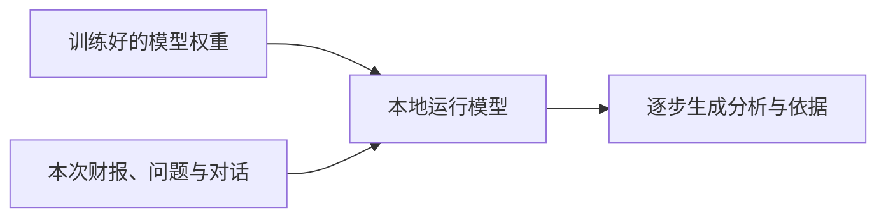
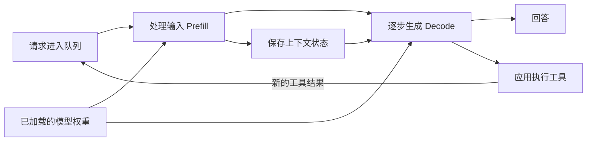
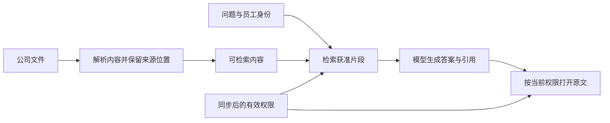
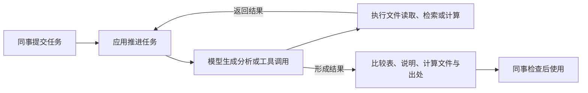

## 01 本地部署 LLM：模型选择、运行性能与成本

实习研究汇报

让公司在可控环境中使用大模型，首先需要选到合适的模型，再把它运行成可用的服务。

2026 年 10 月

---

## 02 LLM 怎样参与我们的工作

大语言模型可以根据材料和要求，帮助我们阅读、分析和写作。

读一份公告时，它可以提取金额、日期和事件要点。比较两期财报时，它可以整理变化，寻找相关解释，并把依据放在一起。

遇到需要重复处理的数据，我们也可以描述计算规则，让它写出代码，生成表格或图表。文字要求因此有了可以继续使用的工作产物。

---

## 03 金融机构中的实际应用

**前台：鹏华投研资讯助手**

助手整理 A 股公告、新闻舆情和券商研报，为信息添加事件标签，再形成个股舆情要点与摘要。基金经理和研究员据此筛选值得继续分析的材料。

**中台：鹏华营销物料审核**

系统读取基金营销宣传材料，检查风险提示、信息披露和宣传内容，向合规人员提供修改建议，帮助完成材料审核与修订。

**后台：永赢邮件安全**

系统结合邮件文本、附件、链接、二维码和 HTML 页面识别社工话术，并调用检测工具。安全人员获得威胁研判、分级处置和攻击链路信息。

机构公开披露案例

---

## 04 公司希望在可控环境中使用这些能力

这些工作既会使用公开资料，也会使用内部研究、业务文件和制度。公司需要安排资料由谁访问、模型在哪里运行，以及工具怎样接入现有系统。

本地部署让公司能够管理模型的运行环境，并把资料权限和日常使用方式纳入自己的安排。这也是本次实习研究的出发点。

研究围绕模型选择、运行框架、性能和成本展开。

---

## 05 一次财报分析任务

“请阅读这份财报，解释本期收入和利润变化的主要原因，并给出依据。”

模型要找到比较数字，读到分部披露和管理层解释，把变化原因与原文位置一起整理出来。期间、单位和合并口径也需要与数字对应。

**教学示例：收入比较使用重述后的上期数字**

```text
本期收入                         120 亿元
上期收入，原披露                  90 亿元
上期收入，按本期口径重述          100 亿元

可比收入增长 =（120 − 100）÷ 100 = 20%
```

一段有用的分析会交代：采用了哪组数字，为什么使用这个口径，财报怎样解释增长。

---

## 06 训练好的模型怎样处理这份财报

训练让模型形成处理语言和完成任务的能力，这些能力保存在模型参数中，存储为权重文件。

本地运行时，设备加载这些权重，再接收本次财报、问题和已有对话。模型根据输入逐步生成分析，这个过程称为推理。



---

## 07 上下文窗口里放着什么

这次交给模型的信息组成上下文。模型用 token 计量内容，数量随文本、符号和分词方式变化。

```text
任务指令 + 财报材料 + 对话历史 + 工具结果 + 本轮输出
                         ＝ 本次总上下文

262,144 tokens 总窗口
＝ 253,952 tokens 材料与历史 + 8,192 tokens 输出预留
```

本轮研究采用四档总窗口：131K、262K、512K、1M，分别为 131,072、262,144、524,288 和 1,000,000 tokens。

长窗口让我们保留更多原文和连续工作的历史。

---

## 08 材料读进去以后，我们关心分析质量与等待

模型的能力体现在它怎样使用材料：读懂会计口径，跨段寻找原因，完成计算，再用原文支持解释。

速度则决定同事使用时的节奏。

| 使用中的感受 | 对应指标 |
|---|---|
| 提交材料后，多久开始回答？ | 首 token 等待时间，TTFT |
| 开始回答后，文字生成多快？ | 每请求生成速率，token/s |
| 多个人一起使用，能处理多少工作？ | 系统吞吐，以及各请求的等待分布 |

---

## 09 固定硬件下怎样兼顾这些要求

在本轮候选模型和运行方式下，设备的内存、算力和带宽共同约束了上下文、能力与速度的组合。

保留更多材料，需要保存更多历史状态，也增加了输入处理和后续读取的工作。选择能力更适合任务的模型，需要为它安排相应的权重空间和计算资源。更多人同时使用时，请求又会共同占用这些资源。

固定资源下的这组取舍，可以借“不可能三角”来理解。模型架构决定怎样使用资源，推理优化则继续寻找更好的组合，例如压缩历史状态，或让多个请求共同利用一次权重读取。

---

## 10 本轮比较的资源情景与服务目标

个人使用从一台 Spark 展开，共享长任务以八卡 H200 作为分析配置。服务目标用同时使用的请求数、保留的材料长度和每路生成速度来描述。

| | 个人／小组辅助 | 公司共享长任务 |
|---|---|---|
| 分析配置 | DGX Spark，128GB 统一内存 | 8×H200 141GB、NVSwitch，1,536GB 主存 |
| 任务 | 文档提取、多文档分析、代码辅助 | 复杂分析、多轮工具任务 |
| 上下文 | 131K／262K 起步，研究 512K／1M | 20 个活跃请求，每路 512K／1M |
| 生成速度目标 | 单人约 20 token/s | 每路 20 token/s，另设 10 token/s 档 |

---

## 11 候选模型的结构与权重规模

稠密模型每一步使用大部分网络。MoE 保存多组专家，每一步选择其中一部分计算。整套权重决定装载规模，每步使用的部分影响计算量。

模型名中的 B 表示十亿参数。BF16 用 16 位存储一个数，FP8 用 8 位；较低精度减少了存储和读取量。

| 候选 | 结构 | 官方上下文 | 归档权重张量体量及格式 |
|---|---|---:|---|
| Qwen3.8-27B | 稠密 | 原生 262,144，可扩展 | BF16 55.56GB；个人路线采用官方 FP8 |
| Qwen3.6-35B-A3B | MoE，约 3B 激活 | 原生 262,144，可扩展 | BF16 71.90GB |
| Gemma 4 31B／26B A4B | 稠密／MoE | 262,144 | BF16 62.55／51.61GB |
| DeepSeek-V4.1-Flash | MoE | 1,048,576 | 混合格式 510.29GB |
| GLM-5.3-Flash | MoE | 1,048,576 | 混合格式 328.33GB |
| MiMo-V2.6-Flash-RL | MoE | 1,048,576 | MXFP4 等混合格式，主索引 172.92GB，辅助制品另列 |

体量采用十进制 GB。

---

## 12 从文档中提取完整字段

ExtractBench 比较从英文企业文档提取指定字段的完整流程。字段值 F1 同时反映提取的准确性和完整性，表中按百分制显示。

370 份文档按长度分组：短文 252 份，中篇 98 份，长篇 20 份。

| 提取流程 | 全集 | ≤10 页 | 11–50 页 | >50 页 |
|---|---:|---:|---:|---:|
| Qwen3.8-27B-FP8，自托管、图像 | 89.75 | 94.68 | 87.54 | 38.45 |
| Qwen3.6-35B-A3B-FP8，自托管、图像 | 88.11 | 92.86 | 86.37 | 36.90 |
| DeepSeek-V4.1-Flash，API、图像 | 87.11 | 94.44 | 81.49 | 22.23 |
| GLM-5.3-Flash，API、原文件 | 80.75 | 96.30 | 51.56 | 27.83 |

图像输入为逐页 150dpi。思考设置：Qwen 使用端点默认，DeepSeek 关闭，GLM 开启。

---

## 13 在多份长材料中回答问题

完整提取要求找齐字段。另一类工作是在多份材料中回答一个问题，AA-LCR v1.1 用约 100K tokens 的材料考察这种能力。

| 模型与评测方推理档位 | 得分 |
|---|---:|
| Qwen3.8-27B，xhigh | 82% |
| DeepSeek-V4.1-Flash 原版，max | 84% |
| GLM-5.3-Flash | 80% |
| MiMo-V2.6-Flash | 74% |
| Kimi K3，max | 89% |
| Gemma 4 31B，reasoning | 70% |

100 道问题，每题重复 3 次。2026-10-20 公开评测快照。

---

## 14 金融研究与工具任务

Finance Agent v2 让模型寻找财报、调用计算等工具，再把依据组织成回答。评分先检查关键事实，再按其他检查项的重要程度计分，关键项失败时该题得零分。

| 模型 | 加权部分得分 |
|---|---:|
| Qwen 3.8 27B | 48.55% |
| DeepSeek V4.1 Flash 原版 | 53.48% |
| DeepSeek V4.1 Flash 1017 | 56.96% |
| GLM 5.3 Flash | 57.85% |
| MiMo V2.6 Flash | 56.28% |
| MiMo V2.6 Pro | 57.34% |
| Kimi K3 | 53.11% |

同一默认执行环境，提供六种工具，每题限时 2 小时。榜单更新于 2026-10-18。

---

## 15 当前选择怎样形成

个人与知识问答从 **Qwen3.8-27B-FP8** 起步。它在文档字段提取和约 100K 长材料问答中已有能力依据，权重规模也适合个人设备。Spark 的约 100K 随机输入外测取得约 20 token/s，接近我们设定的交互目标。更长材料则进入扩展窗口和长任务运行的研究范围。

共享长任务以 **DeepSeek-V4.1-Flash** 为主线。它已有金融工具任务和长材料问答的能力依据，压缩缓存设计有助于减少长历史的内存占用，多卡运行方案则支持继续规划 20 份 1M 历史。1017 作为升级候选，GLM Flash 和 MiMo Flash 保留在金融研究对照中。

---

## 16 一次请求怎样运行

推理框架组织输入计算、生成、缓存和请求调度。应用负责执行工具，再把工具返回的新内容送入模型。



---

## 17 输入处理与生成怎样使用设备

**Prefill** 一次处理许多输入 token，建立后续生成要使用的状态。长材料带来大量计算，这一阶段的效率直接影响首次等待。

**Decode** 逐步生成新 token，反复读取权重和历史状态。低并发时，这些数据的搬运往往占据较多时间。

多个请求一起计算，可以共同利用一次权重读取，这就是合批。每个请求的历史状态也参与计算。这种复用通常能提高设备利用率。一轮要处理的请求更多，所需时间也可能增长。

```text
同一稠密模型、各请求历史独立的简化读取关系

每个输出 token 分摊的读取量
≈ 权重读取量 ÷ 批内请求数 + 本请求历史读取量
```

---

## 18 上下文状态占用多少内存

模型把历史内容计算得到的 Key／Value 状态保存为 KV cache，供后续生成复用。Qwen27 还保存递推与卷积状态。

**Qwen27 全注意力 KV 载荷，十进制 GB**

| 总 context／tokens | 16 位 KV：BF16／FP16 | 8 位 KV：FP8 |
|---|---:|---:|
| 131,072 | 8.59 | 4.29 |
| 262,144 | 17.18 | 8.59 |
| 524,288 | 34.36 | 17.18 |
| 1,000,000 | 65.54 | 32.77 |

```text
完整运行内存
├─ 模型权重
├─ 会话状态：全注意力 KV、递推与卷积状态
└─ 草稿、分页、临时计算与调度空间
```

---

## 19 推理框架的选择

**vLLM 作为共享服务主线。** 它安排多个请求共同运行，管理分页缓存，并组织多卡计算。长输入、持续生成和空闲会话可以放在同一套服务调度中处理。

**SGLang 作为主要对照。** 比较重点放在长上下文、多轮前缀复用和 MoE 服务，观察同样任务下的等待与吞吐。

A100 路线采用固定版本的 modified vLLM，把适配工作集中在算子和设备执行上。Apple Silicon 与其他个人设备保留 MLX／llama.cpp 路线。

版本注：截至 2026-10-20 的核查，vLLM 0.32.0 已正式发布，包含 DeepSeek-V4.1 支持。

---

## 20 Spark 读取长输入时的等待与生成速度

外部单台 DGX Spark 随机 token 测量，Qwen27 FP8 权重和 KV、MTP3、关闭前缀缓存。以下每次输出 2,048 tokens。

```text
首 token 等待                         每格约 1 分钟
 50K 输入  █                          1.05 分钟（63.1 秒）
100K 输入  ██                         2.41 分钟（144.8 秒）
300K 输入  ███████████                10.98 分钟（658.9 秒）
500K 输入  █████████████████████████  24.50 分钟（1,470.1 秒）

生成速率                             每格约 1 token/s
 50K 输入  █████████████████████      21.01 token/s
100K 输入  ████████████████████       20.11 token/s
300K 输入  █████████████████          17.23 token/s
500K 输入  ███████████████            14.82 token/s
```

**1M 总窗口容量测试**：999,936 输入＋64 输出，完成 1 次。首 token 等待 80.26 分钟，短输出段 9.83 token/s。

单请求，FlashInfer、YaRN4，主模型与草稿上限 1M。50K／100K 各 2 次，300K／500K 各 1 次。

---

## 21 草稿长度配置怎样影响生成

MTP／推测解码先提出几个候选 token，再交给主模型验证。一轮接受多个 token 时，计算成本可以分摊到更多输出。

在同一 Spark 外部随机输入测试中，300K 请求遇到了草稿长度配置问题。

```text
300K 输入
    │
    ├─ 主模型上限 1M，草稿上限 262,144
    │      草稿接受率 0%
    │      平均每步接受长度 1.00
    │      生成速率 5.80 token/s
    │
    └─ 草稿上限修正为 1M
           草稿接受率 99.4%
           平均每步接受长度 3.98
           生成速率 17.23 token/s
```

---

## 22 多人共享时，输入计算怎样与生成交替

Spark 外测的共享池约 1.807M tokens。按三份 512K 总窗口驻留估算，占用约 1.573M，保留 10% 池余量后，还剩约 53K 增长空间。

三请求同时提交、每路 100K 输入＋4,096 输出的外测中：

- 三路同时生成的共同窗口内，总速率为 52.41 token/s，每路平均 17.47。
- 计入各请求从首 token 到结束的完整生成阶段，每路平均 12.45 token/s；这一期间还穿插了其他请求的输入计算。

分块处理长输入，让已经开始交互的请求更早获得下一次生成机会。块大小也影响长输入的计算效率。

```text
调度顺序示意

输入集中处理： [整段输入计算] → [已有请求继续生成]
输入分块处理： [输入块1] → [已有请求生成] → [输入块2] → [已有请求生成]
```

外测条件：Qwen27 FP8 权重与 KV、MTP3、随机输入、关闭前缀缓存。

---

## 23 下一轮怎样接着已有材料继续工作

下一轮输入通常保留原有材料，再加新问题和工具结果。相同前缀仍在缓存时，服务复用旧状态，处理追加的内容。

```text
第一次：       完整输入 → 建立状态 → 生成
继续时：       已有状态 + 新增输入 → 生成
离开后返回：   读回保存的状态 → 处理新增输入 → 生成
```

已有状态省去了重复输入处理，生成阶段继续使用这些历史状态。保存 Qwen 会话时，全注意力 KV 与递推、卷积状态需要一起安排。

**拟采用的状态保存路线**

Spark 的 CPU 与 GPU 共用 128GB 内存，近期状态保留在统一内存，较久不用的状态可保存到 NVMe。

独立 GPU 服务器按使用频率分层：GPU 保存活动会话，主存保存近期会话，SSD 延长闲置状态的保留时间。

---

## 24 DeepSeek 的权重与每卡会话状态

DeepSeek-V4.1-Flash 的 Engram 是模型权重中的查表结构，安排在主存，运行时取出所需内容。每个会话另外保存当前资料的计算状态。H100 与 H200 属于 Hopper 架构，下面采用相应实现的缓存格式。

```text
原生权重张量：510.286GB
├─ Engram 表与尺度：202.758GB，安排在主存
└─ 其余权重张量：  307.528GB，分配到 GPU

Hopper 实现的 global KV 记录，在每张参与推理的卡上保存
20 份历史 × 1,000,000 tokens × 1,827 字节/token
＝ 36.54GB/卡

完整运行预算另计局部状态、草稿、加载与计算空间
```

GB 为十进制。权重按原生制品索引划分，global KV 按 Hopper 实现的字节布局计算。

---

## 25 八张 H200 的服务分组

张量并行 TP 把一份模型的计算分到多张卡。数据并行 DP 运行多个副本，让它们分担请求。

```text
单 TP8
一个请求队列 ── [GPU 1 2 3 4 5 6 7 8]
                  一份模型，八卡共同处理
                  主存 Engram 一份：202.758GB

两个独立 TP4
请求队列 A ──── [GPU 1 2 3 4]   模型副本 A
请求队列 B ──── [GPU 5 6 7 8]   模型副本 B
                  主存 Engram 共两份：405.516GB
```

**同服务 TP4×DP2 方案**：同机两个四卡副本可在共享条件下共用一份主存 Engram，各自管理会话缓存。

按公开启动池推算、保留 10% token 余量，单 TP8 和两个独立 TP4 均可容纳 20 份 1M 历史。

若 20 项正在生成，另有 20 项等待工具返回，就要保留 40 份历史。同一容量估算下，单 TP8 每份约 636K，两个独立 TP4 均衡分配时每份约 762K。

---

## 26 共享服务的公开回放与服务目标

**公开回放：DeepSeek 原版，八 H200、TP8、32 个活跃会话**

AgentX 多轮会话在生成与工具等待之间交替。平均输入为 156,951 tokens，前缀命中率 95.7%。

```text
端到端系统输出       1,052.18 token/s
首 token 等待 p95        2.63 秒
```

固定 nightly 构建，合成 DSpark 平均接受长度 3.51。p95 表示 95% 请求的等待落在该值以内。

**规划目标：20 路同时生成，每路 1M 总窗口**

| 每路生成目标 | 系统持续输出目标 | 每路生成 8,192 tokens 的时间 |
|---|---:|---:|
| 10 token/s | 200 token/s | 13.65 分钟 |
| 20 token/s | 400 token/s | 6.83 分钟 |

---

## 27 旧架构适配中的性能增量

A100／A800 适配保留低位权重存储，在计算时展开，再优化矩阵计算与卡间交换。下面的公开实验在同一台八 A800 上，依次加入两项优化。

**128 个并发短请求，总输出吞吐，两次均值**

```text
已适配基线                 2,842.48 token/s
        │
        │ 大批次稠密层采用 BF16 矩阵计算，增加 2.94%
        ▼
                           2,926.08 token/s
        │
        │ 定制八卡专家数据交换，增加 1.52%
        ▼
                           2,970.50 token/s

两项优化合计增加约 4.5%
```

modified vLLM；每请求 78–90 tokens 输入、1,024 输出，DSpark5，计时 180 秒。基线已包含低位算子、草稿解码和执行图。

---

## 28 硬件预算与支持的工作规模

增加硬件投入，可以扩大模型与会话的运行空间。整机比较同时考虑显存、互联和设备形态。

| 硬件方案 | 人民币整机分析预算 | 本轮研究用途与容量结果 |
|---|---:|---|
| Spark 128GB／4TB | 5.8–6.2 万元 | 个人／小组，约 100K 随机输入外测约 20 token/s |
| 8×A100 80GB SXM，翻新 | 91–102 万元 | 旧架构适配路线，长窗口服务纳入设备测试 |
| 8×H100 80GB SXM | 285–298 万元 | 公开池严格预算：20 份历史时每份约 242K |
| 4×H200 141GB NVL | 161–283 万元 | 四卡方案，整机按部件配置估算 |
| 8×H200 141GB SXM | 291–304 万元 | 容量估算覆盖 20 份 1M 历史 |

10 月 12 日预算基线，10 月 20 日复核挂牌。预算汇率 7.00，含税费、价格、交付与支持准备。

共享工具 CPU 节点另预算 12–26 万元。

---

## 29 一项多轮任务怎样累计工作量

三年预算采用一项读取公开资料、交付可核对文件的 8 轮任务。每轮新增内容和生成结果会进入后续历史。

```text
第1轮：100K 输入，生成 2K
第2轮：100K 历史 + 2K 上轮输出 + 8K 新内容 = 110K 输入，生成 2K
第3轮：110K 历史 + 2K 上轮输出 + 8K 新内容 = 120K 输入，生成 2K

第4–8轮输入依次为 130K、140K、150K、160K、170K，各生成 2K

八轮合计：提交输入 1.08M，输出 16K
最后一轮：170K 输入 + 2K 输出 = 172K 总上下文
```

每项任务另加 10% 完整轨迹预算，用于重跑和修改。可复用历史的命中假设为本地 90%、API 95%。

个人首年 750 项、年增 10%；20 人公司共享首年 25,000 项、年增 25%。按每年 2,000 服务小时规划，保留 30% 时间余量。

---

## 30 三年预算的主要支出

**公司中等工作量，三年人民币万元**

| 成本项 | 八 H200 本地 | DeepSeek API |
|---|---:|---:|
| GPU 整机 | 297.36 | 0 |
| 共同工具 CPU 硬件 | 18.00 | 18.00 |
| 实施与运维技术人力 | 56.25 | 37.50 |
| 设施、用电、机位、软件／平台 | 20.93 | 6.88 |
| 模型 token 费用 | 0 | 5.96 |
| **合计** | **392.54** | **68.34** |

GPU 采购占本地预算约 76%。个人情景三年预算为 Spark 9.05 万元、DeepSeek API 1.66 万元。

技术人工按 2,500 元／人日；已有 NAS、身份与检索服务复用，额外知识库建设单列预算。API 情景处理符合服务条款的获准资料。

费率采用 2026-10-20 快照，API 为 DeepSeek 1017，80% 高峰调用；预算汇率 7.00，token 费预留 6% 税费。

---

## 31 工作量增长怎样触发扩容

对 100K–172K 的八轮任务，容量预算采用本地历史 90% 复用、8,000 未缓存输入 token/s 和 400 输出 token/s。

每项任务计入重跑与修改后，占用约 78.16 秒规划机时。单节点每年 1,400 小时可用机时，约支持 64,487 项。

```text
                           第1年       第2年       第3年
中等工作量／项            25,000      31,250      39,062.5
八 H200 节点数                 1           1           1
三年预算：本地 392.54 万元；API 68.34 万元

较高工作量／项            50,000      75,000     112,500
八 H200 节点数                 1           2           2
三年预算：本地 712.78 万元；API 77.23 万元
```

较高工作量情景从第二年增加一台设备，采购与新增维护投入进入当年的预算。

---

## 32 已有设备与业务时间怎样进入成本判断

已有八 A100 的复用情景，三年新增与运行预算为 **134.42 万元**；新购八 A100 翻新整机的三年预算为 **212.13 万元**。复用方案安排改造与支持费用，设备测试关注长窗口容量、服务速度和任务质量。

业务侧记录同一份产物的人工原耗时，再扣除材料准备、主动操作、复核、返工，以及占用人的等待时间，得到每项任务的净时间节省。

释放的时间可以用于更多研究。减少外包、加班或新增招聘支出时，这部分时间会反映到现金费用。

---

## 33 知识库怎样把公司资料交给模型

文件先整理成带来源位置的可检索内容，再按员工身份选取相关片段，送入模型生成回答。这种方式称为检索增强生成，RAG。



Onyx Enterprise 提供企业知识平台路线。Milvus 配合自建应用，则由内部团队组织检索、权限与回答流程。

---

## 34 工具层怎样交付工作文件

个人入口可以连接电脑上的文件与计算工具，共享任务可以使用独立的执行环境。Skills 保存可重复的工作方法，MCP 提供连接工具和资料的接口。



---

## 35 本地部署研究结论

个人与知识问答从 Qwen27 起步，共享长任务以 DeepSeek 为主线，并保留 GLM Flash 与 MiMo Flash 的能力对照。模型选择结合具体任务、上下文需求和运行资源。

推理服务采用 vLLM 主线，设备方案覆盖个人 Spark、旧架构复用和八 H200 共享服务。性能研究解释了长输入、缓存、多人调度和多卡布局怎样影响体验，成本预算进一步把任务量和扩容纳入投入判断。

下一步用公司任务记录质量、等待和人工净时间，据此确定实际使用范围与设备规模。

谢谢
