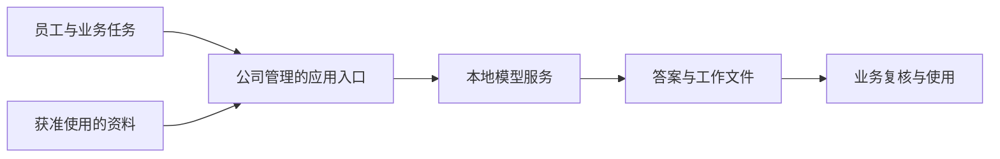
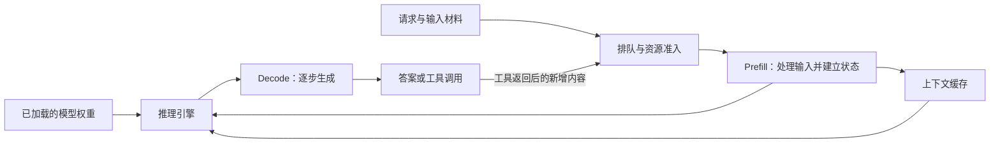
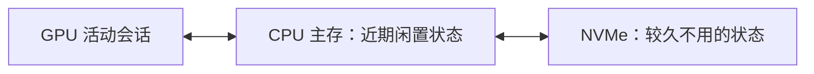
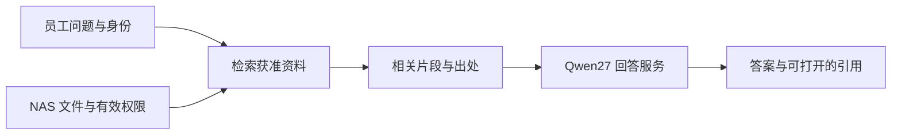
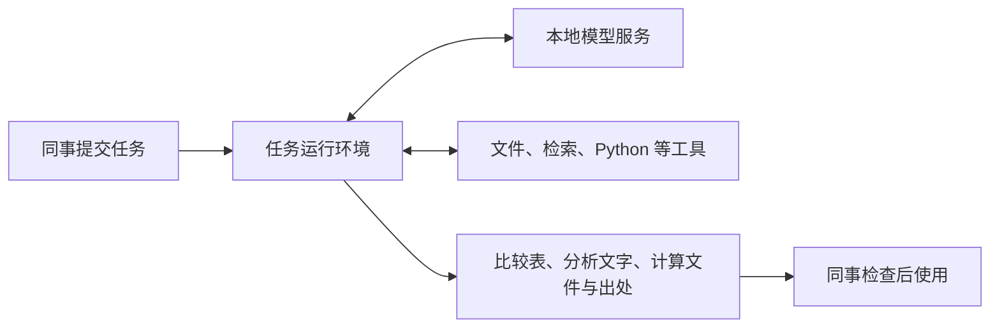

## 01 本地部署 LLM：模型选择、运行性能与成本

实习研究汇报

让公司在可控环境中使用大模型，首先需要选到合适的模型，再把它运行成可用的服务。

2026 年 10 月

---

## 02 LLM 怎样参与我们的工作

大语言模型可以根据给定的材料和要求，提取信息、解释关系，并生成文字或代码。

| 工作环节 | 交给模型的内容 | 可以得到的产物 |
|---|---|---|
| 阅读 | 公告、研报、业务文件 | 关键字段、摘要、待核查问题 |
| 分析 | 数据、比较口径、分析问题 | 解释草稿、计算步骤、支持依据 |
| 形成结果 | 已确认的信息、格式要求 | 比较表、报告初稿、处理数据的代码 |

一份有用的结果，需要材料支持，也需要检查数字、引用和计算过程。模型承担其中一部分工作，人负责判断结果是否可以使用。

---

## 03 金融机构已经怎样使用大模型

| 岗位与公开案例 | 处理的资料 | 帮助谁完成什么工作 | 产出有什么用 |
|---|---|---|---|
| 前台：鹏华投研资讯助手 | A 股公告、新闻舆情、券商研报 | 帮助基金经理和研究员筛选、整理信息 | 事件标签、个股舆情要点与摘要，供研究员继续分析 |
| 中台：鹏华营销物料审核 | 基金营销宣传材料 | 辅助合规人员检查风险提示、信息披露和宣传内容 | 修改建议，供审核与修订使用 |
| 后台：永赢邮件安全 | 邮件文本、附件、链接、二维码与 HTML 页面 | 帮助安全人员识别社工话术并调度检测工具 | 威胁研判、分级处置与攻击链路还原 |

这些是机构公开披露的应用。它们说明了资料和流程怎样进入系统，不能直接当作本公司的效率收益。

---

## 04 本地部署来自对使用环境的要求

公开公告可以支持资讯整理。加入内部研究、业务文件和公司制度后，资料的使用范围就需要与员工身份、工作目的相对应。

公司希望掌握模型运行的位置、能够访问的资料，以及工具连接哪些系统。本地部署为这些安排提供了基础。

模型放在本地以后，资料权限、外部接口和输出复核仍然需要设计。本次研究重点是支撑这套环境的模型、推理框架、性能与成本。

---

## 05 一次财报分析任务

把一家公司的本期财报交给模型，请它解释收入和利润变化的主要原因，并指出依据。

输入中包含本期和上期的比较数字、分部披露、管理层解释，以及我们的问题。扫描页还需要可读取的文本或图像。

我们希望得到一份可以检查的结果：

- 收入、利润及同比变化，写明期间、单位和合并口径。
- 主要变化原因，区分财报明确披露与分析推断。
- 每项判断对应的原文位置，保留无法解释的差额和缺失信息。

完成这件事，需要模型读到足够材料、正确使用材料，并在可接受的时间内完成。

---

## 06 参数保存能力，上下文提供这次任务的材料

训练让模型形成处理语言、知识和任务的能力，这些能力保存在模型参数中。我们通常下载已经训练好的权重，在自己的设备上运行。

这次财报和问题仍需要另行输入。模型读取这些内容，再逐步生成回答，这个运行过程称为推理。

| 对象 | 财报分析中的对应物 | 在本地部署中的意义 |
|---|---|---|
| 模型参数／权重 | 已训练形成的处理能力 | 加载时需要内存，决定使用哪一个模型 |
| 本次上下文 | 指令、财报、问题与已有对话 | 随任务变化，占用额外运行资源 |
| 生成结果 | 分析、计算说明、引用或工具调用 | 逐步输出，进入后续工作或下一轮上下文 |

把一份财报交给模型阅读，通常不会因此更新模型权重。

---

## 07 上下文窗口限制一次能带入多少信息

模型以 token 处理内容。一个 token 可能是字、词的一部分或符号，不宜固定换算成多少页财报。

窗口需要同时容纳输入与生成，历史对话和工具返回也会占用它。

| 总窗口 | 留给已有材料与历史 | 本轮输出预留 |
|---|---:|---:|
| 131K＝131,072 tokens | 122,880 | 8,192 |
| 262K＝262,144 tokens | 253,952 | 8,192 |
| 512K＝524,288 tokens | 516,096 | 8,192 |
| 1M＝1,000,000 tokens | 991,808 | 8,192 |

长窗口让我们保留更多原文和工作历史。材料能放进去以后，还要确认模型是否找到关键内容、是否遗漏字段，以及运行需要多久。

---

## 08 能力和速度决定材料能否变成有用结果

**能力**体现在任务结果中。读懂会计口径、跨段寻找原因、完成计算、给出正确引用，是不同的检查项目。

**速度**也有不同含义。

| 用户感受到的问题 | 对应指标 |
|---|---|
| 提交长材料后，多久开始回答？ | 首 token 等待时间，TTFT |
| 开始回答后，文字生成多快？ | 每请求生成速率，token/s |
| 多个人一起使用，能处理多少工作？ | 系统吞吐，以及各请求的等待分布 |

因此，模型选型围绕上下文、能力和速度展开。单一排行榜分数不能覆盖这三项要求。

---

## 09 固定硬件下的取舍

设备的内存、计算能力和数据传输带宽有限。权重、上下文状态与临时计算都需要使用这些资源。

| 选择 | 可能得到什么 | 同时需要承担什么 |
|---|---|---|
| 保留更长上下文 | 更多材料和连续工作历史 | 更大的缓存，更多输入处理与历史访问 |
| 换用另一种模型 | 不同任务能力与结构效率 | 不同的权重体量、算子和并行要求 |
| 增加同时处理的请求 | 更高的设备利用率与总吞吐 | 单请求等待和资源竞争可能增加 |
| 降低权重或缓存精度 | 减少存储与传输 | 需要检查质量损失和硬件支持 |

这有“不可能三角”的直觉，但约束来自具体模型、硬件和运行条件。新架构和推理优化可能同时改善几项指标，能力也不随参数规模单调增长。

---

## 10 选型采用的工作要求

先固定运行资源，再判断模型能提供什么。硬件价格在性能分析之后比较。

| 工作形态 | 本轮固定资源 | 上下文要求 | 速度与能力要求 |
|---|---|---|---|
| 个人／小组辅助 | 单台 DGX Spark，128GB 统一内存 | 131K／262K 起步，研究 512K／1M 长任务 | 单人约 20 token/s 为目标，支持文档提取、多文档分析和代码辅助 |
| 公司共享长任务 | 八张 H200 141GB、NVSwitch，1,536GB 主存 | 20 个活跃请求，研究每路 512K／1M | 每路 10／20 token/s 两档目标，支持复杂分析和工具任务 |

这些是研究要求与资源情景。长窗口的容量、速度和任务质量分别核验，尚未形成公司业务验收结果。

---

## 11 候选模型的结构与资源差别

稠密模型每一步使用大部分网络。MoE 模型每一步选择部分专家参与计算，因此“激活参数少”可以减少计算，却不代表只需保存那一部分权重。

| 候选 | 结构与主要研究角色 | 官方上下文 | 归档原生制品体量 |
|---|---|---:|---:|
| Qwen3.8-27B | 27B 稠密，个人与知识问答 | 原生 262,144，可扩展 | BF16 55.56GB |
| Qwen3.6-35B-A3B | MoE，约 3B 激活，个人对照 | 原生 262,144，可扩展 | BF16 71.90GB |
| Gemma 4 31B／26B A4B | 稠密／MoE，另一发布方路线 | 262,144 | BF16 62.55／51.61GB |
| DeepSeek-V4.1-Flash | MoE＋Engram，共享长任务 | 1,048,576 | 混合格式 510.29GB |
| GLM-5.3-Flash | MoE，金融研究对照 | 1,048,576 | 混合格式 328.33GB |
| MiMo-V2.6-Flash-RL | MoE，多模态与资源效率对照 | 1,048,576 | 主索引 172.92GB，另有辅助制品 |

单位为十进制 GB，表示归档权重张量字节。格式不同，不能据此排列运行显存或速度。个人主方案另用 Qwen 官方 FP8 制品。

---

## 12 文档提取支持从 Qwen27 起步

ExtractBench 使用 370 份英文企业文档和统一字段要求，比较完整提取流程。表中是字段值 F1×100，越高越好。

| 提取流程 | 全集 | ≤10 页 | 11–50 页 | >50 页 |
|---|---:|---:|---:|---:|
| Qwen3.8-27B-FP8 | 89.75 | 94.68 | 87.54 | 38.45 |
| Qwen3.6-35B-A3B-FP8 | 88.11 | 92.86 | 86.37 | 36.90 |
| DeepSeek-V4.1-Flash | 87.11 | 94.44 | 81.49 | 22.23 |
| GLM-5.3-Flash | 80.75 | 96.30 | 51.56 | 27.83 |

Qwen27 在这组流程中表现较好，支持先用于字段和列表提取。长文档只有 20 份，且各流程成绩明显下降，完整提取仍需要分段和遗漏检查。

测试条件：Qwen 为自托管 vLLM、FP8、逐页 150dpi 图像；DeepSeek 为 API、同分辨率图像、关闭 thinking；GLM 为 API、原文件输入、开启 thinking。输出预算不同。结果不等于同条件纯模型排名，也不等于中文金融实体识别成绩。

---

## 13 长材料问答和完整提取是不同能力

AA-LCR v1.1 在约 100K tokens 的多文档中提出问题，考察材料理解与推理。

| 模型及公开推理档位 | AA-LCR v1.1 得分 |
|---|---:|
| Qwen3.8-27B，xhigh | 82% |
| DeepSeek-V4.1-Flash 原版，max | 84% |
| GLM-5.3-Flash | 80% |
| MiMo-V2.6-Flash | 74% |
| Kimi K3，max | 89% |
| Gemma 4 31B，reasoning | 70% |

100 道问题，每题重复 3 次。模型标签与推理设置沿用评测方，各模型权重修订未完整公开。

Qwen27 的长材料问答有公开能力依据，但问对一个问题与完整列出所有字段不同。原生窗口或扩展窗口达到 1M，也不会自动把约 100K 的质量成绩延伸到 1M。

---

## 14 金融研究任务需要保留有力的对照模型

Finance Agent v2 让模型检索财报、调用工具并回答金融问题。主指标是带关键条件门槛的加权部分得分。

| 模型 | 主指标 |
|---|---:|
| Qwen 3.8 27B | 48.55% |
| DeepSeek V4.1 Flash 原版 | 53.48% |
| DeepSeek V4.1 Flash 1017 | 56.96% |
| GLM 5.3 Flash | 57.85% |
| MiMo V2.6 Flash | 56.28% |
| MiMo V2.6 Pro | 57.34% |
| Kimi K3 | 53.11% |

同一默认执行环境、六种工具、每题限时 2 小时。榜单更新于 2026-10-18，逐模型思考强度、精度和权重修订未完整披露。

GLM Flash 是共享金融研究的优先对照。DeepSeek 1017 比原版取得更高的公开分数，但接近的分数不足以确认显著胜负。更大的模型也没有在每项任务上取得更好的结果。

---

## 15 当前模型选择与接受的取舍

| 路线 | 当前选择 | 依据 | 接受的取舍 |
|---|---|---|---|
| 个人与知识问答 | Qwen3.8-27B-FP8 | 文档提取与长材料问答已有依据，Spark 随机输入外测支持约 100K 时约 20 token/s | 原生 262K 以上依赖扩展，超长材料质量和等待需另验 |
| 公司共享长任务 | DeepSeek-V4.1-Flash | 长材料与工具任务证据、压缩缓存设计、可追溯多卡服务路径 | 资源与运维投入较大，20 路满 1M 速度尚未实测 |
| 共享能力对照 | GLM-5.3-Flash，随后 MiMo Flash | 同榜金融研究成绩具有比较价值 | 尚缺本研究同机同任务的质量与性能对照 |

DeepSeek 1017 已开放权重，采用 MIT 许可。配置和索引体量支持沿用原版静态资源预算，历史速度仍保留原版身份。

这是有证据的实施起点。真正把这些能力变成日常体验，还取决于请求怎样运行。

---

## 16 一次请求经过的本地运行过程

推理框架负责加载模型、组织计算、管理内存和安排多个请求。应用把文件与任务交给服务，框架决定何时处理、怎样利用设备。

第一次读长材料与随后生成文字的工作方式不同，因此它们的瓶颈和优化方法也不同。

---

## 17 首次等待与持续生成消耗不同资源

**Prefill** 一次处理许多输入 token，形成后续可使用的状态。长输入会带来大量计算，也会占用正在服务其他请求的设备时间。

**Decode** 持续生成新 token，反复使用权重和历史状态。低并发时，权重和缓存的数据搬运常常限制速度。合批可以增加复用，同时改变每个人的等待。

| 资源 | 主要影响 |
|---|---|
| 计算能力与算子效率 | 输入处理、矩阵运算和验证候选 token 的耗时 |
| 内存容量与带宽 | 模型能否装下、历史能保留多长、每步读取需要多久 |
| 多卡互联与调度 | 卡间交换、并行效率、长输入对其他请求的干扰 |

优化应对准实际耗时。增加容量可以避免放不下，能提高多少生成速度还要测量。

---

## 18 上下文缓存怎样占用内存

注意力模型保存历史内容计算得到的 Key／Value 状态，通常称为 KV cache。后续生成可以复用它，减少重复计算。混合注意力模型还需要保存其他状态。

以 Qwen27 的全注意力 KV 原始载荷为例：

| 总 context | BF16／FP16 KV | FP8 KV |
|---|---:|---:|
| 131,072 | 8.59GB | 4.29GB |
| 262,144 | 17.18GB | 8.59GB |
| 524,288 | 34.36GB | 17.18GB |
| 1,000,000 | 65.54GB | 32.77GB |

计算采用 65,536／32,768 字节每 token，未含递归与卷积状态、草稿模型、分页和临时空间。

因此，内存预算要同时容纳权重、活动会话状态和运行余量。FP8 缓存节省载荷，但其质量需要在实际任务上确认。

---

## 19 推理框架围绕服务需求选择

| 路线 | 本轮判断 | 需要固定的组合 |
|---|---|---|
| vLLM | 当前共享服务主线，具备连续批处理、分页缓存和多卡服务能力 | 模型制品、镜像、驱动、精度、并行与调度参数 |
| SGLang | 长上下文、前缀复用与 MoE 服务的主要对照 | 相同硬件、任务与延迟目标下比较 |
| MLX／llama.cpp | Apple Silicon 或跨平台个人设备的备选 | 模型转换、设备后端、工具协议与缓存支持 |
| modified vLLM | A100 复用的主线 | 固定 SM80 适配、算子与必要补丁 |

截至 10 月 20 日的核查，vLLM 0.32.0 已正式发布，V4.1 支持已进入正式版本。新增验证可以采用冻结的正式构建，旧测试仍按旧镜像解释。

框架的支持列表证明有实现入口。准确模型、精度、缓存和草稿解码组合是否可用，需要运行记录确认。

---

## 20 Spark 的长输入首先拉长了等待

单台 DGX Spark，Qwen27 FP8 权重＋FP8 KV＋MTP3。

| 实际输入＋输出 tokens | 首 token 等待 | 生成速率 |
|---|---:|---:|
| 50,000＋2,048 | 63.1 秒 | 21.01 token/s |
| 100,000＋2,048 | 144.8 秒 | 20.11 token/s |
| 300,000＋2,048 | 658.9 秒 | 17.23 token/s |
| 500,000＋2,048 | 1,470.1 秒 | 14.82 token/s |
| 999,936＋64 | 4,815.8 秒 | 9.83 token/s，短输出容量样本 |

外部测量汇总，单请求、随机普通 token 输入、关闭前缀缓存，FlashInfer、YaRN4，主模型及草稿上限 1M。前两行各 2 次，后三行各 1 次。完整版本与原始日志待补，未测回答质量。

约 100K 输入可以接近单人速度目标。更长材料既延长首次等待，也降低持续生成速度。1M 已有容量完成记录，尚不能据此承诺日常 1M 分析体验。

---

## 21 草稿解码的收益取决于接受率和实现

MTP／推测解码先产生几个候选 token，再由主模型验证。一轮能接受多个 token 时，验证成本可以分摊到更多输出。

Spark 外测在 300K 输入遇到过一个具体问题：主模型上限已设为 1M，草稿模型仍停在 262,144。

| 300K 输入的运行状态 | 生成速率 | 草稿接受率 | 平均每步输出长度 |
|---|---:|---:|---:|
| 草稿长度配置不匹配 | 5.80 token/s | 0% | 1.00 |
| 草稿上限修正为 1M | 17.23 token/s | 99.4% | 3.98 |

这是故障修复前后的结果，不能解释为正常开启与关闭 MTP 的加速比。随机输入也不能代表财报或代码任务的接受率。

实际优化需要记录候选长度、接受率和每步耗时，并同步检查主模型、草稿模型与输出预留。

---

## 22 多人共享需要同时看驻留与生成

Spark 外测的共享 token 池为 1,806,907。保留 10% 余量后，三份 512K 历史占用 1,572,864 tokens，仅剩约 53K 增长空间。

能保留三份历史，还不代表三个人能各自维持单人速度。

| 三请求同时提交，每路输入＋输出 | 三路共同生成时总速率 | 共同窗口每路平均 | 每请求完整生成阶段平均 |
|---|---:|---:|---:|
| 50,000＋4,096 | 59.08 token/s | 19.69 token/s | 16.85 token/s |
| 100,000＋4,096 | 52.41 token/s | 17.47 token/s | 12.45 token/s |

条件沿用 Spark 外测。共同窗口仅覆盖三路同时生成的时段，完整阶段还受到其他请求输入处理的干扰。

分块 prefill 和连续批处理让输入计算与生成共同调度。实际配置应控制冷长输入的插入，优先保障交互请求，再利用空闲时间处理长批次。

---

## 23 缓存复用减少重复阅读，也引入恢复成本

相同前缀再次进入服务时，可以复用已有状态。等待工具的会话则可以暂时移出昂贵的活动内存。

Spark 的 CPU 与 GPU 共用 128GB 内存，因此它主要通过 NVMe 扩展闲置状态，不能把 CPU 内存再算成额外一层容量。

| 1M 历史恢复的载荷算例 | 纯载荷 | 条件计算时间 |
|---|---:|---:|
| Spark FP8 全注意力 KV，从 SSD 读回 | 32.768GB | 5.46 秒，假设有效 6GB/s |
| DeepSeek TP8 global KV，CPU 送回 GPU | 14.616GB | 0.61 秒，假设八卡合计有效 24GB/s |

两行模型和缓存结构不同，不用于设备排名。均未计其他状态、重放、排队与新增输入处理。

Qwen 还需恢复递归与卷积状态，DeepSeek 还涉及 index、局部窗口与必要重建。LMCache 已有对应文本验证路径，但完整 FP8／MTP／硬件组合仍需单独确认，DeepSeek recipe 的 MTP 尚未验证。

---

## 24 DeepSeek 的资源要分成权重与会话状态

DeepSeek-V4.1-Flash 的 Engram 是模型自带的查表结构。它可以放在主机内存中，按需取出内容，与每个用户的上下文缓存不同。

| 对象 | 资源量 | 随什么变化 |
|---|---:|---|
| 原生权重张量总量 | 510.286GB | 随模型制品固定 |
| 其中 Engram 表与尺度 | 202.758GB，放主存 | 随服务布置决定共享或重复 |
| 其余权重张量 | 307.528GB | 还需考虑分片、复制与运行额外占用 |
| Hopper global KV | 每 token、每 TP rank 1,827 字节 | 随保留的历史与会话数量增长 |
| 20 份 1M global KV | 每 rank 36.54GB | TP8 全 rank 合计 292.32GB |

GB 为十进制。缓存数字仅含该 global 记录，未含局部窗口、草稿和工作区，不能再次除以 TP 数。

模型的压缩与跨层缓存设计降低了长历史的资源需求。能容纳多少真实会话，最终仍由引擎加载后的可用缓存池决定。

---

## 25 同一八 H200 机器可以怎样组织服务

TP 把一个模型的计算分到多卡，DP 则运行多个模型副本，分担不同请求。

| 布置 | 请求与 GPU 分工 | Engram 主存 | 每实例严格 token 池估算，未扣 10% 余量 |
|---|---|---:|---:|
| 单 TP8 | 一个队列，八卡处理一份模型 | 一份 202.758GB | 28.250M tokens |
| 两个独立 TP4 | 两组各四卡，分别排队 | 两份 405.516GB | 各 16.935M tokens |
| 同一服务 TP4×DP2 | 两个四卡副本，服务内分配请求 | 满足同机共享条件时一份 202.758GB | 保留两个独立 KV 池，需重新启动确认 |

前两行从公开启动池按图捕获后建议预算线性缩放。准入时再留 10% token 余量，20 份历史仍可以各保留 1M。若同时保留 40 份历史，TP8 约为每份 636K，双 TP4 约为每份 762K。

两种布局都值得比较。TP8 可以集中处理一次长输入，双 TP4 可以分开队列。DP 共享 Engram 节省主存，不会把两个 GPU 缓存池合成一个。

---

## 26 共享服务已有速度参照，满窗口仍需单测

AgentX 公开多轮回放采用 DeepSeek 原版、固定 nightly 镜像和合成 DSpark 平均接受长度 3.51。

| 配置／活跃会话 | 平均输入 tokens | 前缀命中率 | 端到端总输出 | p95 首 token 等待 |
|---|---:|---:|---:|---:|
| H100 TP8／20 | 140,896 | 93.8% | 718.48 token/s | 6.98 秒 |
| H200 TP4／32 | 149,855 | 95.2% | 922.61 token/s | 5.12 秒 |
| H200 TP8／32 | 156,951 | 95.7% | 1,052.18 token/s | 2.63 秒 |

这些负载约为 140K–157K 平均输入，缓存命中高，活跃会话也不等于始终同时生成。它们不能当作 20 路各 1M 的速度。

| 20 路满窗口的服务目标 | 每路 10 token/s | 每路 20 token/s |
|---|---:|---:|
| 所需系统持续输出 | 200 token/s | 400 token/s |
| 每路生成 8,192 tokens 的纯生成时间 | 13.65 分钟 | 6.83 分钟 |

首次处理 20 份接近 1M 的输入，若要求 15 分钟完成，需约 22,040 未缓存输入 token/s。这是反推门槛，尚非设备实测结果。

---

## 27 A100 的研究重点是适配和可测量的增量

A100 没有原生 FP4／FP8 矩阵乘指令。适配实现可以保留低位权重存储，在计算时展开，并针对算子和多卡通信优化。

同一台八卡 A800、相同 C128 短请求的 modified vLLM 消融，提供了较清楚的增量证据：

| 累计加入的优化 | 总输出吞吐，两次均值 | 相对上一档 |
|---|---:|---:|
| 已适配基线：Marlin＋NCCL EP8 | 2,842.48 token/s | 基线 |
| 大批次稠密层采用 BF16 GEMM | 2,926.08 token/s | +2.94% |
| 再加入定制 EP8 通信 | 2,970.50 token/s | +1.52% |

短输入约 78–90 tokens、输出 1,024、DSpark5，180 秒计时。两项合计约提升 4.5%，不能推广到长窗口。

shi3z 的四卡 A100 PCIe 项目提供了拓扑通信和状态管理的学习材料，但与八卡 SXM 的公开结果不构成同机排名。公司 A100 路线优先采用固定版本的 modified vLLM，再按实际瓶颈引入局部优化。

---

## 28 硬件投入改变的是可支持的工作规模

前面的性能分析固定了设备。现在把硬件变成可调整条件，比较投入究竟增加什么能力。

| 硬件方案 | 人民币整机分析预算 | 可支持的工作及主要边界 |
|---|---:|---|
| Spark 128GB／4TB | 5.8–6.2 万元 | 个人或小组起步，约 100K 输入有接近 20 token/s 外测，超长输入等待明显 |
| 8×A100 80GB SXM，翻新 | 91–102 万元 | 复用旧架构的较低投入路线，SM80 适配及长窗口服务待验 |
| 8×H100 80GB SXM | 285–298 万元 | 公开池严格预算下，20 份历史约各 242K，未覆盖 20×262K |
| 4×H200 141GB NVL | 161–283 万元 | 整机 BOM 估算；公开四卡 H200 容量参照约各 762K／20 份，准确 NVL 配置需复验 |
| 8×H200 141GB SXM | 291–304 万元 | 支撑 20×1M 的容量候选，速度仍按真实任务验收 |

硬件预算采用 10 月 12 日基线，10 月 20 日复核挂牌；预算汇率 7.00，含台账准备。不是本机构含税交付报价。

设备形态、互联和软件组合需要对应。新增共享工具 CPU 节点另预算 12–26 万元。

---

## 29 三年成本先固定同一份工作量

一项基准任务读取公开资料并交付可核对产物，共调用模型 8 轮。

| 每项完整轨迹 | tokens |
|---|---:|
| 首轮输入 | 100,000 |
| 后续每轮新增用户／工具内容 | 8,000 |
| 每轮生成，含思考与正文 | 2,000 |
| 八轮提交输入总量 | 1,080,000 |
| 八轮输出总量 | 16,000 |
| 最后一轮输入＋输出 | 172,000 |

上轮输出进入下轮历史。缓存命中可以降低重复计算和计费，但历史提交量仍然存在。每个计划交付任务另预留 10% 完整轨迹，覆盖重跑和修改。

个人首年 750 项、年增 10%。20 人公司共享首年 25,000 项、年增 25%。按每年 2,000 服务小时规划，保留 30% 时间余量。

这是相同任务轨迹的预算比较。各模型尚未通过同一金融任务验收，1.10 倍轨迹不代表实测成功率。

---

## 30 中等工作量下，本地成本主要来自固定投入

三年人民币万元，含实施与持续运维技术人力。

| 规模 | 本地方案 | DeepSeek 官方 API |
|---|---:|---:|
| 个人 | Spark：9.05 | 1.66 |
| 公司 20 人 | 八 H200：392.54 | 68.34 |

公司方案的三年分项：

| 成本项 | 八 H200 本地 | DeepSeek API |
|---|---:|---:|
| GPU 整机 | 297.36 | 0 |
| 共同工具 CPU 硬件 | 18.00 | 18.00 |
| 实施与运维技术人力 | 56.25 | 37.50 |
| 设施、用电、机位、软件／平台 | 20.93 | 6.88 |
| 模型 token 费用 | 0 | 5.96 |
| 合计 | 392.54 | 68.34 |

本地约 76% 成本来自 GPU 采购。API 也保留工具机器和运维投入。

预算采用 10 月 20 日费率，API 为 DeepSeek 1017，80% 高峰调用、预算汇率 7.00、token 费预留 6% 税费。仅比较符合服务条款的获准资料，未假定整个内部 NAS 可以外发。相同任务质量仍待验证。

---

## 31 使用量增加后，还要支付扩容成本

八 H200 的规划包络采用 8,000 未缓存输入 token/s、400 输出 token/s。两项是预算假设与目标，尚未得到该任务的实测确认。

每项计划任务预算 273,240 未缓存输入和 17,600 输出，合计约 78.16 秒规划机时。每年 1,400 小时可用机时对应约 64,487 项。

| 公司用量情景 | 首年任务与增长 | 三年 GPU 节点数 | 本地三年成本 | API 三年成本 |
|---|---|---|---:|---:|
| 中等 | 25,000 项，年增 25% | 1／1／1 | 392.54 万元 | 68.34 万元 |
| 较高 | 50,000 项，年增 50% | 1／2／2 | 712.78 万元 | 77.23 万元 |

固定成本可以分摊，但机器产能有上限。把第二台设备加回预算后，成本不会沿单机曲线一直下降。

这套轨迹最后约 172K，不能据此推算 1M 日常任务产能。缓存全部失效会使中等情景第二年也需要扩容，三年本地成本约增至 712.75 万元。

---

## 32 成本判断需要真实的任务收益

对于允许进入普通 API 的材料，本轮中等工作量预算支持 API 更低成本。本地部署的投入理由，需要落在内部资料、运行控制、实际任务质量和已有资源上。

| 可调整条件 | 已有预算判断 | 仍需确认 |
|---|---|---|
| 复用已有八 A100 | 三年完整资源预算 134.42 万元 | 长窗口容量、吞吐和任务质量，不能填入 H200 速度 |
| 新购八 A100 翻新整机 | 三年完整资源预算 212.13 万元 | 设备状态、适配与维护投入 |
| 提高任务使用量 | 单位固定成本下降，也可能触发扩容 | 实际轮数、缓存命中与服务时段 |
| 节省业务时间 | 每任务净省 15 分钟、按 150 元／小时，公司三年约 357.42 万元工时价值 | 扣除准备、复核、返工和不能并行的等待 |

释放工时可以支持更多研究。只有改变外包、加班或新增招聘支出，才形成相应现金节省。

下一步最有价值的数据是任务质量、人工净时间和真实服务负载，它们决定预算中的哪些假设成立。

---

## 33 知识库把获准资料送入模型

当问题涉及公司 NAS，检索系统先寻找相关材料，再把获准片段交给模型。这种方式称为检索增强生成，RAG。

本轮比较 Onyx Enterprise 与 Milvus＋自建 RAG＋Open WebUI。两条路线使用同一回答资源，差别主要在现成功能、内部开发和维护分工。

三张 84GB 卡各运行一个 Qwen27 回答副本，第四张运行检索辅助模型。在 FP8 权重、完整精度 KV、15% 缓存准备的计算下，20 路 8,192 输入＋600 输出的短问答可以驻留，131K 长会话合计约 9 份，262K 约 3 份。

检索帮助控制输入规模。打开引用和撤销权限时，仍需与原资料权限保持一致。

---

## 34 工具层把模型输出变成工作文件

模型可以提出工具调用，由应用执行读取文件、计算、检索或运行代码，再把结果交回模型。

个人入口可采用 OpenCode 与本机文件工具，共享任务可采用 Hermes 配合 Skills／MCP。Skills 保存可重复的任务方法，MCP 连接工具和资料接口。

工具层负责推进步骤、保存产物和控制执行范围。GPU 服务提供模型推理，工具执行使用员工电脑或独立 CPU 环境，分别核算资源。

起步任务选择字段提取、研究代码辅助和财报比较，交付可以逐项检查的文件，再根据使用结果扩大范围。

---

## 35 本地部署已经有了可解释的选择依据

这次研究形成了模型候选与公开能力比较、推理框架和资源分析，以及可以替换输入重新计算的性能与成本预算。

个人与知识问答从 Qwen27 起步。共享长任务保留 DeepSeek，GLM Flash 作为重要对照。vLLM 是共享服务主线，A100 采用经验证的适配路线。

Spark 支持个人起步，但超长材料的等待明显。八 H200 是 20×1M 的容量候选，满窗口速度需要真实负载确认。硬件投入必须同时对应可用体验和实际工作量。

目前尚未完成公司设备上的统一业务质量与长任务服务验收。接下来用真实任务核对质量、等待、复核时间和资源使用，再决定采用范围与硬件规模。

谢谢
