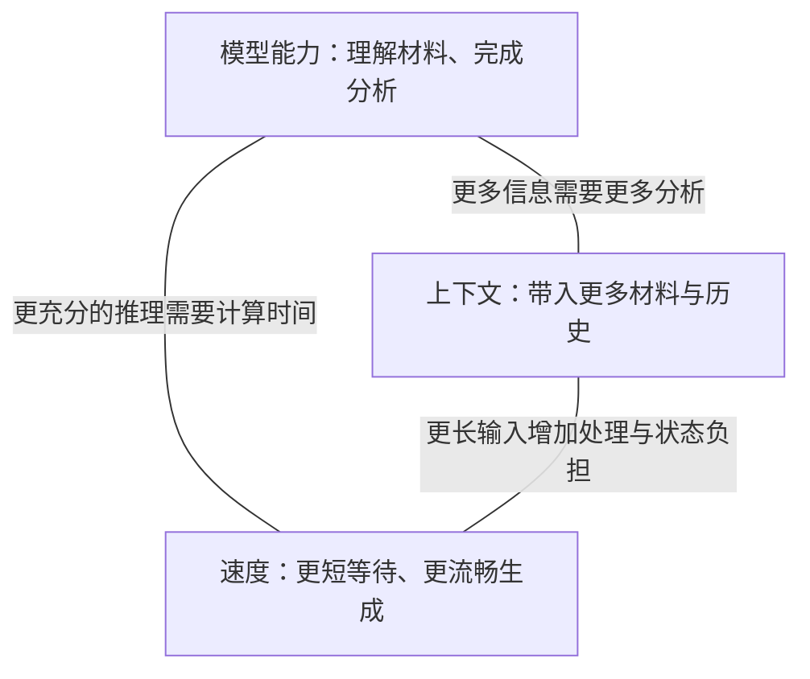

# 第 1 页｜公司本地部署 LLM：模型、运行环境与成本

实习研究汇报

从金融工作的需要出发，解释当前部署选择及其依据。

2026 年 10 月 23 日

模型资料与模型能力评测更新至 10 月 23 日；硬件预算采用 10 月 12 日研究基线。

---

# 第 2 页｜从工作需要走到部署选择

| 章节 | 本章要展开的问题 | 页码 |
| --- | --- | --- |
| 一、从金融工作看本地部署需求 | 哪些工作值得交给 LLM？ | 3–7 |
| 二、一项分析任务对模型提出什么要求 | 上下文、模型能力、速度怎样影响体验？ | 8–15 |
| 三、怎样选出适合当前工作的模型 | 比较什么，为什么这样选？ | 16–23 |
| 四、运行环境怎样影响使用体验 | 一次请求怎样运行，又怎样继续下一轮？ | 24–35 |
| 五、为需要的性能准备多少资源 | 一台设备支持这些工作，三年要投入多少？ | 36–41 |
| 六、把部署方案接回日常工作 | 同事如何使用，接下来验证什么？ | 42–46 |

---

# 第 3 页｜第一章：从金融工作看本地部署需求

先看同事会把哪些工作交给 LLM，再看这些工作需要怎样的使用环境。

---

# 第 4 页｜LLM 可以怎样参与资料处理

LLM，也就是大语言模型，能够根据我们提供的问题和资料，参与阅读、归纳、分析和文字形成。

```text
资料与任务要求
    ↓
寻找相关信息 → 组织关系与解释 → 形成文字或结构化结果
    ↓
同事核对依据，决定怎样使用
```

它可以从公告中整理日期、主体和金额，也可以比较几份材料中的不同说法。明确的任务和交付要求，让这些能力落到一项可以检查的工作上。

---

# 第 5 页｜前台、中台、后台有哪些具体用法

**投研：把分散信息组织成研究线索。** 易方达参与的 MENTOR 研究，以中文文章和英文财经新闻为材料，依次识别热点事件、推演后续事件，再形成行业排序。这个公开研究原型展示了文本信息进入投研分析的一条路径。

**合规：在初稿阶段给出修改意见。** 盈米的内容合规审查 Skill 接收文本或文档，返回风险位置、理由和修改建议。内容作者据此修改，再将稿件交给合规人员终审。

**技术支持：在开发与测试中使用模型。** 易方达在协会发布的云平台案例中，披露将大模型接入开发、测试环节。研发人员围绕代码和测试获得辅助，产物继续进入既有交付流程。

---

# 第 6 页｜应用走进公司后，需要安排什么

公开新闻、财报与内部研究文件，对使用环境的要求并不相同。工具开始帮助同事完成工作，也就开始接触不同范围的资料。

| 使用中会遇到的问题 | 需要明确的安排 |
| --- | --- |
| 谁可以使用这项能力？ | 身份、用户范围与使用入口 |
| 本次任务可以读什么？ | 文件权限、资料来源与可访问范围 |
| 结果怎样进入后续工作？ | 引用、复核和交付流程 |
| 模型在哪里运行？ | 运行位置、服务连接与维护责任 |

这些安排让工具能够进入日常工作。安全与合规也落实在这些具体条件之中。

---

# 第 7 页｜本地部署让公司能够管理运行环境

公司的需求，是在自己掌握的环境中使用 LLM 的能力。

本地部署把模型放到公司管理的设备上，便于安排运行位置、服务连接和资源使用。身份与权限系统决定同事可以读取哪些资料，应用流程组织结果的复核与交付。

这次研究围绕其中三个相互关联的选择展开：**用什么模型，怎样把它运行起来，以及为此准备多少资源。**

要理解这些选择，可以先看看模型怎样完成一项大家熟悉的任务。

---

# 第 8 页｜第二章：一项分析任务对模型提出什么要求

把一份财报交给本地模型，看看从提供材料到得到解释之间发生什么。

---

# 第 9 页｜请模型解释收入和利润为什么变化

> 请阅读这份公司的财报，解释本期收入和利润变化的主要原因，并指出各项判断的依据。

一份有用的回答，需要把几件事连起来：先读对数字和单位，再区分本期、上期以及可比口径，最后用财报正文和附注支撑原因解释。

| 要交付的内容 | 同事怎样核对 |
| --- | --- |
| 主要收入、利润及变化 | 回到对应报表，检查数字、期间和单位 |
| 变化原因及相关业务 | 查看管理层解释、分部信息和必要附注 |
| 判断依据 | 打开引用位置，检查解释与原文的关系 |

---

# 第 10 页｜本地部署通常从已经训练好的模型开始

模型在训练中形成处理语言和完成任务的能力，这些能力保存在大量数值参数中。部署时，我们通常取得已经训练好的模型，把参数加载到自己的设备上运行。

**参数提供已有能力，眼前的材料提供本次任务的信息。**

我们把财报与问题交给模型，它就可以运用已有能力，围绕这份材料组织回答。不同模型的结构、训练与运行方式，也会影响这项工作的结果。

---

# 第 11 页｜眼前的财报和问题怎样进入这次回答

本次提供的材料、问题，以及需要保留的对话历史，构成模型可使用的**上下文**。模型利用这些信息生成回答，这个运行过程叫作**推理**。

```text
系统要求 + 财报内容 + 用户问题 + 已有对话
                    ↓
              已训练好的模型
                    ↓
       收入与利润变化、原因解释、原文依据
```

沿着这次任务，会自然出现三个要求：

**财报和相关附注要放得下；模型要能读懂并解释；同事希望尽快拿到结果。**

这三个要求分别对应上下文、模型能力和速度，也构成了模型选型的核心。

---

# 第 12 页｜固定资源下的“不可能三角”



**给定硬件、并发规模和运行方式，三项要求使用同一份内存与计算预算。**

材料增加，设备需要处理并保留更多信息；给难题分配更多思考步骤，或者采用计算量更大的候选模型，每项任务就会占用更多资源。此时再要求更短等待，留给每项工作的时间便更紧。

所以，选型需要决定资源优先用在哪里：当前工作最需要带入多少材料、完成怎样的分析，以及接受多长等待。

---

# 第 13 页｜上下文决定一次任务能带入多少信息

上下文窗口容纳本次任务的材料与过程。对于财报分析，它包括问题、报表、附注，也包括后续补充的资料和已经形成的讨论。

```text
上下文窗口
┌──────────────────────────────────────────┐
│ 系统要求 │ 材料与附注 │ 历史与工具结果 │ 本轮生成 │
└──────────────────────────────────────────┘
```

输入和输出通常按 **token** 计量。Token 是模型处理文本的片段，可能对应字、词或部分字符。

窗口较长，便于把更多相关材料放在一起，保留较完整的工作过程。实际安排时，要给后续生成留出空间，让分析能够继续展开。

---

# 第 14 页｜模型能力：怎样把材料变成分析

同样一份财报，可以提出深浅不同的工作要求。

| 要完成的工作 | 模型需要怎样使用材料 |
| --- | --- |
| 整理收入与利润 | 找到对应表格，识别数字、单位与期间 |
| 解释本期变化 | 联系业务、费用和附注，组织有依据的原因 |
| 比较不同公司的表现 | 对齐口径，识别差异，说明差异的意义 |
| 形成可交付的分析 | 组织比较表、计算结果、文字与引用 |

任务越往下展开，越需要模型把多个步骤连起来。我们评价模型能力，就要看它最终能把这项工作做到什么程度。

---

# 第 15 页｜速度决定这项工作怎样进入日常节奏

```text
提交材料 ── 等待首次输出 ── 开始看到内容 ── 持续生成 ── 本轮完成
```

**首次输出时间**影响交入材料后多久能开始跟进。

**生成速度**影响内容出现得有多快，通常用 token/s 表示；输出长度则决定这一段持续多久。

完整任务还可能包含工具计算、补充资料和几轮修改。短问答适合边问边看，较长分析可以先提交，再在其他工作之间回来检查结果。模型与运行环境的选择，会决定哪种节奏更合适。

---

# 第 16 页｜第三章：怎样选出适合当前工作的模型

先明确工作真正需要什么，再比较候选模型能提供什么。

---

# 第 17 页｜先把工作需要写成选型条件

本次研究区分个人工作与公司共享服务，两者使用同一组评价维度，工作规模有所不同。

| 维度 | 个人工作／小组 | 公司共享长任务 |
| --- | --- | --- |
| 上下文 | 131K、262K为基础档，继续研究512K／1M | 长材料和多轮任务按每会话1M设计 |
| 模型能力 | 文档整理、多文档分析、代码与文件辅助 | 联系长材料、调用工具并完成多步工作 |
| 速度目标 | 单人生成约20 token/s | 20路活动请求，每路约20 token/s |
| 部署设备 | 一台DGX Spark，128GB统一内存 | 一台八GPU服务器 |

131K、262K、512K分别指131,072、262,144、524,288总tokens；1M指1,000,000。各档留8,192 tokens给本轮生成，剩余空间用于材料与历史。

---

# 第 18 页｜围绕工作要求组织比较

个人设备采用Qwen3.8-27B，公司服务器的主力模型采用 **DeepSeek-V4.1-Flash-1017**。

| 要回答的问题 | 使用的依据 |
| --- | --- |
| 模型能把专业工作做到什么程度？ | GDPval-AA对完整交付物的评价 |
| 工作需要的材料怎样带入？ | 模型窗口与任务长度预算 |
| 同事使用时会等多久？ | 对应设备上的输入处理与生成测量 |

下面先看窗口，再看模型能力，最后把设备体验带进来，说明这两项选择的依据。

---

# 第 19 页｜把材料、历史和输出放进窗口预算

| 模型 | 上下文配置 | 对工作安排的意义 |
| --- | --- | --- |
| Qwen3.8-27B | 原生262,144 tokens；提供扩展至1,000,000的配置 | 个人任务从262K起步，长任务继续扩展 |
| DeepSeek-V4.1-Flash-1017 | 官方建议上下文为1M tokens | 为长材料和连续多轮过程安排空间 |

以262K为例，预留8,192 tokens给本轮生成后，材料和历史可以使用 **253,952 tokens**。

我们可以据此安排任务：先放入相关材料，保留有用的工作过程，再根据分析需要追加信息。接着看模型怎样把这些信息变成工作产物。

---

# 第 20 页｜GDPval-AA 评价模型能交付怎样的工作

GDPval-AA v2.1 使用 **220 项专业工作任务**，覆盖 **44 种职业、9 个行业**。Artificial Analysis 让模型在 Stirrup 任务环境中使用文件、代码和网页工具，完成文档、表格、幻灯片或图示。

例如，网页展示的一项任务要求模型根据五位乐队成员的设备与监听需求，制作一页舞台布置 PDF，并列清输入输出及设备编号。

```text
工作要求与参考资料
        ↓
读文件、查资料、运行工具、制作产物
        ↓
提交完整文件
        ↓
同一任务的两份产物匿名比较 → 汇总为 Elo 评分
```

评分越高，表示模型在这些工作交付物的比较中越占优势。这与我们的选型问题相接：交给模型一项任务后，它能否把资料、操作和结果组织成同事需要的产物。

---

# 第 21 页｜专业工作表现支持服务器主力模型的选择

**GDPval-AA v2.1，2026年10月23日读取；Elo越高，工作交付表现越强。**

| 开放权重模型／AA推理标签 | Elo |
| --- | ---: |
| **DeepSeek-V4.1-Flash-1017／Max** | **1,746** |
| GLM-5.3-Flash | 1,642 |
| MiMo-V2.6-Flash | 1,607 |
| Kimi K3／Max | 1,533 |
| Qwen3.8-27B／Xhigh | 1,417 |
| Gemma 4 31B／Reasoning | 620 |

DeepSeek-V4.1-Flash-1017在这组开放权重模型中排名首位。它同时提供1M上下文、开放权重和MIT许可，适合成为公司本地服务器的主力模型。

Qwen27则兼顾个人设备的资源条件与工作交付能力，接下来结合Spark上的实际体验来看。

---

# 第 22 页｜Qwen27 在个人设备上用起来有多快

单台 DGX Spark 的外部测试，给出了 Qwen27 的具体体验参照。

| 实际输入 tokens | 每次输出 tokens | 首次输出等待 | 后续生成速度 |
| ---: | ---: | ---: | ---: |
| 50,000 | 2,048 | 63.1 秒 | 21.01 token/s |
| 100,000 | 2,048 | 144.8 秒 | 20.11 token/s |
| 500,000 | 2,048 | 1,470.1 秒 | 14.82 token/s |

测试采用随机 token 输入、FP8 权重、FP8 KV 缓存和 MTP3 推测生成，前缀缓存关闭。50K、100K 各两次，500K 一次；数据来自用户提供的外部设备测试汇总。

50K–100K 输入下，单人生成接近 20 token/s 的目标。到 500K，首次等待约 24.5 分钟，生成约 15 token/s，长材料更适合提前提交和分阶段处理。

---

# 第 23 页｜两种使用规模，对应两项模型选择

**个人工作与知识问答：Qwen3.8-27B。** GDPval-AA提供工作交付能力依据，262K原生窗口覆盖基础长度档，Spark测量给出了单人使用体验。它适合先承接文档、文件与代码辅助工作。

**公司服务器主力：DeepSeek-V4.1-Flash-1017。** 专业工作表现、1M上下文和本地运行方式共同支持这项选择。围绕它安排一台服务器的资源、请求处理和使用入口。

接下来，沿着一次请求看运行环境怎样把模型组织成持续可用的服务。

---

# 第 24 页｜第四章：运行环境怎样影响使用体验

从服务启动到一轮回答，再到同事继续工作，沿着请求的路径看每一步需要什么。

---

# 第 25 页｜一项任务怎样经过本地服务

```text
服务启动：加载模型，准备会话与计算空间
                         ↓
同事提交材料 → 处理输入 → 持续生成 → 返回本轮结果
                         ↑                 ↓
                         └── 新问题／工具结果 ──┘
                              继续下一轮
```

模型持续留在设备上，一项任务可以反复经过输入和生成两个阶段。每轮产生的结果，又成为后续工作的基础。

先从图中最上方开始：服务接到任务之前，要把模型和工作空间准备好。

---

# 第 26 页｜服务启动时，要给模型和会话留出空间

模型加载以后，设备还要保存同事的任务状态，并为计算留出空间。

| 服务中要保留什么 | 在请求过程中做什么 |
| --- | --- |
| 模型参数 | 提供每次输入处理与生成所用的模型能力 |
| 会话状态 | 保存已经处理的历史，供后续生成和下一轮使用 |
| 执行空间 | 容纳临时计算、运行图和推测生成的草稿网络 |

其中，**KV缓存**保存注意力计算中可以重复使用的历史表示。Qwen27还保存递推状态，它们共同帮助模型接着已有内容往下处理。

这些空间准备好后，同事提交的材料就进入图中的第一个请求环节：处理输入。

---

# 第 27 页｜材料提交后，先把输入处理好

输入处理阶段称为 **prefill**。服务把材料转成模型能够使用的表示，并建立后续生成需要的状态。

材料变长，处理工作随之增加。全注意力层需要联系前后内容；模型中的稀疏或递推结构，则以各自的方式组织信息。

```text
提交材料 ── 排队与状态准备 ── 处理输入 ── 首个输出
             └──────── 首次输出等待 ────────┘
```

Spark的500K输入首次等待约24.5分钟，完整读入长材料是其中的重要部分。首个输出出现后，服务进入持续生成阶段。

---

# 第 28 页｜回答开始之后，模型逐步生成内容

后续生成阶段称为 **decode**。新生成的内容成为下一步的条件，模型继续生成，直到本轮结束。

低并发时，设备需要为少量新输出反复读取权重和历史状态，内存带宽经常影响速度。历史增长，也会改变每一步需要访问的内容。

推测生成先提出几个后续token，再由目标模型一起验证，让一次计算推进更多内容。Spark测试中的MTP3采用了这一思路。

**生成速度和输出长度，共同决定这一段持续多久。**

若保持20 token/s，生成8,192 tokens约需 **410秒，即6.8分钟**。完整一轮的等待，还要加上前面的输入处理时间。

---

# 第 29 页｜把两段等待放回一次长材料任务

同一台Spark、同一组设置下，输入长度增加，两段时间发生了不同幅度的变化。

| 实际输入tokens | 首次输出等待（分钟） | 后续生成速度（token/s） |
| ---: | ---: | ---: |
| 50,000 | 1.1 | 21.01 |
| 100,000 | 2.4 | 20.11 |
| 300,000 | 11.0 | 17.23 |
| 500,000 | 24.5 | 14.82 |

各次输出2,048 tokens，前缀缓存关闭；前两档各两次，后两档各一次。

从100K到500K，最明显的变化是首次读入更久，后续生成也逐步变慢。长任务往往还会继续追加问题和工具结果，已经花时间处理过的历史，就值得保留下来。

---

# 第 30 页｜同一项任务继续时，沿用已经处理的历史

下一轮通常包含旧材料、前面的回答，以及新增加的问题或工具结果。

```text
第一轮：旧材料 ── 处理 ──→ 保存历史状态
                              ↓
下一轮：匹配的旧前缀 ── 复用 ──┼── 新问题／工具结果
                              ↓
                        处理新增部分 → 继续生成
```

**前缀缓存**让服务复用前面已经完成的计算。系统要求和工具定义保持稳定，后续内容追加在末尾，就更容易沿用已有状态。

前面的长度数据说明了这项安排的价值：长材料第一次处理花费较多时间，后续每轮集中处理新增内容，任务衔接会更顺畅。

---

# 第 31 页｜等工具返回时，把会话状态保存在哪里

模型生成一段代码后，工具开始运行；计算结果回来，模型才继续下一轮。工具运行期间，原会话的历史仍需要保留。

| 距离下一次使用有多近 | 状态怎样安排 |
| --- | --- |
| 正在生成或马上继续 | 留在快速工作内存中，便于直接使用 |
| 暂时等待工具 | 保存到合适的主机内存区域，按需恢复 |
| 较长时间闲置 | 转存到NVMe SSD，为其他会话释放工作空间 |

独立GPU服务器可以在显存、主机内存和SSD之间安排状态；Spark的CPU与GPU共用统一内存，SSD提供下一层容量。

保存完整、兼容的会话状态，可以把再次读入旧材料的工作变成恢复。此时，同一台服务也能继续处理其他同事的请求。

---

# 第 32 页｜其他同事进入时，怎样安排同一台服务

一位同事正在生成，另一位刚提交长材料，还有人等待工具返回。调度器需要为这些不同阶段分配运行时间。

Spark三路请求同时提交，各生成4,096 tokens：

| 每路输入 | 三路共同生成的总速度 | 共同窗口每路平均 | 各请求完整生成阶段平均 |
| ---: | ---: | ---: | ---: |
| 50,000 tokens | 59.08 token/s | 19.69 token/s | 16.85 token/s |
| 100,000 tokens | 52.41 token/s | 17.47 token/s | 12.45 token/s |

共同窗口取三路都在输出的时段；完整阶段也包含其他请求处理输入带来的等待。

合批提高设备利用率，分块处理长输入则给正在生成的请求留下继续运行的机会。共享服务要同时安排这两件事：让设备持续工作，也让每位同事及时看到进展。

---

# 第 33 页｜主力模型怎样处理共享服务中的长任务

**DeepSeek-V4.1-Flash-1017**的运行结构，对应了前面几项资源需要。

```text
长输入 → 编码器整理信息 → 压缩、共享的历史表示 → 解码器生成

主机中的Engram参数表 ── 按需查找 ──→ GPU上的模型计算
```

输入处理与生成采用不同的计算路径；历史表示经过压缩，并在层之间共享，减少长会话的重复保存。生成时通过稀疏索引选择相关历史，组织需要读取的信息。

Engram是模型参数中的大型查找表，可以安排在主机内存，按需向GPU提供结果。1017发布制品约510GB，其中这部分表及尺度约203GB。

这些结构使模型、主机内存与GPU能够分工，为一台服务器运行长任务提供基础。

---

# 第 34 页｜推理框架把前面的环节组织起来

框架承担的是整条请求路径上的工作。

| 已经走过的环节 | 框架要组织什么 |
| --- | --- |
| 服务启动 | 按模型格式加载参数，安排GPU与主机内存 |
| 处理输入 | 组织计算，把长输入分块调度 |
| 持续生成 | 管理生成步骤、工具调用输出和推测生成 |
| 继续下一轮 | 查找可复用前缀，恢复相应会话状态 |
| 多人使用 | 合批、排队和分配缓存空间 |

本方案以 **vLLM** 组织DeepSeek-V4.1-Flash-1017的单机服务，固定模型修订、引擎版本、驱动和运行参数。SGLang可承担相同的服务职责，作为框架层面的对照。

比较框架时，使用同一台设备和同一批任务，观察首次等待、连续生成、多人调度与恢复过程。

---

# 第 35 页｜把这些环节放进一台服务器

```text
同事的任务入口
      ↓
一台服务器
┌─────────────────────────────────────────────┐
│ vLLM请求队列                                 │
│       ↓                                     │
│ 8张H200共同运行DeepSeek-V4.1-Flash-1017         │
│       ↕                                     │
│ 主机内存与SSD：参数表、会话状态、任务文件        │
│       ↕                                     │
│ 同机隔离工具环境：计算、文件处理与结果回传       │
└─────────────────────────────────────────────┘
```

八张GPU通过机内互联共同计算一套模型；服务器的CPU、主存和SSD支持参数查找、状态保存与工具工作。

服务按20路活动任务安排，每路20 token/s的目标对应总输出400 token/s。验证过程覆盖首次长输入、下一轮续跑、工具等待和多人同时工作。

到这里，运行方案已经完整。接下来算一算，支持这样的日常工作，一台设备需要多少投入。

---

# 第 36 页｜第五章：为需要的性能准备多少资源

从每天要完成的工作开始，看看一台设备的购买、实施和持续运行需要准备多少钱。

---

# 第 37 页｜这台设备每天要支持多少工作

先把使用规模换成同事熟悉的工作量。

| 使用情况 | 第一年每天的任务 | 后续增长安排 | 三年计划任务量 |
| --- | --- | --- | ---: |
| 个人工作 | 1人，每天3项 | 每年增长10% | 约2,483项 |
| 公司共享 | 20人，每人每天5项 | 每年增长25% | 约95,313项 |

每年按250个工作日计算。公司第一年每天100项，全年就是25,000项；第二、三年随着使用深入，分别安排约31,250项和39,063项。

一项工作从读取资料开始，经过工具计算、补充和修改，最后形成交付物。预算先为每项任务安排8轮模型调用，并准备10%的额外轨迹用于修改与重试。

接着看，这两种使用规模分别对应怎样的一台设备。

---

# 第 38 页｜个人与公司共享，分别用怎样的一台设备

| | 个人工作 | 公司共享 |
| --- | --- | --- |
| 模型 | Qwen3.8-27B | DeepSeek-V4.1-Flash-1017 |
| 设备 | 一台DGX Spark | 一台八H200服务器 |
| 模型计算与工作内存 | 128GB统一内存 | 8张H200，每张141GB显存，机内NVSwitch互联 |
| 主机与存储 | 4TB NVMe SSD | 双路CPU、1536GB主存与NVMe SSD |
| 主要用途 | 单人交互、文件和代码工作 | 多人共享长任务、状态保存与同机工具运行 |
| 硬件预算 | **5.8–6.2万元** | **291–304万元** |

公司方案增加的资源对应两件事：运行主力模型，以及同时保存和处理多人的任务。GPU承担主要计算，主机内存放置参数表和会话状态，SSD保存文件与较长时间闲置的状态。

以上为10月12日硬件研究预算。设备价格进入总成本后，还要继续加上部署和日常维护。

---

# 第 39 页｜买下设备以后，三年还要投入什么

部署需要安装、接入和验证；日常使用需要升级、维护、电力和运行空间。把这些工作与购机一起计入，才能看见完整投入。

**中等工作量，三年预算；单位：万元，金额取约数。**

| 费用组成 | 个人Spark | 公司单台八H200 |
| --- | ---: | ---: |
| 硬件及机房接入 | 6.01 | 300.36 |
| 初次实施 | 1.50 | 11.25 |
| 三年技术运维 | 1.50 | 45.00 |
| 电力、机位与软件支持 | 0.03 | 17.04 |
| **合计** | **约9.05** | **约373.66** |

个人实施按6人天、年运维2人天，公司实施45人天、年运维60人天；技术人力按2,500元／人天预算。

公司总额中，GPU整机约297.36万元，占约80%。购机是主要投入，后续运维则决定这项服务怎样持续提供给同事。

---

# 第 40 页｜相同工作通过API完成，费用怎样比较

API通过网络按模型调用量收费。一次任务的输入、历史复用和输出，分别进入相应的价格。

本次8轮任务预算，首轮输入100K，之后每轮新增8K资料，每轮生成2K内容；累计提交1.08M输入、生成16K输出。缓存命中的旧历史按较低费率计价。

| 相同计划工作量 | 本地三年预算 | DeepSeek-V4.1-Flash-1017 API三年预算 |
| --- | ---: | ---: |
| 个人约2,483项 | 9.05万元 | 1.66万元 |
| 公司约95,313项 | 373.66万元 | 49.46万元 |

API栏同样计入接入、技术运维与平台支持，使用已有应用资源和员工终端。预算使用获准的资料范围、95%可复用前缀命中、80%高峰时段和7.00汇率。

这些工作量下，按调用购买服务的支出更低。本地投入则同时获得模型、资料处理和运行环境的控制权，选择需要结合这些实际用途。

---

# 第 41 页｜让一台设备的投入对应到实际工作价值

同一台服务器，主要投入在开始使用时发生。任务越充分，每项工作分摊的费用越低。

| 公司使用情况 | 三年计划任务 | 同一台八H200的三年预算 | 每项计划任务预算 |
| --- | ---: | ---: | ---: |
| 20人各每天2项，工作量稳定 | 30,000项 | 372.82万元 | 124.27元 |
| 20人首年各每天5项，每年增25% | 约95,313项 | 373.66万元 | 39.20元 |

因此，部署前要找到会持续使用的工作：哪些材料需要留在公司环境，哪些步骤反复发生，哪些产物能让同事直接检查和使用。

实际运行中，记录合格产物、完整任务时间和人工复核时间。将每项任务的费用与同事节省的时间放在一起，就能判断这台设备是否用在了值得投入的工作上。

---

# 第 42 页｜第六章：把部署方案接回日常工作

模型与运行环境准备好之后，同事从哪里使用，又怎样接入工作需要的资料？

---

# 第 43 页｜同事怎样使用这项本地服务

使用入口跟着工作方式安排。

```text
个人文件与代码工作
员工电脑上的OpenCode／文件工具 → Spark模型服务 → 结果回到工作目录

公司共享任务
浏览器入口 → 身份与任务管理 → 单台服务器上的任务执行层
                                  ├→ 主力模型服务
                                  └→ 同机隔离工具环境
```

任务执行层组织模型与工具的多轮工作：模型提出操作，工具返回结果，模型再继续处理。

个人工具操作员工电脑上的工作文件；共享任务在服务器获得授权的目录中执行。入口、执行位置和资料范围一起构成完整的使用路径。

---

# 第 44 页｜工作需要的资料和工具怎样接进来

公司知识库先找到与问题有关、且当前用户有权读取的内容，再交给模型回答。这种方式称为检索增强生成，通常简称 **RAG**。

```text
用户身份与问题
    ↓
在获准范围内检索资料 → 授权过滤 → 重排相关片段
    ↓
模型根据片段回答 → 同事打开引用，核验对应资料
```

平台路线可以比较 Onyx Enterprise 与 Milvus＋自建 RAG 服务＋Open WebUI。前者集中提供企业知识平台能力，后者由团队组合并维护检索、权限和应用。两条路线都围绕 NAS 身份、访问范围和撤权更新接入资料。

工具还可以提供文件读取、计算和代码执行。Skills 保存可复用的操作说明，MCP 等接口连接外部工具，让同事通过一个任务入口组织这些能力。

---

# 第 45 页｜用实际产物验证这套选择

从有明确产物的工作开始，可以逐步积累公司自己的使用依据。

| 验证工作 | 交付与检查方式 | 帮助决定什么 |
| --- | --- | --- |
| 公告字段整理 | 字段表与出处，检查主体、日期、金额和覆盖情况 | 第一批文档工作的范围 |
| 研究代码辅助 | 可复跑的修改、测试与结果文件 | 模型与工具的配合方式 |
| 财报比较 | 数字、期间、口径、计算文件与引用 | 共享模型带来的质量收益 |
| 权限知识问答 | 按身份检查检索和引用，测试撤权更新 | 公司资料接入范围 |

同时记录首次等待、生成停顿、完整任务时间、重试和人工复核。长任务覆盖 512K／1M、真实推测接受率，以及多人使用时长输入带来的调度变化。

这些记录将进入下一轮模型、框架与资源配置的判断。

---

# 第 46 页｜回到公司的本地部署需求

这次研究把本地部署整理成了一组相互衔接的选择。

**模型方面，**个人工作采用Qwen3.8-27B，服务器主力采用DeepSeek-V4.1-Flash-1017。GDPval-AA、上下文和资源条件支持这两项选择。

**运行环境方面，**从服务启动沿着输入、生成、下一轮和多人调度展开，再由推理框架把这些环节组织成一台持续运行的服务。

**投入方面，**先明确日常工作量，再选择设备，计算购买、实施与三年运行费用，让预算对应到同事实际完成的工作。

下一步，用明确的任务产物检查模型能力和使用体验，记录等待、复核与净节省时间，为公司的本地服务建立实际依据。
