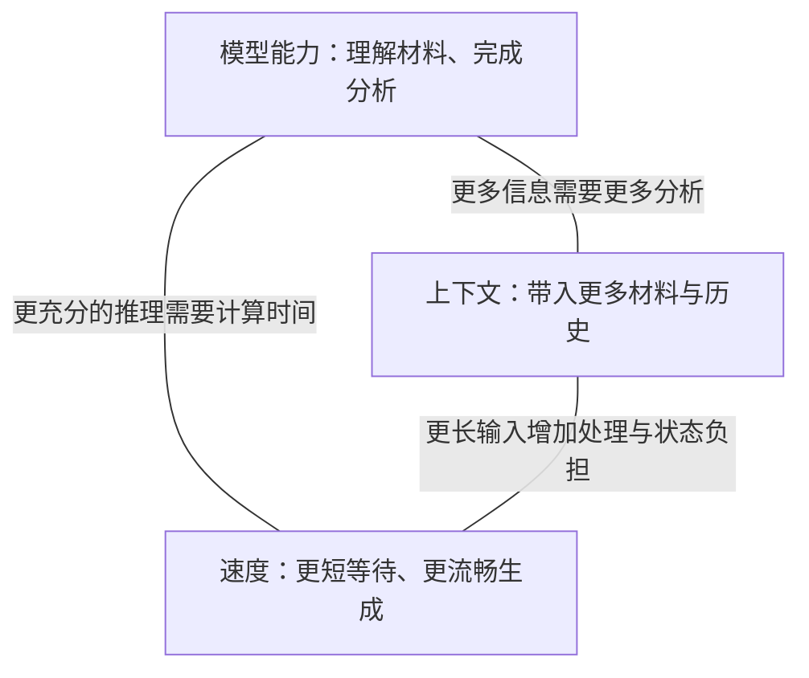

# 第 1 页｜公司本地部署 LLM：模型、运行环境与成本

实习研究汇报

从金融工作的需要出发，解释当前部署选择及其依据。

2026 年 10 月 23 日

---

# 第 2 页｜从工作需要走到部署选择

| 章节 | 本章要展开的问题 | 页码 |
| --- | --- | --- |
| 一、从金融工作看本地部署需求 | 哪些工作值得交给 LLM？ | 3–7 |
| 二、一项分析任务对模型提出什么要求 | 上下文、模型能力、速度怎样影响体验？ | 8–15 |
| 三、怎样选出适合当前工作的模型 | 比较什么，为什么这样选？ | 16–24 |
| 四、运行环境怎样影响使用体验 | 一次请求怎样运行，又怎样继续下一轮？ | 25–37 |
| 五、为需要的性能准备多少资源 | 一台设备支持这些工作，三年要投入多少？ | 38–44 |
| 六、把部署方案接回日常工作 | 同事如何使用，接下来验证什么？ | 45–49 |

---

# 第 3 页｜第一章：从金融工作看本地部署需求

先看同事会把哪些工作交给 LLM，再看这些工作需要怎样的使用环境。

---

# 第 4 页｜LLM 可以怎样参与资料处理

LLM，也就是大语言模型，能够根据我们提供的问题和资料，参与阅读、归纳、分析和文字形成。

```text
资料与任务要求
    ↓
寻找相关信息 → 组织关系与解释 → 形成文字或结构化结果
    ↓
同事核对依据，决定怎样使用
```

它可以从公告中整理日期、主体和金额，也可以比较几份材料中的不同说法。明确的任务和交付要求，让这些能力落到一项可以检查的工作上。

---

# 第 5 页｜前台、中台、后台有哪些具体用法

**投研：把分散信息组织成研究线索。** 易方达参与的 MENTOR 研究，以中文文章和英文财经新闻为材料，依次识别热点事件、推演后续事件，再形成行业排序。这个公开研究原型展示了文本信息进入投研分析的一条路径。

**合规：在初稿阶段给出修改意见。** 盈米的内容合规审查 Skill 接收文本或文档，返回风险位置、理由和修改建议。内容作者据此修改，再将稿件交给合规人员终审。

**技术支持：在开发与测试中使用模型。** 易方达在协会发布的云平台案例中，披露将大模型接入开发、测试环节。研发人员围绕代码和测试获得辅助，产物继续进入既有交付流程。

---

# 第 6 页｜应用走进公司后，需要安排什么

公开新闻、财报与内部研究文件，对使用环境的要求并不相同。工具开始帮助同事完成工作，也就开始接触不同范围的资料。

| 使用中会遇到的问题 | 需要明确的安排 |
| --- | --- |
| 谁可以使用这项能力？ | 身份、用户范围与使用入口 |
| 本次任务可以读什么？ | 文件权限、资料来源与可访问范围 |
| 结果怎样进入后续工作？ | 引用、复核和交付流程 |
| 模型在哪里运行？ | 运行位置、服务连接与维护责任 |

这些安排让工具能够进入日常工作。安全与合规也落实在这些具体条件之中。

---

# 第 7 页｜本地部署让公司能够管理运行环境

公司的需求，是在自己掌握的环境中使用 LLM 的能力。

本地部署把模型放到公司管理的设备上，便于安排运行位置、服务连接和资源使用。身份与权限系统决定同事可以读取哪些资料，应用流程组织结果的复核与交付。

这次研究围绕其中三个相互关联的选择展开：**用什么模型，怎样把它运行起来，以及为此准备多少资源。**

要理解这些选择，可以先看看模型怎样完成一项大家熟悉的任务。

---

# 第 8 页｜第二章：一项分析任务对模型提出什么要求

把一份财报交给本地模型，看看从提供材料到得到解释之间发生什么。

---

# 第 9 页｜请模型解释收入和利润为什么变化

> 请阅读这份公司的财报，解释本期收入和利润变化的主要原因，并指出各项判断的依据。

一份有用的回答，需要把几件事连起来：先读对数字和单位，再区分本期、上期以及可比口径，最后用财报正文和附注支撑原因解释。

| 要交付的内容 | 同事怎样核对 |
| --- | --- |
| 主要收入、利润及变化 | 回到对应报表，检查数字、期间和单位 |
| 变化原因及相关业务 | 查看管理层解释、分部信息和必要附注 |
| 判断依据 | 打开引用位置，检查解释与原文的关系 |

---

# 第 10 页｜眼前的财报和问题怎样进入这次回答

本次提供的材料、问题，以及需要保留的对话历史，构成模型可使用的**上下文**。模型利用这些信息生成回答，这个运行过程叫作**推理**。

```text
系统要求 + 财报内容 + 用户问题 + 已有对话
                    ↓
              已训练好的模型
                    ↓
       收入与利润变化、原因解释、原文依据
```

沿着这次任务，会自然出现三个要求：

**财报和相关附注要放得下；模型要能读懂并解释；同事希望尽快拿到结果。**

这三个要求分别对应上下文、模型能力和速度，也构成了模型选型的核心。

---

# 第 11 页｜固定资源下的“不可能三角”



**给定硬件、并发规模和运行方式，三项要求使用同一份内存与计算预算。**

材料增加，设备需要处理并保留更多信息；给难题分配更多思考步骤，或者采用计算量更大的候选模型，每项任务就会占用更多资源。此时再要求更短等待，留给每项工作的时间便更紧。

所以，选型需要决定资源优先用在哪里：当前工作最需要带入多少材料、完成怎样的分析，以及接受多长等待。

---

# 第 12 页｜上下文决定一次任务能带入多少信息

上下文窗口容纳本次任务的材料与过程。对于财报分析，它包括问题、报表、附注，也包括后续补充的资料和已经形成的讨论。

```text
上下文窗口
┌──────────────────────────────────────────┐
│ 系统要求 │ 材料与附注 │ 历史与工具结果 │ 本轮生成 │
└──────────────────────────────────────────┘
```

输入和输出通常按 **token** 计量。Token 是模型处理文本的片段，可能对应字、词或部分字符。

窗口较长，便于把更多相关材料放在一起，保留较完整的工作过程。实际安排时，要给后续生成留出空间，让分析能够继续展开。

---

# 第 13 页｜模型能力：怎样把材料变成分析

同样一份财报，可以提出深浅不同的工作要求。

| 要完成的工作 | 模型需要怎样使用材料 |
| --- | --- |
| 整理收入与利润 | 找到对应表格，识别数字、单位与期间 |
| 解释本期变化 | 联系业务、费用和附注，组织有依据的原因 |
| 比较不同公司的表现 | 对齐口径，识别差异，说明差异的意义 |
| 形成可交付的分析 | 组织比较表、计算结果、文字与引用 |

任务越往下展开，越需要模型把多个步骤连起来。我们评价模型能力，就要看它最终能把这项工作做到什么程度。

---

# 第 14 页｜速度决定这项工作怎样进入日常节奏

```text
提交材料 ── 等待首次输出 ── 开始看到内容 ── 持续生成 ── 本轮完成
```

**首次输出时间**影响交入材料后多久能开始跟进。

**生成速度**影响内容出现得有多快，通常用 token/s 表示；输出长度则决定这一段持续多久。

完整任务还可能包含工具计算、补充资料和几轮修改。短问答适合边问边看，较长分析可以先提交，再在其他工作之间回来检查结果。模型与运行环境的选择，会决定哪种节奏更合适。

---

# 第 15 页｜三个维度，怎样变成实际选择

上下文、模型能力、速度告诉我们要比较什么。真正开始选择时，还需要把它们放进使用场景和设备条件。

| 使用场景 | 选择从哪里开始 | 随后怎样判断 |
| --- | --- | --- |
| 个人日常工作 | 一台容易部署和维护的整机 | 硬件确定后优先模型能力，再看速度是否可以接受 |
| 公司共享服务 | 单台八卡服务器的部署条件 | 把模型能力、运行速度和框架支持放在一起判断 |

接下来沿着这两条路径，看设备与模型怎样逐步选出来。

---

# 第 16 页｜第三章：怎样选出适合当前工作的模型

先看设备怎样使用，再看模型能否把工作做好，最后判断运行体验是否合适。

---

# 第 17 页｜个人方案先从一台省心的整机开始

个人工具需要方便部署，也需要在日常使用中容易维护。因此，我先比较成熟的整机方案，重点看两台设备：

| 整机 | 本次比较的配置 | 使用路径 |
| --- | --- | --- |
| NVIDIA DGX Spark | 128GB统一内存、4TB SSD | NVIDIA软件栈，连接员工电脑使用 |
| Mac Studio，M5 Ultra | 256GB统一内存、2TB SSD | macOS，使用MLX或Metal等本地推理路径 |

整机把计算、内存、散热和系统集成在一起，部署时可以沿厂商提供的方式安装、升级和维护。

下一步要判断，哪台整机更适合这次研究的模型与公司的运行环境。

---

# 第 18 页｜选择Spark，把个人设备接到同一套技术栈

我最终选择 **NVIDIA DGX Spark**，主要考虑三件事。

**所需框架有直接的运行路径。** Spark支持NVIDIA的软件与容器环境，厂商提供vLLM、SGLang等部署指南，方便使用本次研究所需的推理框架。

**与公司服务器共用部署经验。** 个人设备和服务器都沿NVIDIA路线，模型服务接口、框架配置、监控和维护经验可以延续到公司环境。

**整机投入与用途匹配。** 本次Spark配置的研究预算约5.8–6.2万元，M5 Ultra 256GB／2TB配置的调研价格约9.05万元。把购机、框架适配和后续维护一起考虑，Spark对当前用途更有性价比。

硬件确定后，模型就进入 **128GB统一内存** 的资源范围。

---

# 第 19 页｜先选能把工作做好的个人模型

在Spark的容量范围内，我首先看模型能力：能否理解材料、完成分析，并稳定地把多步工作做下去。满足这一要求后，再比较生成速度和运行方式。

GDPval-AA让模型利用文件、代码和网页工具完成专业工作，再比较其交付物。它提供了与这项要求相接的评价依据。

**GDPval-AA v2.1，2026年10月23日读取；Elo越高，工作交付表现越强。**

| 个人候选模型／AA推理标签 | Elo |
| --- | ---: |
| **Qwen3.8-27B／Xhigh** | **1,417** |
| Qwen3.6-35B-A3B／Reasoning | 889 |
| Gemma 4 31B／Reasoning | 620 |

Qwen27在这组候选中模型能力最强，也符合我对稳定使用表现的调研判断，因此成为个人主力。接下来要接受或解决的取舍，是它的生成速度。

---

# 第 20 页｜接受较慢的生成，保留更强的模型能力

模型参数是训练形成、保存在模型里的数值。Qwen27采用稠密架构，每步生成都会用到主体参数。Qwen3.6-35B-A3B则从总计35B参数中选择约3B参与每步计算。两种结构带来的计算负担不同，Qwen27需要为更重的生成过程安排时间。

Spark上的FP8测试给出了实际体验：

| 输入tokens | 输出tokens | 首次输出等待 | 后续生成速度 |
| ---: | ---: | ---: | ---: |
| 50,000 | 2,048 | 63.1秒 | 21.01 token/s |
| 100,000 | 2,048 | 144.8秒 | 20.11 token/s |
| 500,000 | 2,048 | 1,470.1秒 | 14.82 token/s |

外部测量采用FP8权重、FP8缓存、MTP3和随机token输入，前缀缓存关闭；前两档各两次，500K一次。

在50K–100K输入下，约20 token/s的生成速度可以接受。较长材料提前提交，等待完整读入后再继续工作。这个取舍让我保留Qwen27的模型能力，并把速度放进实际使用节奏中安排。

---

# 第 21 页｜服务器方案从一台八卡机器的条件出发

公司服务器要同时承接多人的任务。选择模型时，需要一起看模型能力、推理速度、框架支持，以及模型和会话怎样放进同一台八卡服务器。

调研比较了以下候选。权重文件的体量，先帮助我们理解设备要容纳多大的模型。

| 调研候选 | 当时采用的官方权重制品体量，约GB |
| --- | ---: |
| DeepSeek-V4.1-Flash | 510 |
| MiMo-V2.6-Pro-RL | 566 |
| GLM-5.3-Flash | 328 |
| GLM-5.3 | 756 |
| Kimi K3 | 1,561 |

这一步把候选放回实际部署条件：既要为模型安排空间，也要给用户历史和持续计算留出资源。随后再看哪一种组合能顺畅地提供共享服务。

---

# 第 22 页｜最初选择Flash，是看中它适合这台服务器

当时的主力选择是 **DeepSeek-V4.1-Flash**。

**规模与运行结构适合单机八卡。** 相对更大的候选，Flash的模型体量更容易安排；其中大型Engram参数表可以放在主机内存，压缩与共享历史的设计也有利于长任务。

**速度与框架形成了可用的部署路线。** vLLM、SGLang提供运行路径，公开的多卡运行记录给出速度参照。调研中，我把较快的推理、主流框架支持和可延续的维护方式放在一起考虑。

**模型能力已经足以承担目标工作。** 在这一基础上，Flash形成了模型能力、速度和部署条件之间合适的组合，因此被选为服务器主力。

接着，调研期间发布的新版本，让这条部署路线有了进一步提升。

---

# 第 23 页｜1017发布后，沿既定部署路线更新主力模型

**10月17日，DeepSeek-V4.1-Flash-1017发布。** 它继续采用这条模型架构和部署路线，并提升了专业工作中的表现。

| 版本／AA推理标签 | GDPval-AA v2.1 Elo |
| --- | ---: |
| DeepSeek-V4.1-Flash／Max | 1,600 |
| **DeepSeek-V4.1-Flash-1017／Max** | **1,746** |

上表为2026年10月23日对这两个版本的评价。1017的1,746分在本轮考察的开放模型中领先，使它成为最终主力。

因此，服务器方案自然更新为 **DeepSeek-V4.1-Flash-1017**：保留已经形成的单机八卡部署方向，采用更新的模型能力。

---

# 第 24 页｜两项最终选择，各自有清楚的取舍

```text
个人：先选成熟整机
  → Spark与公司NVIDIA技术栈衔接
  → 128GB统一内存范围内优先模型能力
  → Qwen3.8-27B，接受约20 token/s的常用输入生成体验

服务器：从单台八卡部署条件出发
  → 原Flash兼顾规模、速度、框架与模型能力
  → 1017发布后更新
  → DeepSeek-V4.1-Flash-1017作为最终主力
```

模型与设备的选择已经落定。接下来沿着一次请求，看运行环境怎样把它们组织成同事可以持续使用的服务。

---

# 第 25 页｜第四章：运行环境怎样影响使用体验

先理解共同的运行过程，再分别看个人设备的实测和公司服务器的安排。

---

# 第 26 页｜模型、推理框架和设备，各自在做什么

| 层次 | 它负责的事情 |
| --- | --- |
| 模型 | 理解输入，生成回答或工具请求 |
| 推理框架 | 加载模型，组织计算、缓存与请求调度 |
| 硬件设备 | 提供计算、内存、存储与连接 |

```text
服务启动：框架加载模型，准备工作空间
                         ↓
提交材料 → 处理输入 → 持续生成 → 返回本轮结果
                         ↑                 ↓
                         └── 新问题／工具结果 ──┘
```

这一部分先沿共同流程展开。vLLM这样的推理框架，负责把每个环节接成持续运行的服务。

---

# 第 27 页｜服务启动时，先安排模型和工作空间

模型加载以后，设备还要保存任务状态，并为实际计算留出空间。

| 要保留的内容 | 在请求过程中有什么用 |
| --- | --- |
| 模型参数 | 供每次输入处理与生成使用 |
| 会话状态 | 保存已处理的历史，支持生成和下一轮继续 |
| 执行空间 | 容纳临时计算、运行图和推测生成的草稿网络 |

**KV缓存**保存注意力计算中可以重复使用的历史表示。有些模型还需要保存其他状态，这些内容共同构成一项任务的计算现场。

工作空间准备好后，本次提交的材料就开始进入模型。

---

# 第 28 页｜材料提交后，先处理输入

输入处理阶段称为 **prefill**。模型把材料转成后续生成可以使用的表示，框架在这个过程中建立相应的会话状态。

```text
提交材料 ── 排队与状态准备 ── 处理输入 ── 首个输出
             └──────── 首次输出等待 ────────┘
```

材料增加，需要处理的信息和前后关系也随之增加。首次输出的等待，便与本轮实际输入、已有状态和请求队列联系起来。

首个输出出现后，任务进入持续生成阶段。

---

# 第 29 页｜回答开始之后，模型逐步生成内容

后续生成阶段称为 **decode**。新生成的内容成为下一步的条件，模型继续生成，直到本轮结束。

设备反复读取模型参数和历史状态，完成每一步计算。低并发时，内存带宽经常影响这一段的速度。

推测生成会先提出几个后续token，再由目标模型一起验证，让一次计算推进更多内容。

**生成速度和输出长度，共同决定这一段持续多久。** 若保持20 token/s，生成8,192 tokens约需410秒，即6.8分钟。再加上前面的输入处理，就得到这一轮的主要等待。

---

# 第 30 页｜下一轮继续时，复用已经处理的历史

一项任务往往会继续补充资料、调用工具和修改结果。下一轮输入中，许多内容来自前面的工作。

```text
第一轮：材料 → 处理 → 保存历史状态
                         ↓
下一轮：匹配的旧前缀 → 复用已有计算
                         ＋ 新问题／工具结果
                         ↓
                    处理新增部分 → 继续生成
```

前缀缓存让框架找到已经处理的部分。系统要求和工具定义保持稳定，新的内容追加在末尾，就更容易延续已有状态。

这样，第一次整理长材料的计算，可以继续服务后面的多轮工作。

---

# 第 31 页｜等工具返回时，保留任务的计算现场

模型生成代码后，工具开始运行；结果回来，模型再继续下一轮。工具工作期间，会话状态仍需要保留。

| 任务所处的位置 | 状态怎样安排 |
| --- | --- |
| 正在生成或马上继续 | 保留在快速工作内存中，直接接着使用 |
| 等待工具返回 | 根据等待时间与资源情况安排缓存，恢复后继续 |
| 较长时间闲置 | 保存到下一层存储，为其他任务释放工作空间 |

恢复需要取回与模型、历史前缀和运行格式相匹配的状态。框架把保存与恢复接到任务生命周期里，让工具等待期间的资源也能得到利用。

---

# 第 32 页｜其他同事进入时，框架怎样安排请求

同一时刻，可能有人刚提交长材料，有人正在看回答，也有人等待工具。

```text
新材料 ───────┐
正在生成 ─────┼→ 框架调度 → 一批计算 → 返回各自进展
工具结果返回 ─┘                 ↑
                         继续安排下一批
```

合批让多个请求共享计算机会，提高设备利用率。长输入分块处理，则让框架在块之间继续推进已有请求的生成。

共同流程到这里已经完整：加载、输入、生成、复用和调度。下面固定一套个人配置，看看这些机制在实测中怎样影响体验。

---

# 第 33 页｜个人实例：DGX Spark上的Qwen27

**配置：单台DGX Spark GB10、128GB统一内存；Qwen3.8-27B-FP8；vLLM服务路径、FP8缓存、MTP3。**

| 实际输入tokens | 首次输出等待（分钟） | 后续生成速度（token/s） |
| ---: | ---: | ---: |
| 50,000 | 1.1 | 21.01 |
| 100,000 | 2.4 | 20.11 |
| 300,000 | 11.0 | 17.23 |
| 500,000 | 24.5 | 14.82 |

这组外部测试使用随机token输入，每次输出2,048 tokens，关闭前缀缓存；前两档各两次，后两档各一次。

在这台设备上，材料变长，最明显的变化是首次读入更久，后续生成也逐步变慢。个人使用时可以提前提交长材料，后面的追问再沿已有历史继续。

---

# 第 34 页｜个人实例：几个人共用这台Spark

**继续使用DGX Spark＋Qwen3.8-27B-FP8的同一组测试配置。** 三路请求同时提交，各生成4,096 tokens。

| 每路输入 | 三路共同生成的总速度 | 共同窗口每路平均 | 各请求完整生成阶段平均 |
| ---: | ---: | ---: | ---: |
| 50,000 tokens | 59.08 token/s | 19.69 token/s | 16.85 token/s |
| 100,000 tokens | 52.41 token/s | 17.47 token/s | 12.45 token/s |

共同窗口取三路都在输出的时段；完整阶段还包括其他请求处理输入带来的等待。调度怎样插入新材料，会直接影响每个人感受到的流畅度。

Spark的CPU与GPU共用128GB统一内存，闲置会话可以进一步考虑SSD保存与恢复。这套个人实例将输入长度、同时使用和状态保存联系了起来。

---

# 第 35 页｜服务器实例：一台八H200运行1017

**配置：单台八H200服务器＋DeepSeek-V4.1-Flash-1017＋vLLM。**

```text
同事的任务入口
      ↓
单台服务器
┌───────────────────────────────────────────┐
│ vLLM：请求、计算、缓存与调度                 │
│       ↓                                   │
│ 8张H200：共同运行DeepSeek-V4.1-Flash-1017    │
│       ↕                                   │
│ CPU、主存与SSD：参数表、会话状态、任务文件     │
│       ↕                                   │
│ 同机隔离工具环境：计算与文件处理              │
└───────────────────────────────────────────┘
```

从这里开始看公司服务器。它沿用前面同一条请求过程，用更大的单机资源承接共享任务。

---

# 第 36 页｜服务器实例：给1017安排模型和历史

**DeepSeek-V4.1-Flash-1017的发布制品约510GB，其中Engram参数表及尺度约203GB。**

```text
长输入 → 编码器处理 → 压缩、共享的历史表示 → 解码器生成

主机内存中的Engram参数表 → 按需查找 → GPU上的模型计算
```

输入处理与生成采用不同计算路径，历史表示经过压缩，并在层之间共享。生成时，再通过稀疏索引组织需要读取的历史。

Engram属于模型的大型查找表，可以放在主机内存，按需提供结果。八张GPU、主机内存与SSD据此分工，为模型、会话和工具分别安排空间。

---

# 第 37 页｜服务器实例：vLLM怎样组织共享使用

| 请求过程 | 在这台八H200服务器上的安排 |
| --- | --- |
| 启动 | 加载1017，安排参数表与计算空间 |
| 长材料进入 | 分块处理输入，与已有生成交错调度 |
| 持续生成 | 合批推进活动请求，检查推测生成的实际收益 |
| 下一轮继续 | 复用匹配前缀，恢复需要的会话状态 |
| 工具等待 | 同机工具处理任务，模型服务接续其他请求 |

服务以20路活动请求、每路约20 token/s为目标，对应系统总输出400 token/s。使用人数和每日任务量进入下一章，决定这套单机服务需要承担多少工作，以及为此准备多少投入。

---

# 第 38 页｜第五章：为需要的性能准备多少资源

固定每天的工作量，计算单台设备与API服务分别需要多少投入。

---

# 第 39 页｜20人或50人使用，每天各要完成多少工作

按每人每天5项任务、每年250个工作日计算，三年保持同一使用规模。

| 公司使用情景 | 每日任务 | 每年任务 | 三年任务 |
| --- | ---: | ---: | ---: |
| 20人 | 100项 | 25,000项 | 75,000项 |
| 50人 | 250项 | 62,500项 | 187,500项 |

一项任务从读取材料开始，经过计算、补充和修改，最后交付结果。预算为每项工作安排8轮模型调用，并准备10%的额外轨迹用于修改与重试。

50人每天250项，是这台服务器需要处理的工作量。接下来还要看这些任务在一天中怎样到达。

---

# 第 40 页｜一天250项任务，怎样安排到同一台服务器

同样250项工作，分散提交与集中提交，会形成不同的排队和等待。

| 到达方式 | 运行安排关注什么 |
| --- | --- |
| 一天内较均匀地提交 | 持续处理输入与生成，保持队列平稳 |
| 某个时段集中提交 | 交互任务优先，长输入分块，检查排队与完成时间 |
| 允许稍后完成的长任务 | 提前提交，安排到较空闲时段 |

按当前规划速度——8,000未缓存输入tokens/s、400输出tokens/s——每天250项约使用 **5.43小时整机计算时间**。8小时工作窗口中，按70%安排模型工作，对应5.6小时。

因此，50人情景需要重点核对高峰到达和工具等待，把同事的响应体验与一天的总处理量一起安排。

---

# 第 41 页｜八卡H200的购置预算，按国内交付情景安排

目标设备是一台八H200 SXM/HGX服务器，GPU通过机内NVSwitch互联，主机内存与SSD支持参数表、缓存和工具工作。

9月16日国内公开采价中，H200 HGX整机报566万元，超微H200现货报575万元含税。采购预算据此采用三档情景：

| 单台整机采购情景 | 预算 |
| --- | ---: |
| 较低 | 500万元 |
| 中间 | **550万元** |
| 较高 | 600万元 |

后续总成本以550万元计算，并观察上下50万元的变化。实际采购按指定CPU、内存、存储、网络、交付与保修取得完整报价。

个人方案继续采用DGX Spark，128GB统一内存、4TB SSD，硬件研究预算约5.8–6.2万元。

---

# 第 42 页｜购机、实施和持续运行，共同形成三年投入

**50人使用、单台八H200、550万元整机采购情景；单位：万元。**

| 费用组成 | 三年预算 |
| --- | ---: |
| 整机与机房初次接入 | 553.00 |
| 初次实施 | 11.25 |
| 持续技术运维 | 45.00 |
| 电力、机位与软件支持 | 18.23 |
| **合计** | **627.48** |

实施按45人天、年运维60人天、技术人力2,500元／人天安排。整机运行与空闲功耗、工作量和机房条件共同进入电费。

采购价为500万元时，这一情景的三年投入约577.48万元；采购价为600万元时，约677.48万元。设备价格是当前预算最主要的变量。

个人Spark按每天3项、固定三年使用计算，总投入约9.05万元。

---

# 第 43 页｜API怎样为同一项工作计费

8轮任务从100K输入开始，后续每轮新增8K资料，每轮生成2K内容。累计提交 **1.08M输入**、生成 **16K输出**；输出预算包括思考、工具参数与正文。

**2026年10月23日官方价格，均按每百万tokens计。**

| API | 普通输入 | 缓存读取 | 输出 |
| --- | ---: | ---: | ---: |
| DeepSeek-V4.1-Flash-1017，高峰美元价 | $0.30 | $0.006 | $1.20 |
| GLM-5.3，境内人民币价 | ¥8 | ¥2 | ¥28 |
| Kimi K3，境内人民币价 | ¥20 | ¥2 | **¥100** |

DeepSeek低峰价格减半，预算按80%高峰、7.00汇率计算。Kimi缓存写入另分5分钟和1小时，分别为20元、40元／百万tokens；基准选1小时，以承接工具与人工操作间隔。

API预算统一按累计输入80%命中、10%额外轨迹计算，输入按普通输入、缓存写入和缓存读取归类，输出另计。

---

# 第 44 页｜固定使用规模下，本地与API的三年预算

**单位：万元；本地按550万元购机，API按当前公开费率。**

| 方案 | 20人、75,000项任务 | 50人、187,500项任务 |
| --- | ---: | ---: |
| 单台八H200，本地1017 | **626.03** | **627.48** |
| DeepSeek-V4.1-Flash-1017 API | **48.14** | **55.09** |
| GLM-5.3 API | **75.71＋缓存存储费** | **124.02＋缓存存储费** |
| Kimi K3 API，1小时缓存 | **142.24** | **290.34** |

API总额统一包括43.5万元的接入、技术运维与平台支持。GLM缓存存储当前限时免费，未来公布的收费加入相应预算。

这两个使用规模下，按调用购买模型服务的支出更低。本地投入同时获得模型与资料处理环境的控制权，需要落实到持续发生、确有本地使用价值的工作上。

---

# 第 45 页｜第六章：把部署方案接回日常工作

模型与运行环境准备好之后，同事从哪里使用，又怎样接入工作需要的资料？

---

# 第 46 页｜同事怎样使用这项本地服务

使用入口跟着工作方式安排。

```text
个人文件与代码工作
员工电脑上的OpenCode／文件工具 → Spark模型服务 → 结果回到工作目录

公司共享任务
浏览器入口 → 身份与任务管理 → 单台服务器上的任务执行层
                                  ├→ 主力模型服务
                                  └→ 同机隔离工具环境
```

任务执行层组织模型与工具的多轮工作：模型提出操作，工具返回结果，模型再继续处理。

个人工具操作员工电脑上的工作文件；共享任务在服务器获得授权的目录中执行。入口、执行位置和资料范围一起构成完整的使用路径。

---

# 第 47 页｜工作需要的资料和工具怎样接进来

公司知识库先找到与问题有关、且当前用户有权读取的内容，再交给模型回答。这种方式称为检索增强生成，通常简称 **RAG**。

```text
用户身份与问题
    ↓
在获准范围内检索资料 → 授权过滤 → 重排相关片段
    ↓
模型根据片段回答 → 同事打开引用，核验对应资料
```

平台路线可以比较 Onyx Enterprise 与 Milvus＋自建 RAG 服务＋Open WebUI。前者集中提供企业知识平台能力，后者由团队组合并维护检索、权限和应用。两条路线都围绕 NAS 身份、访问范围和撤权更新接入资料。

工具还可以提供文件读取、计算和代码执行。Skills 保存可复用的操作说明，MCP 等接口连接外部工具，让同事通过一个任务入口组织这些能力。

---

# 第 48 页｜用实际产物验证这套选择

从有明确产物的工作开始，可以逐步积累公司自己的使用依据。

| 验证工作 | 交付与检查方式 | 帮助决定什么 |
| --- | --- | --- |
| 公告字段整理 | 字段表与出处，检查主体、日期、金额和覆盖情况 | 第一批文档工作的范围 |
| 研究代码辅助 | 可复跑的修改、测试与结果文件 | 模型与工具的配合方式 |
| 财报比较 | 数字、期间、口径、计算文件与引用 | 共享模型带来的质量收益 |
| 权限知识问答 | 按身份检查检索和引用，测试撤权更新 | 公司资料接入范围 |

记录首次等待、生成停顿、完整任务时间、重试和人工复核，并观察材料增长、工具返回和多人工作对等待的影响。

这些记录将进入下一轮模型、框架与资源配置的判断。

---

# 第 49 页｜回到公司的本地部署需求

这次研究把本地部署整理成了一组相互衔接的选择。

**选型方面，**个人端先选Spark整机，再在128GB统一内存范围内优先模型能力，采用Qwen3.8-27B；服务器从单台八卡条件选出Flash，并随1017发布更新到最终主力。

**运行环境方面，**先沿共同的请求过程理解框架，再分别看Spark个人实例和八H200服务器安排，让每套配置都有清楚的运行路径。

**投入方面，**按20人、50人的固定工作量，把单台设备、实施运维和不同API的完整调用费放在一起比较，让预算对应到实际使用。

下一步，用明确的任务产物检查模型能力和使用体验，记录等待、复核与净节省时间，为公司的本地服务建立实际依据。
