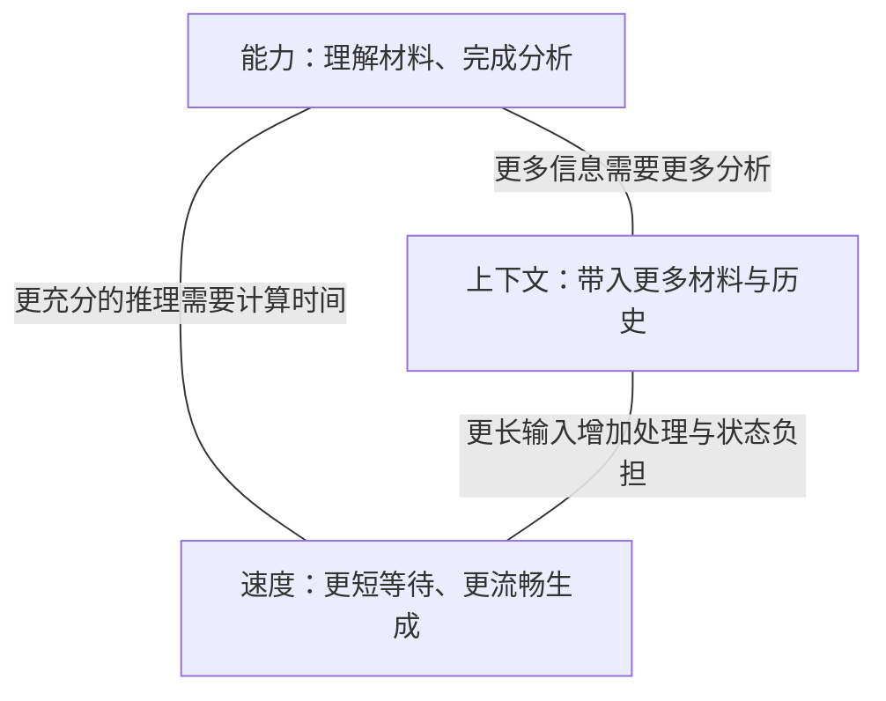

# 第 1 页｜公司本地部署 LLM：模型、运行环境与成本

实习研究汇报

从金融工作的需要出发，解释当前部署选择及其依据。

2026 年 10 月 22 日

能力评测更新至 10 月 22 日；部署研究截至 10 月 20 日；硬件预算采用 10 月 12 日基线。

---

# 第 2 页｜从工作需要走到部署选择

1. **从金融工作看本地部署需求**：哪些工作值得交给 LLM？
2. **一项分析任务对模型提出什么要求**：材料、能力与等待怎样影响体验？
3. **怎样选出适合当前工作的模型**：比较什么，为什么这样选？
4. **运行环境怎样影响使用体验**：模型怎样运行，性能怎样改善？
5. **为需要的性能准备多少资源**：投入能换来什么，成本怎样计算？
6. **把部署方案接回日常工作**：同事如何使用，接下来验证什么？

---

# 第 3 页｜第一章：从金融工作看本地部署需求

先看同事会把哪些工作交给 LLM，再看这些工作需要怎样的使用环境。

---

# 第 4 页｜LLM 可以怎样参与资料处理

LLM，也就是大语言模型，能够根据我们提供的问题和资料，参与阅读、归纳、分析和文字形成。

```text
资料与任务要求
    ↓
寻找相关信息 → 组织关系与解释 → 形成文字或结构化结果
    ↓
同事核对依据，决定怎样使用
```

它可以从公告中整理日期、主体和金额，也可以比较几份材料中的不同说法。明确的任务和交付要求，让这些能力落到一项可以检查的工作上。

---

# 第 5 页｜前台、中台、后台有哪些具体用法

**投研：把分散信息组织成研究线索。** 易方达参与的 MENTOR 研究，以中文文章和英文财经新闻为材料，依次识别热点事件、推演后续事件，再形成行业排序。这个公开研究原型展示了文本信息进入投研分析的一条路径。

**合规：在初稿阶段给出修改意见。** 盈米的内容合规审查 Skill 接收文本或文档，返回风险位置、理由和修改建议。内容作者据此修改，再将稿件交给合规人员终审。

**技术支持：在开发与测试中使用模型。** 易方达在协会发布的云平台案例中，披露将大模型接入开发、测试环节。研发人员围绕代码和测试获得辅助，产物继续进入既有交付流程。

---

# 第 6 页｜应用走进公司后，需要安排什么

公开新闻、财报与内部研究文件，对使用环境的要求并不相同。工具开始帮助同事完成工作，也就开始接触不同范围的资料。

| 使用中会遇到的问题 | 需要明确的安排 |
| --- | --- |
| 谁可以使用这项能力？ | 身份、用户范围与使用入口 |
| 本次任务可以读什么？ | 文件权限、资料来源与可访问范围 |
| 结果怎样进入后续工作？ | 引用、复核和交付流程 |
| 模型在哪里运行？ | 运行位置、服务连接与维护责任 |

这些安排让工具能够进入日常工作。安全与合规也落实在这些具体条件之中。

---

# 第 7 页｜本地部署让公司能够管理运行环境

公司的需求，是在自己掌握的环境中使用 LLM 的能力。

本地部署把模型放到公司管理的设备上，便于安排运行位置、服务连接和资源使用。身份与权限系统决定同事可以读取哪些资料，应用流程组织结果的复核与交付。

这次研究围绕其中三个相互关联的选择展开：**用什么模型，怎样把它运行起来，以及为此准备多少资源。**

要理解这些选择，可以先看看模型怎样完成一项大家熟悉的任务。

---

# 第 8 页｜第二章：一项分析任务对模型提出什么要求

把一份财报交给本地模型，看看从提供材料到得到解释之间发生什么。

---

# 第 9 页｜请模型解释收入和利润为什么变化

> 请阅读这份公司的财报，解释本期收入和利润变化的主要原因，并指出各项判断的依据。

一份有用的回答，需要把几件事连起来：先读对数字和单位，再区分本期、上期以及可比口径，最后用财报正文和附注支撑原因解释。

| 要交付的内容 | 同事怎样核对 |
| --- | --- |
| 主要收入、利润及变化 | 回到对应报表，检查数字、期间和单位 |
| 变化原因及相关业务 | 查看管理层解释、分部信息和必要附注 |
| 判断依据 | 打开引用位置，检查解释与原文的关系 |

---

# 第 10 页｜本地部署通常从已经训练好的模型开始

模型在训练中形成处理语言和完成任务的能力，这些能力保存在大量数值参数中。部署时，我们通常取得已经训练好的模型，把参数加载到自己的设备上运行。

**参数提供已有能力，眼前的材料提供本次任务的信息。**

我们把财报与问题交给模型，它就可以运用已有能力，围绕这份材料组织回答。不同模型的结构、训练与运行方式，也会影响这项工作的结果。

---

# 第 11 页｜眼前的财报和问题怎样进入这次回答

本次提供的材料、问题，以及需要保留的对话历史，构成模型可使用的**上下文**。模型利用这些信息生成回答，这个运行过程叫作**推理**。

```text
系统要求 + 财报内容 + 用户问题 + 已有对话
                    ↓
              已训练好的模型
                    ↓
       收入与利润变化、原因解释、原文依据
```

沿着这次任务，会自然出现三个要求：

**财报和相关附注要放得下；模型要能读懂并解释；同事希望尽快拿到结果。**

这三个要求分别对应上下文、能力和速度，也构成了模型选型的核心。

---

# 第 12 页｜固定资源下的“不可能三角”



**给定硬件、并发规模和运行方式，三项要求使用同一份内存与计算预算。**

材料增加，设备需要处理并保留更多信息；给难题分配更多思考步骤，或者采用计算量更大的候选模型，每项任务就会占用更多资源。此时再要求更短等待，留给每项工作的时间便更紧。

所以，选型需要决定资源优先用在哪里：当前工作最需要带入多少材料、完成怎样的分析，以及接受多长等待。

---

# 第 13 页｜上下文决定一次任务能带入多少信息

上下文窗口容纳本次任务的材料与过程。对于财报分析，它包括问题、报表、附注，也包括后续补充的资料和已经形成的讨论。

```text
上下文窗口
┌──────────────────────────────────────────┐
│ 系统要求 │ 材料与附注 │ 历史与工具结果 │ 本轮生成 │
└──────────────────────────────────────────┘
```

输入和输出通常按 **token** 计量。Token 是模型处理文本的片段，可能对应字、词或部分字符。

窗口较长，便于把更多相关材料放在一起，保留较完整的工作过程。实际安排时，要给后续生成留出空间，让分析能够继续展开。

---

# 第 14 页｜能力决定模型怎样使用这些信息

同样一份财报，可以提出深浅不同的工作要求。

| 要完成的工作 | 模型需要怎样使用材料 |
| --- | --- |
| 整理收入与利润 | 找到对应表格，识别数字、单位与期间 |
| 解释本期变化 | 联系业务、费用和附注，组织有依据的原因 |
| 比较不同公司的表现 | 对齐口径，识别差异，说明差异的意义 |
| 形成可交付的分析 | 组织比较表、计算结果、文字与引用 |

任务越往下展开，越需要模型把多个步骤连起来。我们评价能力，就要看它最终能把这项工作做到什么程度。

---

# 第 15 页｜速度决定这项工作怎样进入日常节奏

```text
提交材料 ── 等待首次输出 ── 开始看到内容 ── 持续生成 ── 本轮完成
```

**首次输出时间**影响交入材料后多久能开始跟进。

**生成速度**影响内容出现得有多快，通常用 token/s 表示；输出长度则决定这一段持续多久。

完整任务还可能包含工具计算、补充资料和几轮修改。短问答适合边问边看，较长分析可以先提交，再在其他工作之间回来检查结果。模型与运行环境的选择，会决定哪种节奏更合适。

---

# 第 16 页｜第三章：怎样选出适合当前工作的模型

先明确工作真正需要什么，再比较候选模型能提供什么。

---

# 第 17 页｜先把工作需要写成选型条件

本次研究区分个人工作与公司共享服务，两者使用同一组评价维度，工作规模有所不同。

| 维度 | 个人工作／小组 | 公司共享长任务 |
| --- | --- | --- |
| 上下文 | 131K、262K 为基础档，继续研究 512K／1M | 为较长的多轮任务研究每会话 1M |
| 能力 | 文档整理、多文档分析、代码与文件辅助 | 在长材料上继续推理、调用工具并完成多步任务 |
| 速度目标 | 单人生成约 20 token/s | 20 路活动请求，比较每路 10／20 token/s |
| 比较设备 | 单台 DGX Spark，128GB 统一内存 | 分别固定四卡或八卡服务器 |

131K、262K、512K 分别指 131,072、262,144、524,288 总 tokens；1M 指 1,000,000。各档留 8,192 tokens 给本轮生成，剩余空间用于材料与历史。

---

# 第 18 页｜围绕工作要求组织比较

个人路线主要看 Qwen3.8-27B 与相近规模的模型；共享路线重点看 DeepSeek-V4.1-Flash、GLM-5.3-Flash，并保留 MiMo、Kimi 的能力参照。

| 要回答的问题 | 使用的依据 |
| --- | --- |
| 哪个模型更能完成专业工作？ | GDPval-AA 对完整交付物的评价 |
| 工作需要的材料能否一起带入？ | 模型窗口与设备容量分析 |
| 同事使用时会等多久？ | 对应设备上的输入处理与生成测量 |

下面先看窗口，再看工作能力，最后把速度带进来，形成当前选择。

---

# 第 19 页｜把材料、历史和输出放进窗口预算

| 模型 | 上下文配置 | 对工作安排的意义 |
| --- | --- | --- |
| Qwen3.8-27B | 原生 262,144 tokens；提供扩展至 1,000,000 的配置 | 个人任务从 262K 起步，长任务继续扩展 |
| DeepSeek-V4.1-Flash | 原生支持 1,000,000 tokens | 为较长材料和多轮过程提供空间 |

以 262K 为例，预留 8,192 tokens 给本轮生成后，材料和历史可以使用 **253,952 tokens**。

这个预算帮助我们安排任务：先放入需要的材料，保留有用的工作过程，再根据后续分析决定追加什么。模型处理这些信息的效果，则进入下一项能力比较。

---

# 第 20 页｜GDPval-AA 评价模型能交付怎样的工作

GDPval-AA v2.1 使用 **220 项专业工作任务**，覆盖 **44 种职业、9 个行业**。Artificial Analysis 让模型在 Stirrup 任务环境中使用文件、代码和网页工具，完成文档、表格、幻灯片或图示。

例如，网页展示的一项任务要求模型根据五位乐队成员的设备与监听需求，制作一页舞台布置 PDF，并列清输入输出及设备编号。

```text
工作要求与参考资料
        ↓
读文件、查资料、运行工具、制作产物
        ↓
提交完整文件
        ↓
同一任务的两份产物匿名比较 → 汇总为 Elo 评分
```

评分越高，表示模型在这些工作交付物的比较中越占优势。这与我们的选型问题相接：交给模型一项任务后，它能否把资料、操作和结果组织成同事需要的产物。

---

# 第 21 页｜同一工作评价体系下，候选模型表现怎样

**GDPval-AA v2.1，2026 年 10 月 22 日读取。Elo 越高，工作交付表现越强。**

| Artificial Analysis 模型标签 | Elo |
| --- | ---: |
| DeepSeek V4.1 Flash 1017（Max） | 1,746 |
| GLM-5.3-Flash | 1,642 |
| MiMo-V2.6-Flash | 1,607 |
| DeepSeek V4.1 Flash（Max） | 1,600 |
| Kimi K3（Max） | 1,533 |
| Qwen3.8 27B（Xhigh） | 1,417 |
| Gemma 4 31B（Reasoning） | 620 |

这组结果为选择提供了清楚方向：在个人设备对应的规模里，Qwen27 是值得先用起来的起点；共享复杂任务可以沿 DeepSeek 路线推进，并将 GLM Flash 纳入重点对照。

1017 的工作交付表现进一步提高，使它成为 DeepSeek 路线的优先升级候选。

---

# 第 22 页｜Qwen27 在个人设备上用起来有多快

单台 DGX Spark 的外部测试，给出了 Qwen27 的具体体验参照。

| 实际输入 tokens | 每次输出 tokens | 首次输出等待 | 后续生成速度 |
| ---: | ---: | ---: | ---: |
| 50,000 | 2,048 | 63.1 秒 | 21.01 token/s |
| 100,000 | 2,048 | 144.8 秒 | 20.11 token/s |
| 500,000 | 2,048 | 1,470.1 秒 | 14.82 token/s |

测试采用随机 token 输入、FP8 权重、FP8 KV 缓存和 MTP3 推测生成，前缀缓存关闭。50K、100K 各两次，500K 一次；数据来自用户提供的外部设备测试汇总。

50K–100K 输入下，单人生成接近 20 token/s 的目标。到 500K，首次等待约 24.5 分钟，生成约 15 token/s，长材料更适合提前提交和分阶段处理。

---

# 第 23 页｜当前模型选择

**个人工作与知识问答，以 Qwen3.8-27B 为起点。** GDPval-AA 提供了工作交付能力的依据，262K 原生窗口覆盖基础长度档，Spark 测量又给出了单人体验参照。它适合先承接文档、文件与代码辅助工作。

**共享长任务，沿 DeepSeek-V4.1-Flash 路线推进。** 1M 窗口、专业工作表现与多卡运行研究形成了相互支持的依据。1017 作为优先升级候选，进入同一套资源与任务验证流程。

**GLM-5.3-Flash 保留为重点对照。** 它在 GDPval-AA 中的表现值得继续比较，下一步将使用相同工作材料、交付要求和运行预算，检查两条路线的实际体验。

接下来，打开一次请求的运行过程，看看这些选择怎样落实成可以持续使用的服务。

---

# 第 24 页｜第四章：运行环境怎样影响使用体验

模型确定之后，一次请求怎样运行，决定同事实际会遇到怎样的等待。

---

# 第 25 页｜一次请求怎样经过本地推理服务

推理服务把模型持续加载在设备上，接收请求并返回结果。推理框架负责组织其中的计算、内存与调度。

```text
启动服务：加载模型参数 → 准备计算与缓存空间

同事提交请求
    ↓
检查请求与排队
    ↓
读取或建立会话状态
    ↓
处理输入 → 产生首个输出 → 持续生成 → 返回结果
```

模型加载完成后，多次请求可以共用这套参数。每次输入仍需要得到处理，会话也需要保存必要状态，供后续生成和下一轮使用。

输入处理与后续生成承担不同的工作。区分这两段，就能找到改善等待的具体位置。

---

# 第 26 页｜设备内存里需要放下哪些东西

内存既要存放模型，也要容纳正在进行的工作。

| 占用 | 内容 | 主要随什么变化 |
| --- | --- | --- |
| 模型参数 | 已经训练好的权重 | 模型、存储精度与放置方式 |
| 会话状态 | 已处理历史的 KV 缓存及其他状态 | 历史长度、会话数与模型结构 |
| 执行空间 | 临时计算、运行图、草稿网络等 | 框架、调度与优化配置 |

**KV 缓存保存注意力计算中可重复使用的历史表示。** 后续生成使用这些表示，减少对旧输入的重复计算。Qwen27 还保存递推状态，二者共同支持会话继续运行。

FP8、BF16 表示不同的数值存储精度。较低精度通常减少占用，具体配置需要同时考虑任务效果。模型、会话和执行空间一起构成设备的容量预算。

---

# 第 27 页｜回答出现之前，服务先处理输入

输入处理阶段称为 **prefill**。服务把输入转成模型能够使用的表示，并建立后续生成需要的状态。

材料变长，处理工作也随之增加。全注意力层需要联系前后内容；模型中的稀疏或递推结构，则以各自的方式组织这些信息。

```text
首次输出等待
  = 请求进入与排队
  + 必要的状态恢复
  + 输入处理及首个输出
```

Spark 的 500K 输入首次等待约 24.5 分钟，完整读入长材料是其中的重要部分。旧前缀处理过并保存下来后，下一轮就有机会沿用已有状态，集中处理新增内容。

---

# 第 28 页｜回答开始之后，模型逐步生成内容

后续生成阶段称为 **decode**。新生成的内容成为下一步的条件，模型继续生成，直到本轮结束。

低并发时，设备需要为少量新输出反复读取权重和历史状态，内存带宽因而经常影响速度。历史增长，也会改变每一步需要访问的内容。

**生成速度和输出长度，共同决定这一段持续多久。**

若保持 20 token/s，生成 8,192 tokens 约需 **410 秒，即 6.8 分钟**。完整任务还包括首次等待、工具运行和复核时间。

明确交付物的长度与形式，可以把生成时间用在真正需要的分析上。

---

# 第 29 页｜任务变长时，等待与资源怎样变化

同一台 Spark、同一组运行设置，把输入逐步加长后，两段体验出现了不同幅度的变化。

| 实际输入 tokens | 首次输出等待（分钟） | 生成速度（token/s） |
| ---: | ---: | ---: |
| 50,000 | 1.1 | 21.01 |
| 100,000 | 2.4 | 20.11 |
| 300,000 | 11.0 | 17.23 |
| 500,000 | 24.5 | 14.82 |

每次输出 2,048 tokens，前缀缓存关闭；前两档各两次，后两档各一次。

从 100K 到 500K，首次等待明显增长，生成速度逐步下降。这使长任务的运行策略变得具体：把首次长输入提前处理，保留可复用状态，让后续工作沿已有历史继续。

---

# 第 30 页｜多人使用时，服务还要安排请求

合批让不同请求共享一次权重读取，提高设备利用率。每位同事的历史仍要参与计算，新进入的长输入也会占用运行时间。

Spark 三路请求同时提交，各生成 4,096 tokens：

| 每路输入 | 三路共同生成时的总速度 | 共同窗口每路平均 | 各请求完整生成阶段的平均速度 |
| ---: | ---: | ---: | ---: |
| 50,000 tokens | 59.08 token/s | 19.69 token/s | 16.85 token/s |
| 100,000 tokens | 52.41 token/s | 17.47 token/s | 12.45 token/s |

共同窗口取三路都已开始、尚在输出的时段；完整阶段也包含其他请求输入处理带来的等待，因此速度更低。

调度器可以把长输入拆成小块，在块之间继续服务生成中的请求。这样就能在输入处理效率与同事感受到的停顿之间，找到合适的安排。

---

# 第 31 页｜大模型怎样放到多张卡上运行

DeepSeek 原版的原生权重制品约 **510.286GB**。其中约 **202.758GB** 是 Engram 查找表及尺度，可以放在主机内存；其余约 **307.528GB** 按实际运行格式分配。

```text
主机内存：Engram 参数表 ── 按需查找／预取 ──→ GPU 计算

GPU 组：模型的其余部分 + 各卡所需会话状态 + 执行空间
```

Engram 属于模型参数，随会话增长的 KV 则保存用户历史。它们各自进入相应的容量预算。

**张量并行（TP）**让多张卡共同计算一套模型。八卡可以组成一个 TP8 服务，也可以分成两个 TP4 副本，各有自己的队列和缓存池。

实际预算要逐类检查分片与复制。按本研究的 H100／H200 缓存格式，20 份 1M 会话用于长历史的全局 KV，在**每张参与 TP 的 GPU 上占用 36.54GB**；其他状态和执行空间继续另计。

---

# 第 32 页｜不同框架怎样组织这些运行环节

框架选择首先匹配模型与硬件，再围绕使用体验和维护方式比较。

| 路线 | 与当前部署有关的能力 | 本次研究中的位置 |
| --- | --- | --- |
| vLLM | 分页管理、连续批处理、分块输入、前缀复用、多卡执行 | GPU 服务主线，已有 Spark 测量和 DeepSeek 公开回放 |
| SGLang | 前缀缓存、连续批处理、分块输入、多卡与分层缓存 | 相同模型和负载下的重点对照 |
| modified vLLM／A100 | 为 A100 的 SM80 架构适配算子、调度和通信 | 公司 A100 的运行路线 |
| MLX、llama.cpp 等 | 对应个人平台、多种设备与模型格式 | 硬件条件变化时的备选路径 |

A100 适配让现有硬件接上当前模型；模型的稀疏结构、Engram 与长历史机制提供底层能力，框架负责把它们组织起来。

新增部署可采用 vLLM 0.32.0 作为固定版本候选，将模型、驱动、精度和参数一并固定，方便比较与维护。

---

# 第 33 页｜缓存与推测生成，分别改善哪一段等待

**前缀复用减少重复输入计算。** 系统提示、旧材料和历史保持匹配，已有状态就可以用于下一轮。闲置状态转存到内存或 SSD 后，可以保留更久，再在需要时恢复。

Spark 的 CPU 与 GPU 共用物理内存，NVMe SSD 提供下一层容量。保存完整兼容状态，可以把重新处理旧材料的工作，变成一次状态恢复。

**MTP／推测生成一次提出多个后续 token，再由目标模型验证。** 每次接受的内容越多，且草稿和验证开销合适，生成就越高效。

Spark 的一次 300K 配置诊断显示，草稿上限从 262K 同步到主模型的 1M 后，接受率由 0% 恢复到 99.4%，生成速度由 5.80 回升到 17.23 token/s。

这一经历帮助确定了运行配置：主模型与草稿窗口要一起安排，再根据实际任务的接受情况选择推测长度。

---

# 第 34 页｜共享服务怎样在吞吐与等待之间取舍

DeepSeek 原版的公开 AgentX 多轮回放，展示了多卡共享服务的几种运行组合。

**测试条件：旧 vLLM 镜像，前缀命中约 95%，DSpark 合成平均接受长度 3.51。**

| 配置／活动会话数 | 平均输入 tokens | 系统端到端输出（token/s） | p95 首次输出等待 |
| --- | ---: | ---: | ---: |
| 4×H200，TP4／16 | 138,189 | 614.76 | 3.03 秒 |
| 4×H200，TP4／32 | 149,855 | 922.61 | 5.12 秒 |
| 8×H200，TP8／32 | 156,951 | 1,052.18 | 2.63 秒 |

p95 表示约 95% 请求的等待不超过该值。

四卡增加活动会话后，总输出提高，等待也变长；八卡记录呈现出更高吞吐与较短等待的组合。实际选择可以围绕小组的任务到达方式，比较一组八卡与两组四卡怎样分配请求。

---

# 第 35 页｜把运行研究整理成服务方案

**个人服务：**Qwen27＋Spark 用于文档与代码工作。50K–100K 单请求生成接近 20 token/s；长材料提前读入，多轮任务优先复用已有状态。

**公司共享服务：**DeepSeek＋多卡 vLLM 比较 TP8 与两个 TP4 副本。同一服务中的两组四卡副本，即 TP4×DP2，可以在满足同机共享条件时共用主机 Engram 表；每组继续保留自己的 GPU 模型和会话池。

**服务目标：**20 路每人 20 token/s，对应系统持续输出 400 token/s。下一轮测量围绕这个目标，覆盖 512K／1M 上下文、冷输入、热恢复与工具等待。

到这里，硬件一直是给定条件。接下来把它变成可以调整的选择，看增加投入会改善什么。

---

# 第 36 页｜第五章：为需要的性能准备多少资源

如果改变设备配置，可以改善什么体验，又要增加多少投入？

---

# 第 37 页｜增加资源，能改变哪些限制

更大内存增加可保留的模型与历史；计算、带宽和互联则影响等待与吞吐。

下面根据 DeepSeek 的公开启动记录，扣除运行图等额外占用，再留 10% token 余量，估算 20 份独立会话的容量。

| 部署 | 每份会话可分配的总上下文，上限取 1M |
| --- | ---: |
| 8×H100，TP8 | 242,240 tokens |
| 4×H200，TP4 | 762,048 tokens |
| 8×H200，TP8 | 1,000,000 tokens |
| 8×H200，两个 TP4，每组 10 份 | 1,000,000 tokens |

八 H200 因此成为 20 路 1M 的容量方案。

会话驻留也影响选择：20 项任务正在生成，另有 20 项等待工具并保留历史，就需要安排 40 份状态。八 H200 TP8 在同一预算下，平均每份约 636K。扩大服务时，要同时计算正在运行与等待继续的任务。

---

# 第 38 页｜费用比较先约定同一套假设

成本需要把设备、实施、运维与日常工作量放进同一个范围。API 路线则通过网络按调用量购买供应商的模型服务。

| 三年预算的主要输入 | 采用的假设 |
| --- | --- |
| 个人工作量 | 首年每天 3 项，每年增长 10% |
| 公司工作量 | 20 人首年各每天 5 项，每年增长 25% |
| 工作日 | 每年 250 天 |
| 每项任务 | 8 轮调用，首轮输入 100K；后续每轮新增 8K；每轮输出 2K |
| 重试与修改 | 额外准备 10% 完整轨迹 |
| 可复用前缀命中 | 本地 90%，API 95% |
| 技术人力 | 2,500 元／人天 |

一份 8 轮轨迹累计提交 **1.08M 输入**、生成 **16K 输出**，最后一轮总长 **172K**。旧历史按相应缓存规则计费或复用。

硬件采用 10 月 12 日预算，API 采用 10 月 20 日公开价，预算汇率为 7.00，三年保持相同费率。各路线按相同计划交付量计算，后续用实际任务记录更新输入。

---

# 第 39 页｜不同使用规模，对应多少投入

| 中等工作量情景 | 本地配置 | 三年计划任务量 | 本地三年总投入 | DeepSeek API 三年对照 |
| --- | --- | ---: | ---: | ---: |
| 个人 | 1 台 Spark＋Qwen27 | 约 2,483 项 | **9.05 万元** | **1.66 万元** |
| 公司共享 | 8×H200＋DeepSeek，含工具 CPU | 约 95,313 项 | **392.54 万元** | **68.34 万元** |

**固定硬件是主要差额。** 公司本地方案的 GPU 整机约 297.36 万元，占三年总额约 75.8%；三年运维技术人力为 45 万元。两条公司路线都保留工具 CPU、实施和持续运维。

API 经济对照使用公开或已获准的资料。对于这些任务，当前预算中的 API 支出更低；本地投入则需要结合资料管理、运行控制和实际工作价值来判断。

公司工作量按每年 2,000 服务小时、70% 时间预算，以及 8,000 未缓存输入 tokens/s、400 输出 tokens/s 的规划能力计算。

---

# 第 40 页｜增加的投入换来了多少改善

同一套预算方法下，八 H100 整机约 **285–298 万元**，八 H200 约 **291–304 万元**；逐项同口径差约 **5.68 万元**。

结合容量分析，这一差额把 20 份会话从每份约 242K，提升到每份 1M 的容量方案。它使 H200 成为本次新购长上下文服务的优先配置。

任务量增长还会带来下一次投入。按前页的服务预算，一台每年约承担 **64,487 项任务**。较高工作量情景依次为每年 50,000、75,000、112,500 项，第二年需要第二台节点。

| 公司情景 | GPU 节点数：第 1／2／3 年 | 三年本地总投入 |
| --- | --- | ---: |
| 中等工作量 | 1／1／1 | 392.54 万元 |
| 较高工作量 | 1／2／2 | 712.78 万元 |

使用增加会分摊固定成本，也会推动扩容。预算要沿着这两种变化一起安排。

---

# 第 41 页｜当前用途下，怎样的投入较为合适

**个人与小组先形成使用记录。** Spark 硬件约 5.8–6.2 万元，个人中情景三年总投入约 9.05 万元。先承接文档、文件与代码任务，观察工作量、质量和人工时间，再安排规模扩展。

**公司长任务保留八 H200 方案。** 它对应 20 路 1M 的容量目标，采购推进时，将真实任务量、目标等待和供应商交付报价放在一起判断。

**已有 A100 先走复用验证。** modified vLLM 路线的八卡复用预算约为三年 134.42 万元。下一步测量它的长会话容量和服务速度，把已有资产纳入资源选择。

最终衡量投入时，按合格完成的任务记录成本，并核算同事实际节省的时间。释放工时可以用于更多研究，减少外包、加班或新增用工则形成现金收益。

---

# 第 42 页｜第六章：把部署方案接回日常工作

模型与运行环境准备好之后，同事从哪里使用，又怎样接入工作需要的资料？

---

# 第 43 页｜同事怎样使用这项本地服务

使用入口可以随工作方式不同而不同，底层模型服务可以共用。

```text
个人文件与代码工作
员工电脑上的 OpenCode／文件工具 → 本地模型服务 → 结果回到工作目录

公司共享任务
浏览器入口 → 身份与任务管理 → Hermes 等任务执行层
                                   ├→ 模型服务
                                   └→ 隔离的文件、代码与工具环境
```

任务执行层组织模型与工具的多轮工作：模型提出操作，工具返回结果，模型再继续处理。

个人工具在员工电脑上操作工作文件；远程任务在获准的服务器目录中执行。入口、执行位置和资料范围一起构成完整的使用路径。

---

# 第 44 页｜工作需要的资料和工具怎样接进来

公司知识库先找到与问题有关、且当前用户有权读取的内容，再交给模型回答。这种方式称为检索增强生成，通常简称 **RAG**。

```text
用户身份与问题
    ↓
在获准范围内检索资料 → 授权过滤 → 重排相关片段
    ↓
模型根据片段回答 → 同事打开引用，核验对应资料
```

平台路线可以比较 Onyx Enterprise 与 Milvus＋自建 RAG 服务＋Open WebUI。前者集中提供企业知识平台能力，后者由团队组合并维护检索、权限和应用。两条路线都围绕 NAS 身份、访问范围和撤权更新接入资料。

工具还可以提供文件读取、计算和代码执行。Skills 保存可复用的操作说明，MCP 等接口连接外部工具，让同事通过一个任务入口组织这些能力。

---

# 第 45 页｜用实际产物验证这套选择

从有明确产物的工作开始，可以逐步积累公司自己的使用依据。

| 验证工作 | 交付与检查方式 | 帮助决定什么 |
| --- | --- | --- |
| 公告字段整理 | 字段表与出处，检查主体、日期、金额和覆盖情况 | 第一批文档工作的范围 |
| 研究代码辅助 | 可复跑的修改、测试与结果文件 | 模型与工具的配合方式 |
| 财报比较 | 数字、期间、口径、计算文件与引用 | 共享模型带来的质量收益 |
| 权限知识问答 | 按身份检查检索和引用，测试撤权更新 | 公司资料接入范围 |

同时记录首次等待、生成停顿、完整任务时间、重试和人工复核。长任务覆盖 512K／1M、真实推测接受率，以及多人使用时长输入带来的调度变化。

这些记录将进入下一轮模型、框架与资源配置的判断。

---

# 第 46 页｜回到公司的本地部署需求

这次研究把本地部署整理成了一组相互衔接的选择。

**模型方面，**个人与知识问答从 Qwen27 起步，共享长任务沿 DeepSeek 路线推进，并用 GLM Flash 做重点对照。GDPval-AA、窗口与设备体验共同支持这个安排。

**运行环境方面，**沿输入处理、持续生成和多人调度解释性能，再安排框架、缓存与多卡分工。这样，优化就能够对应到同事实际感受到的等待。

**投入方面，**Spark 支持个人和小组先用起来，已有 A100 纳入复用验证，共享服务器随清楚的工作规模推进。

下一步，把一批可核对的任务交给同事使用，记录产物质量、等待与复核时间，让这套研究继续形成公司的实际部署依据。
