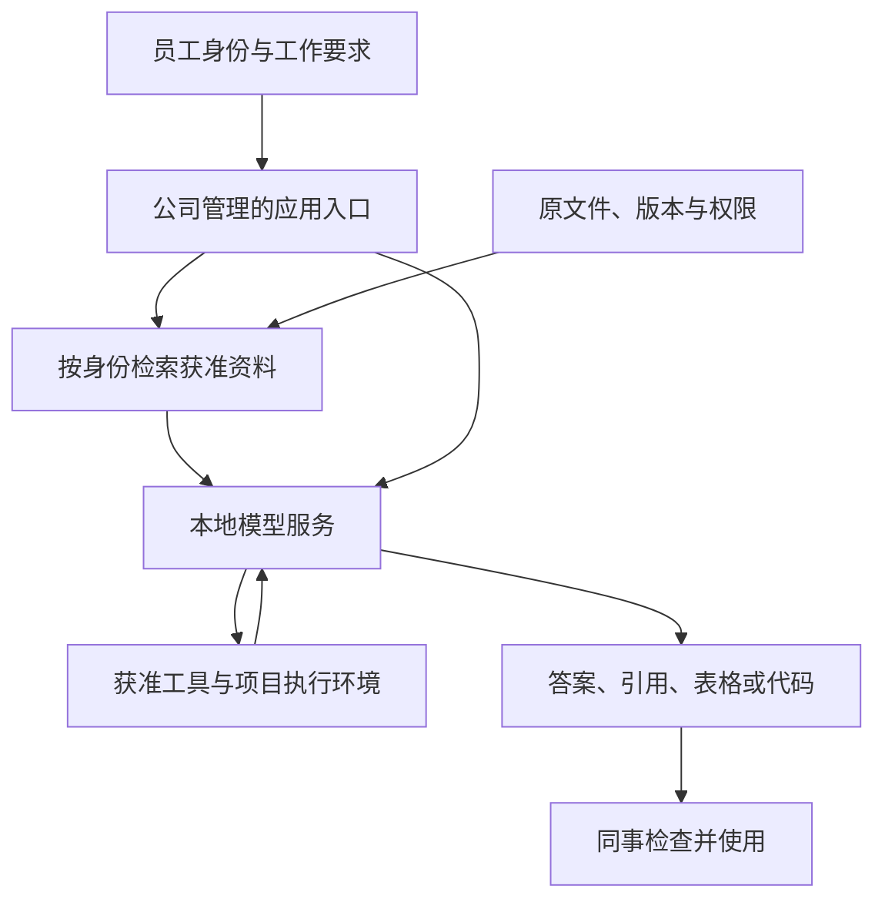
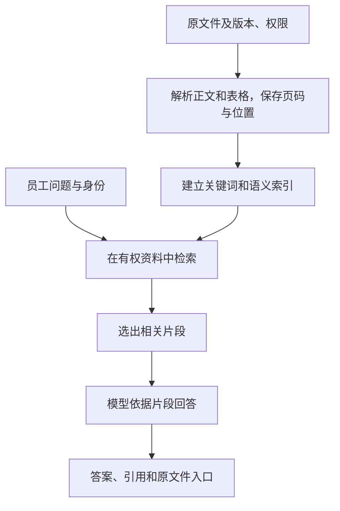

# 第 01 页｜让大模型进入日常工作

金融应用、本地部署与可验证的使用方式

实习研究汇报

2026年10月

---

# 第 02 页｜大语言模型能怎样参与工作

大语言模型（LLM）根据我们提供的问题和材料，生成文字、表格或代码。它可以理解任务要求，也可以把不同形式的信息整理成我们需要的产物。

| 我们交给它的工作 | 可以得到的产物 |
|---|---|
| 阅读一份公告，找到合同金额和履行期限 | 字段表及对应原句 |
| 比较两期财报中同一业务的变化 | 对照表、计算步骤和差异说明 |
| 把一段业务需求变成数据处理方法 | 代码、运行结果和需要核对的地方 |

这些产物提供一个可检查、可修改的起点。数字是否正确、材料是否完整，仍要回到来源和计算过程判断。

---

# 第 03 页｜一个小例子：把公告整理成事件记录

**教学用虚构摘录**

“甲公司于10月18日签订设备采购合同，合同金额人民币1.2亿元。合同约定在收到预付款后六个月内交付。截至公告日，预付款尚未支付。”

| 字段 | 提取结果 | 依据 |
|---|---|---|
| 事件 | 签订设备采购合同 | “签订设备采购合同” |
| 合同金额 | 人民币1.2亿元，即12,000万元 | “合同金额人民币1.2亿元” |
| 交付期限 | 收到预付款后六个月内 | “收到预付款后六个月内交付” |
| 当前状态 | 已签约，尚未支付预付款 | “预付款尚未支付” |
| 确定交付日 | 无法确定 | 交付起算条件尚未满足 |

理解文字条件、转换字段和保留依据，可以一起完成。把“六个月”直接变成一个确定日期，就会改变原文的意思。

---

# 第 04 页｜金融应用已经覆盖多种岗位

| 工作位置 | 公开案例 | 大模型参与的环节 |
|---|---|---|
| 前台：投研 | 华安基金“灵思”平台 | 根据债市数据生成报告，整理尽调材料 |
| 前台：交易支持 | 南方基金“小喃同学” | 理解查询要求，连接数据库和业务工具 |
| 中台：合规与审核 | 华安基金“灵思”平台 | 提取定期报告要素，辅助比对和质检 |
| 后台：信息技术 | 易方达基金云平台建设 | 在开发和测试流程中使用大模型 |

共同的变化是：同事可以用自然语言提出要求，再把阅读、查找或处理资料的一部分工作交给系统。

案例来自机构公开披露。本次只讨论披露的工作方式，不将项目整体成效全部归因于大模型。

---

# 第 05 页｜投研：资料怎样变成一份初稿

华安基金公开的“灵思”案例介绍了两类工作：债券周报和可转债报告导入债市数据生成，基金尽调报告利用语音转写材料生成。

```text
债市数据                         尽调语音
   │                              │
   │                           语音转写
   └─────────────┬────────────────┘
                 │
           大模型提取和组织内容
                 │
          报告初稿及待核对事项
                 │
            研究人员复核使用
```

上图为基于案例提出的工作流程，加入待核对事项和研究人员复核。

材料进入工作流程之后，需要保留数据时点、原话和报告之间的对应关系。写出一份通顺的报告只是其中一步。

---

# 第 06 页｜交易支持：一句话需要接到真实系统

南方基金“小喃同学”把自然语言要求拆解为任务，再调用数据库查询、知识检索、业务接口或Python工具。

案例中的债券筛选可以包含价格、收益率、内部评级和期限等条件。系统需要理解条件，也需要知道到哪里查询以及用户可以查询什么。

| 环节 | 需要接入的内容 | 返回给同事的结果 |
|---|---|---|
| 理解问题 | 业务术语、表结构和字段含义 | 可执行的查询条件 |
| 查询与计算 | 行情、内部评级及授权业务数据 | 候选债券及计算结果 |
| 解释结果 | 原问题、查询结果和相关依据 | 对结果的说明 |

案例还披露了对高敏操作的角色、终端及二次确认要求。查询资料与发送交易指令，使用同一个对话入口也需要不同的执行条件。

---

# 第 07 页｜材料质检：先把疑点找出来

华安基金案例披露，定期报告质检使用结构化提取和比对，运营文档也使用要素提取与报告生成。

在我们的拟议流程中，审核同事可以收到这样一份结果：

| 交付项 | 具体内容 |
|---|---|
| 疑点位置 | 文件版本、页码和对应原句 |
| 比对对象 | 同一指标在其他表格或文件中的记录 |
| 判断依据 | 适用检查项、规则版本或计算关系 |
| 人工处理 | 确认问题、说明原因，或标记无需修改 |

这项工作的价值在于减少逐页寻找与反复比对。能否有效使用，还取决于重要问题有没有漏掉，以及审核人员需要花多少时间处理误报。

---

# 第 08 页｜开发与测试：产物可以直接运行和检查

易方达基金公开的云平台案例，在一站式研发管理平台中引入大模型辅助开发和测试。

对研究代码，也可以采用类似的工作方式：

```text
业务需求＋现有脚本＋允许使用的数据样例
                    │
             助手修改项目副本
                    │
          运行测试，检查计算与输出
                    │
         交付代码差异、结果和运行说明
                    │
              研究员审阅接收
```

这条拟议流程需要读取项目代码、依赖和数据结构。涉及收益率、交易日期或缺失值时，测试应覆盖具体计算口径。

公开案例支持“大模型进入开发测试流程”，没有单独给出大模型带来的收益率或效率增幅。

---

# 第 09 页｜越贴近日常工作，越会接触内部资料

| 同一项工作 | 使用公开资料时 | 进一步结合公司工作时 |
|---|---|---|
| 整理研究材料 | 年报、公告、公开市场数据 | 内部研究观点、尽调记录、尚未发布的初稿 |
| 查询债券 | 公开发行信息和行情 | 内部评级、业务数据库和用户权限 |
| 检查材料 | 已发布报告和公开规则 | 待审文件、公司检查口径和历史处理意见 |
| 维护代码 | 公开示例和虚构数据 | 研究脚本、内部字段、项目目录和运行环境 |

右列概括这些工作在公司内可能需要的资料，不表示上述每家机构都采用了同一套输入。

只有接触到相关资料，助手才能理解本公司的具体问题。接入哪些资料、由谁使用，随之成为应用本身的一部分。

---

# 第 10 页｜我们希望在可控的环境下使用这些能力

对同事而言，理想的体验仍然是：提出问题，获得有帮助的结果。

公司同时需要能回答这些问题：

| 需要掌握的事情 | 对日常使用的具体含义 |
|---|---|
| 资料范围 | 哪些文件可以进入模型，原件和处理结果保存在哪里 |
| 使用者身份 | 同事沿用自己的权限，换人登录后看到的资料范围相应改变 |
| 工具范围 | 哪些任务可以查询、计算、修改文件，哪些操作需要人工确认 |
| 运行与维护 | 谁管理版本、查看故障、暂停服务并恢复工作 |

公司已经提出本地部署需求。本次研究围绕这一条件，讨论怎样把模型能力接入实际工作。

---

# 第 11 页｜本地部署在完整工作流程中的位置



本地模型服务让公司掌握模型运行的位置和版本。资料检索、文件解析、工具执行与结果保存，也要纳入同一套运行安排。

本地部署可以服务内部资料和定制工作流。具体权限仍由应用及资料系统执行，不能靠模型自己判断用户是否有权查看文件。

---

# 第 12 页｜我的研究围绕工作条件展开

| 实际问题 | 本次研究内容 | 已形成的依据 |
|---|---|---|
| 哪些任务值得尝试 | 行业应用与试点任务 | 一手案例、输入和交付物定义 |
| 哪些模型适合这些任务 | 金融研究、文档提取和工具能力 | 按任务拆开的公开评测 |
| 同事怎样使用 | 工作台、知识库和任务助手 | 软件路线与资料接入方案 |
| 需要多少资源 | 个人设备与共享服务 | 容量计算、外部测量和负载条件 |
| 如何判断是否值得扩展 | 实施、运维及使用成本 | 成本情景与业务验收方法 |

目前的成果是研究与方案准备。外部测量另行标明，内部业务质量和真实使用收益仍需试点验证。

---

# 第 13 页｜三种工作方式，需要不同的支持

| 工作方式 | 同事希望完成的事情 | 系统主要需要什么 |
|---|---|---|
| 一个人处理一组材料 | 比较财报，整理表格，修改研究脚本 | 文件工具、计算环境和顺畅的单人交互 |
| 多人查询共同资料 | 查制度、历史材料和相关研究记录 | 身份、资料更新、检索、引用及共享服务 |
| 助手连续完成任务 | 多次查资料和计算，交付一套研究产物 | 工具调用、持续任务状态、失败恢复和资源调度 |

一个人也可以使用共享模型，公司知识库也可以成为任务助手的资料来源。这三种工作方式可以组合，资源需求却不完全相同。

---

# 第 14 页｜财报比较可以交付一套能继续使用的材料

**拟议任务：比较同一公司两期财报，说明收入和经营现金流的变化。**

| 顺序 | 助手完成的工作 | 留给研究员检查的产物 |
|---|---|---|
| 1 | 找到两期原文及补充披露 | 文档、期间、币种、单位、合并范围清单 |
| 2 | 提取相关指标，识别重述 | 新旧披露并列的指标表及页码 |
| 3 | 用程序计算差额和变化率 | 可复算的计算文件 |
| 4 | 对照管理层解释和相关注释 | 差异说明及逐项引用 |
| 5 | 整理没有充分依据的地方 | 待研究员继续验证的问题 |

遇到口径变化时，先保留差异，再决定能否直接同比。助手可以帮助完成这条流程，最终结论仍由研究员结合业务背景判断。

---

# 第 15 页｜公司知识库怎样找到回答所需的资料

检索增强生成（RAG）的做法，是先找相关资料，再把资料和问题一起交给模型。



检索负责缩小阅读范围，模型负责理解和组织答案。文件解析漏掉表头、检索没有找到关键条款，都会影响最后的回答。

资料经常更新时，需要同步版本和索引。把新文件放进目录，并不意味着助手立刻会使用到它。

---

# 第 16 页｜同一个问题，不同同事可以有不同的资料范围

**拟议权限例子**

研究员可以查看某行业研究目录。其他部门员工只能查看公开资料目录。两人问同一个问题，系统分别在各自有权范围内检索。

| 时间点 | 系统需要完成的事 |
|---|---|
| 提问时 | 取得当前员工身份和有效权限 |
| 检索时 | 限定候选资料，避免无权片段进入模型 |
| 打开引用时 | 再次检查是否可以访问原文件 |
| 资料撤权后 | 更新索引、缓存和后续会话可用的内容 |

应当分别测试有权、无权和刚刚撤权的情况。答案、文件名、引用与导出文件都属于这条检查链路。

---

# 第 17 页｜软件让一次回答变成持续的工作

| 使用需要 | 可考虑的软件路线 | 仍需完成的接入工作 |
|---|---|---|
| 日常聊天、上传文件 | Open WebUI等内部工作台 | 接入本地模型、文件解析和员工身份 |
| 搜索共同资料并给出引用 | Onyx Enterprise | 验证实际资料源、权限继承和撤权同步 |
| 定制公司的检索流程 | Milvus＋自建检索服务＋工作台 | 自行承担权限、解析、检索和引用的完整交付 |
| 持续查资料、计算和写文件 | Hermes等任务助手 | 配置工具、项目环境、任务记录和人工接收环节 |

可复用的工作方法可以写成Skill，例如财报比较的口径和校验步骤。MCP等工具接口负责连接查询或计算能力。

方法、工具和资料分别需要维护。软件能力按已归档版本讨论，具体版本与企业授权要在实施时确认。

---

# 第 18 页｜模型比较要回到具体任务

**公开金融研究评测：Finance Agent v2，2026年10月20日归档。**

| 模型 | 金融研究得分，% |
|---|---:|
| Qwen 3.8 27B | 48.55 |
| DeepSeek V4.1 Flash，原版 | 53.48 |
| MiMo V2.6 Flash | 56.28 |
| GLM 5.3 Flash | 57.85 |

评测提供财报检索和计算等工具。分数是带关键条件门槛的加权部分得分，不能理解为“有多少业务任务可以完全交给模型”。

Qwen27值得进入个人任务与资料提取试验。共享复杂任务可以比较DeepSeek、GLM Flash和MiMo Flash，再结合资源条件选择。

这些结果支持建立候选名单。中文公司资料、实际工具和人工复核成本，需要在同一套内部任务上继续比较。

---

# 第 19 页｜长材料的完整提取仍然很难

**ExtractBench公开结果：Qwen3.8-27B-FP8的一次性提取流程。**

| 文档长度 | 样本数 | 字段值F1×100 |
|---|---:|---:|
| 短文，10页及以内 | 252 | 94.68 |
| 中篇，11–50页 | 98 | 87.54 |
| 长篇，超过50页 | 20 | 38.45 |

这组英文企业文档共有370份，其中145份属于金融领域。输入使用逐页图像，分数评价字段值的完整性与正确性。

对于长财报，我们可以按章节或指标提取，保存中间表，再检查列表数量、重复和遗漏。长上下文提供阅读空间，完整提取还需要合适的处理流程。

这是不同长度文档组的结果，任务难度也有差异，不能单独解释为长度增加造成的因果效应。

---

# 第 20 页｜把模型运行起来，需要一套配合工作的组件

```text
模型权重和配置       推理引擎             应用和工具
存放模型能力       加载与执行模型       组织同事的工作
      │                 │                   │
      └───────────匹配版本与接口─────────────┘
                        │
                 GPU、主存和存储
```

研究中的个人候选是Qwen3.8-27B，FP8制品降低权重存储量。共享长任务候选包括DeepSeek-V4.1-Flash，资源规模更大。

vLLM等推理引擎负责模型执行和请求调度。选定模型之后，还要核对具体权重格式、硬件支持和工具调用接口。

同名模型的新版本需要重新验证。旧版取得的速度与业务结果，不能直接写到新版名称下面。

---

# 第 21 页｜资料长度和同时使用人数都会占用内存

推理时的内存主要容纳：模型本身、执行所需空间，以及各个会话的状态。

```text
可用内存
├─ 模型权重
├─ 引擎与临时计算空间
└─ 会话状态
   ├─ 甲的资料和历史
   ├─ 乙的资料和历史
   └─ 丙的资料和历史
```

Token是模型计算文本长度的单位，不等于一个汉字。上下文包括问题、资料、历史对话、工具返回内容以及生成内容。

随着任务继续，工具查到的材料也会进入上下文。一个模型标称支持长窗口，并不说明一台机器能同时保留很多份长历史。

会话缓存常称KV缓存。不同模型还可能保存其他状态，具体容量要按模型与引擎配置计算。

---

# 第 22 页｜“快不快”至少有三种感受

| 同事感受到的等待 | 对应测量 | 主要受什么影响 |
|---|---|---|
| 提问后多久开始回答 | 首字等待时间 | 排队、处理输入、缓存状态 |
| 开始之后输出是否流畅 | 生成速度，token/秒 | 模型、硬件、历史长度及其他请求 |
| 多久拿到完整可用产物 | 任务总时间 | 多轮查询与计算、生成、失败重试和复核 |

**算例：**假设持续生成速度为20 token/秒，输出2,000 tokens仅生成就需要100秒。首次等待和中间工具执行还要另计。

对日常问答，较短的首次等待很重要。对批量报告，可以安排后台处理，但仍要明确任务完成时间。

---

# 第 23 页｜一台个人设备的外部测量提供了什么信息

**单台DGX Spark，Qwen3.8-27B-FP8。用户提供的外部测试摘要，2026年10月12日入库。**

| 输入长度，tokens | 输出长度，tokens | 首字等待，秒 | 生成速度，token/秒 |
|---|---:|---:|---:|
| 50,000 | 2,048 | 63.1 | 21.01 |
| 100,000 | 2,048 | 144.8 | 20.11 |
| 300,000 | 2,048 | 658.9 | 17.23 |
| 500,000 | 2,048 | 1,470.1 | 14.82 |

配置为FP8权重、FP8会话缓存与MTP3，关闭前缀缓存，输入为随机普通token。50K和100K各两次稳定请求，300K和500K各一次。

这组结果提醒我们：装得下很长的材料，还需要考虑第一次读入的等待。测试没有评价财报理解或答案质量，也不是公司的部署结果。

---

# 第 24 页｜继续同一项工作，可以复用已经处理过的内容

```text
第一次
固定资料＋问题一          处理整段输入，再生成回答

第二次
相同前缀＋新增问题        若兼容状态仍在缓存中，复用旧状态

稍后恢复
保存的聊天记录           可以重建内容，通常仍需重新计算
保存的兼容会话状态       有机会减少重复计算，也需要恢复时间
```

前缀缓存可以减少重复处理相同输入的工作。它不能直接消除长历史下的持续生成开销。

模型版本、缓存格式和前缀内容需要匹配。权限发生变化时，也要检查原先保存的内容还能否继续使用。

前页关闭缓存的外测，可以作为冷输入参考。启用缓存之后的首次等待、容量和恢复时间，需要另测。

---

# 第 25 页｜共享服务要分别数人、任务和历史

**规划例子：20位同事，每人同时保留两个任务。**

| 数量 | 这个例子中的值 | 对资源的含义 |
|---|---:|---|
| 使用者 | 20人 | 账号和工作范围 |
| 正在生成的任务 | 20个 | 计算、排队和生成速度 |
| 等待工具返回的任务 | 20个 | 暂时不生成，仍可能保留会话状态 |
| 总共需要保存的历史 | 40份 | 缓存容量和恢复安排 |

“支持20人”需要进一步说明每人的材料多长、是否同时生成，以及是否允许等待或恢复历史。

共享服务的调度还要照顾短问答。一个新来的长文件，不应让其他人的简单查询长期排队。

---

# 第 26 页｜研究中的资源组合

| 工作需要 | 研究中的配置候选 | 目前能支持的判断 |
|---|---|---|
| 个人或小组处理文件 | DGX Spark，128GB统一内存，Qwen27 | 有单人及三请求外测摘要，可继续验证真实任务 |
| 公司权限知识库 | 四张6000D服务器版84GB，三路回答服务，一张辅助检索模型 | 已有按资料长度计算的容量方案，性能仍是条件估算 |
| 较多并发的连续任务 | 八张H200 141GB，DeepSeek共享服务，另配工具执行环境 | 公开启动日志与容量计算支持20份1M历史的容量候选，满窗口体验尚待测试 |

这些配置服务不同负载，不是必须同时采购的清单。已有设备也可以进入复用比较，但需要按实际模型、引擎和负载重新测量。

硬件型号之外，应用节点、主存、存储、机房和后续维护都属于完整方案。

---

# 第 27 页｜共享服务的验收可以写成明确条件

**建议用同一组任务，对容量、速度和产物分别验收。**

| 验收对象 | 具体条件 | 身份 |
|---|---|---|
| 长历史容量 | 20份历史，各1,000,000 tokens，含每份8,192输出预留 | 资源规划要求 |
| 持续生成 | 20路同时生成，每路20 token/秒 | 待验证服务目标 |
| 系统输出能力 | 20×20＝400 token/秒 | 由目标反推 |
| 每轮生成时间 | 8,192÷20＝409.6秒，约6.8分钟 | 仅生成阶段算例 |
| 日常使用 | 冷文件插入、继续旧任务、工具等待后恢复 | 必测负载 |
| 工作产物 | 数值、引用和工具结果通过业务检查 | 独立质量要求 |

1M容量要求与日常任务长度分别记录。公开的高缓存命中回放，不能代替20路满1M的实际体验。

---

# 第 28 页｜设备预算需要和交付范围一起看

**人民币万元。沿用10月12日研究预算，10月20日资料复核。**

| 资源方案 | 硬件预算 | 另需考虑 |
|---|---:|---|
| 单台DGX Spark | 5.8–6.2 | 个人实施与配置，后续维护 |
| 知识库GPU服务器及两台应用节点 | 74–141 | 企业授权或自建应用实施，资料整理与权限接入 |
| 八H200 GPU整机 | 291–304 | 集中工具CPU节点12–26，机房接入及应用实施 |

上表是分析预算，包含原研究设定的税费、交付与支持准备，不是公司的供应商报价。型号、供货路径、安装地和本地支持仍需逐项确认。

本地部署的投入要由需要它的工作来支持。个人试用、受控目录试点和大规模共享服务，可以分别决定规模与投入时间。

---

# 第 29 页｜持续成本取决于工作量和使用方式

**既有三年预算情景：20人，公开或获准资料任务。首年25,000项，每年增长25%。每项按8轮模型调用及10%额外轨迹准备，上下文约100K–172K。**

| 路线 | 三年投入，万元 | 主要构成 |
|---|---:|---|
| 八H200本地共享服务 | 392.54 | 整机、共同工具节点、实施、运维、用电和机位 |
| DeepSeek官方API | 68.34 | 共同工具节点、实施、运维及调用费用 |

金额为2026年10月20日成本模型情景，技术人力按2,500元/人日。本地任务产能使用待验证的服务目标，模型质量与人工复核量尚未完成同题比较。

在这一使用量下，新购GPU的固定投入占比较大。允许调用API的任务可以保留经济对照，涉及内部资料的任务则先确定允许的处理方式。

最终应比较完成一项合格工作所需的全部成本，把失败尝试和人工复核一并算入。

---

# 第 30 页｜试点先交付容易检查的产物

| 顺序 | 拟议试点 | 首期交付 | 这样安排的原因 |
|---|---|---|---|
| 先做 | 短公告实体与事件提取 | 字段、状态、原句和待核对清单 | 输出边界明确，可以逐字段检查 |
| 同期尝试 | 研究代码与测试辅助 | 代码差异、测试和计算结果 | 可以运行，方便发现具体错误 |
| 再扩展 | 两期财报比较 | 指标表、计算文件、差异说明和引用 | 复用提取和计算，增加口径检查 |
| 完成接入后开放 | 一个部门的资料问答 | 按身份回答，附可打开的原文 | 需要资料、身份和撤权链路共同完成 |

材料预审先积累由审核人员确认的规则和错例。漏报、误报及维护工作量有了可靠基线后，再决定开放范围。

这是试点建议，不是已经完成的部署安排。

---

# 第 31 页｜验收要检查结果，也要记录人的投入

| 任务 | 建议验收样本 | 核心检查 |
|---|---|---|
| 公告提取 | 100份盲测公告 | 金额、单位、日期、事件状态和原文依据 |
| 代码辅助 | 20项研究任务 | 原有测试、边界情况、时间对齐与研究员接收意见 |
| 财报比较 | 30组材料，至少150项事实 | 重述、期间、合并范围、计算、引用与遗漏 |
| 部门问答 | 100项问答 | 有权、无权、撤权、旧版本和没有答案的情况 |

每项任务同时记录：准备和操作时间、编辑时间、复核返工时间，以及不能并行工作的等待。

```text
净节省人工时间
＝原流程人工时间－使用助手后的全部人工活动时间
```

失败后完整重做的时间也计入。节省下来的时间可以用于更多研究，但是否形成现金节省，要看实际人员或外包安排。

---

# 第 32 页｜下一阶段需要业务和技术共同完成

| 阶段 | 业务同事提供 | 技术与资料管理提供 | 交付判断 |
|---|---|---|---|
| 第1–2周 | 公告字段口径、代码任务和人工基线 | 可用模型端点、文件流程和隔离计算环境 | 字段与代码产物是否可接受 |
| 第3–5周 | 财报比较口径、难例和审阅意见 | 解析、计算、引用与任务记录 | 成套材料是否减少总工作量 |
| 第5–8周 | 一个部门目录及问答样例 | 身份、权限、更新、撤权和服务监测 | 能否开放受控目录试点 |

时间是启动后的规划，部分准备工作可以并行。

本次已有案例、模型证据、配置与成本情景，以及验收方法。下一步要补入真实任务表现、使用量和交付报价，再决定共享服务的规模。

---

# 第 33 页｜让同事用上能力，也让公司掌握使用条件

金融工作已经给出了具体的应用入口：阅读资料、查询信息、检查材料和处理代码。

当这些应用进入公司的真实工作，就需要接入内部资料、员工身份和现有工具。本地部署为公司掌握运行环境提供了一条路径，完整的使用体验还需要应用、资料和运维共同完成。

接下来的判断可以围绕一件具体工作展开：

**同事能否更快地得到一份正确、可核对、可以继续使用的产物？**

讨论：最值得先验证的日常任务，以及它需要哪些资料和工具。
