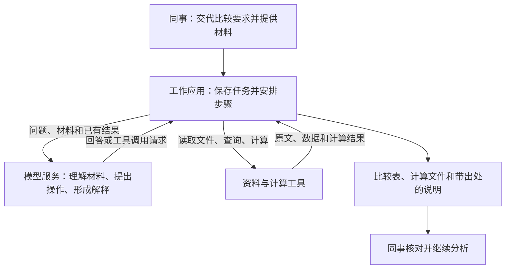
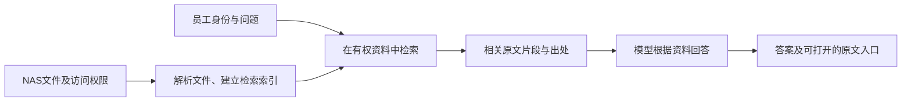
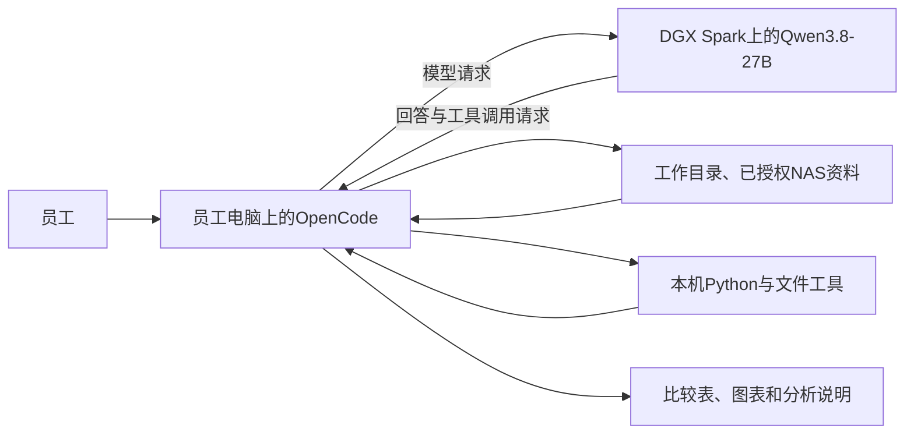
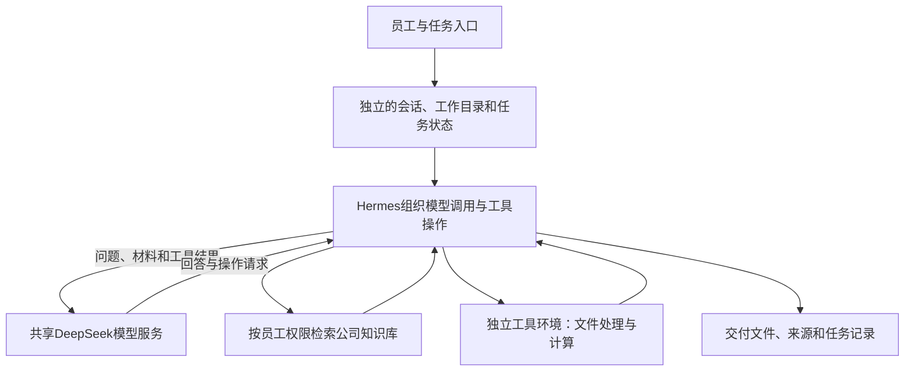

## 01｜LLM怎样进入我们的日常工作

金融应用、本地部署与这段实习的研究

在公司可控的环境里，让模型接触合适的资料，帮助同事完成具体工作。

实习项目汇报

2026年10月22日

## 02｜LLM可以接手哪些工作

大语言模型（LLM）根据收到的指令和上下文生成内容。我们可以用自然语言交代任务，再补充资料、要求和例子。

一份长报告，可以变成围绕指定问题的摘要。一段公告，可以变成包含日期、金额和事件状态的记录。一个分析要求，也可以变成调用查询或计算工具的指令。

当资料和工具接入以后，同事交给它的可以是一项工作：

> 比较这家公司两年的收入和成本，核对季度数据，整理成一张表，并说明主要变化。

模型生成的解释和数字，都需要能回到原文或计算结果。

## 03｜一项财报比较任务的结果

输入：两期财报、一份季度收入CSV、需要比较的指标。

| 指标 | 2024年 | 2025年 | 核对方式 |
|---|---:|---:|---|
| 营业收入，亿元 | 120 | 138 | 财报与季度收入加总相符 |
| 营业成本，亿元 | 84 | 96.6 | 核对财报的期间、单位和业务范围 |
| 毛利率 | 30.0% | 30.0% | 用收入与成本计算 |

收入增长15%，成本同比例增长，毛利率保持不变。两年的季度收入加总分别为120亿元和138亿元。

模型负责找出相关字段和解释变化，计算工具负责加总与比率，交付物保留原文位置和计算依据。

本页为第3周报告中的教学示例，公司与数字均为虚构。

## 04｜金融工作中的应用

| 工作位置 | 已披露的应用 | 交给同事的结果 |
|---|---|---|
| 前台投研 | 富国基金整理研报并生成市场观点 | 分项小结、综合观点和资料来源 |
| 中台合规 | 鹏华基金辅助营销材料审核 | 问题片段和修改建议 |
| 后台IT | 永赢基金将大模型用于邮件检测 | 邮件研判和分级处置 |

前台、中台、后台帮助我们定位使用者。每项应用的具体价值，还要看它读什么材料、做哪一步，以及结果怎样进入原有工作。

来源：行业报告及中国证券投资基金业协会公开案例，2026年披露。

## 05｜投研：围绕一个问题整理多份研报

富国基金的市场观点流程，由研究员指定投资标的和分析方向。

系统筛选相关研报，模型为选中的材料形成小结，再按研究方向归纳，综合为市场观点。

例如，分析一个行业的需求变化时，同事需要比较各份报告的判断及其依据。经过整理，可以直接查看不同报告对同一问题的解释，再回到原文判断分歧。

这套应用还使用内部点评、分析数据和行业标签。资料越接近本公司的研究积累，结果就越有机会贴近实际工作。

来源：富国基金公开案例，第8–9页。此处介绍工作流程，不将机构披露的效率成果作为本公司的收益预测。

## 06｜合规：先把需要复核的内容找出来

鹏华基金把大模型用于营销材料审核，结合既定规则检查风险提示、基金信息、业绩宣传和禁止性表达。

模型读取待审文案，定位疑点并提出修改建议。审核人员结合产品事实和适用规则完成复核与发布审批。

在这项工作里，一条有用的结果应当同时说清：哪段文字有疑点，依据是什么，准备怎样修改。

因此，系统既需要待审材料，也需要有效的规则和产品资料。规则更新后，同事还要知道这次判断依据的是哪个版本。

来源：鹏华基金公开案例，第6页。

## 07｜后台IT：理解邮件内容并调用检测工具

永赢基金披露的邮件检测应用，让大模型理解邮件中的上下文和意图，识别仿冒监管、财务付款、账户异常等话术。

邮件中的附件、链接和二维码需要进一步检查，Agent可以调度检测工具，将各环节结果用于研判和分级处置。

这里的输入超出了邮件正文，也包括工具取得的检测结果。模型将这些信息联系起来，协助IT人员处理具体邮件。

这个案例说明，同一类语言能力也能参与后台工作。进入实际流程后，需要一起考虑材料、工具和处理权限。

来源：永赢基金公开案例，第1–2页。案例介绍不包含对本公司邮件系统的部署假设。

## 08｜应用接近业务，使用条件也更具体

阅读公开财报，可以从公开材料开始。整理内部研究观点，需要取得授权的点评和分析文件。审核业务材料，还要连接当前有效的制度和产品资料。

我们希望公司能够掌握这些能力的使用范围：

- 员工登录后，助手可以读取哪些资料。
- 完成任务时，哪些操作由模型组织，哪些工具实际执行。
- 资料、对话和产物保存在什么环境，交给谁复核和继续使用。

这让讨论自然进入一个问题：怎样在公司可控的环境里使用LLM。

## 09｜本地部署与现有工作环境

公司已经提出本地部署需求，既考虑个人使用，也考虑面向数十人的共享服务。

现有资料保存在NAS，员工按各自权限访问。部署后的助手应当能沿着这些工作关系取得资料、处理任务，并把结果交还给使用者。

本地模型服务让公司安排模型运行位置、服务对象和资源。资料权限、工具访问及结果保存，则需要应用与现有系统共同实现。

由此，部署研究需要同时回答：同事怎样使用、资料怎样接入，以及运行这些任务需要多少资源。

## 10｜这段实习形成的研究成果

**行业研究**梳理了基金业务中的任务、模型作用和交付内容，形成行业报告与案例材料。

**技术研究**比较了模型、推理服务和应用工具，解释它们怎样共同完成财报阅读、数据计算及文件交付。

**部署研究**形成个人Agent、公司知识库和公司共享Agent三种方案，并继续细化长任务的速度、上下文容量、缓存与成本。

已有成果包括阶段报告、部署方案、公开资料核验、计算文件和外部设备测试分析。公司内部业务试点仍是后续工作。

研究与发布记录：2026年9–10月。

## 11｜完成财报比较，需要哪些部分配合

推理服务负责让模型运行并处理请求。应用负责把模型和工具组织成完整工作，保存中途结果，让任务能够继续。

## 12｜模型选择与任务难度

个人阅读、字段提取和知识问答，以Qwen3.8-27B作为研究起点。共享长任务以DeepSeek-V4.1-Flash作为主要候选，进一步比较复杂资料分析和连续工具使用。

模型能力需要结合具体任务判断。同一个模型，找出几个指定数字与完整整理一份长报告，难度并不相同。

研究还比较了Gemma、GLM、MiMo和Kimi的能力、运行资源与许可。公开评测帮助缩小候选范围，最后仍要让候选完成相同的业务材料和交付要求。

本稿沿用已研究的模型版本。个人与知识库的Qwen权重采用8-bit路线，长任务性能按对应部署配置分别记录。

## 13｜公司知识库：先找到有依据的材料

员工查询一项制度时，系统需要找到与问题相关、当前有效且该员工有权访问的原文，再组织答案。

这种方式称为检索增强生成，简称RAG。原始资料持续更新，检索系统维护可用内容，模型在每次回答时使用找到的依据。

Word、PDF、PPT和Excel都需要先处理成可检索内容，保留表格、单位及来源位置。

## 14｜知识库方案的两条路线

| 路线 | 同事使用什么 | 主要建设工作 |
|---|---|---|
| Onyx Enterprise | 平台提供的搜索、问答和研究入口 | 接入NAS及身份，配置本地模型，验证文件和权限同步 |
| Milvus自建方案 | Open WebUI入口与自建问答服务 | 组织文件解析、检索、权限判断、模型回答及运行管理 |

两条路线都连接公司资料和本地回答模型。采购平台的重点是确认现有NAS怎样接入，自建的重点是明确谁维护完整处理过程。

目前NAS的文件总量尚未盘点。可以先以一个实际目录比较解析结果、检索效果和员工使用体验，再确定全量建设规模。

本页为已有研究方案，尚未完成本公司NAS接入验证。

## 15｜Agent怎样把一次回答继续做成一项工作

财报比较往往需要来回几步：找到报表，发现单位不同，查脚注，运行计算，再根据结果补充解释。

Agent的运行程序保存任务状态，让模型根据当前结果选择下一步，调用工具后再继续。研究中把这部分称为Harness。

**Skill保存做事的方法。** 例如财报比较需要先对齐期间和币种，保存计算表，并为结论附上原文位置。

**工具完成具体操作。** Python计算增长率，文件工具读取报告，MCP接口连接资料或业务服务。

因此，代码Agent也可以处理文档和数据。它使用代码与工具，最终交付给同事的可以是Excel、图表和说明。

## 16｜个人方案：模型在Spark，工具在员工电脑

Spark承担模型计算，员工电脑继续处理熟悉的文件与工具。模型收到任务所需的资料，应用把计算结果送回模型，再保存最终产物。

这套方案适合先验证单人的完整工作体验，也能进一步观察小组共享时的变化。

## 17｜长任务为什么需要较大的上下文

上下文是一次模型请求要处理的全部内容，包括工作要求、资料、对话记录、工具返回结果和本轮输出。

比较两期财报后，同事可能继续追问分部变化、检查重述数字，再加入新的材料。Agent需要把相关信息带入后续步骤，上下文会随任务推进而增长。

本项目把131K和262K作为基础研究档位，继续考察512K和1M长任务。

K和M表示token数量级。token是模型处理文字的单位，不等于汉字数。本稿512K指524,288 token，1M指1,000,000 token，总窗口包含输出。

窗口变大以后，还要看读入这些内容和继续生成需要多久。

## 18｜使用时会遇到两种等待

**开始输出之前**，系统要排队、处理输入，再生成第一个输出。处理输入的阶段称为prefill，长材料的首次读取常常在这里花费较多时间。

**开始输出之后**，模型逐步生成内容，这一阶段称为decode。每秒生成的token数，影响一份说明多久能写完。

同事还会等待文件读取、检索和计算工具。对一项财报任务，最终要计量的是从提交要求到拿到可用文件的完整时间。

所以，“每秒生成20个token”和“几秒内开始回答”描述的是不同体验。

## 19｜Spark外部测试中的单人体验

用户提供的朋友设备测试，使用单台DGX Spark运行Qwen3.8-27B。

| 实际输入长度 | 首个输出等待 | 开始输出后的平均速度 |
|---|---:|---:|
| 50,000 token | 63.1秒 | 21.01 token/秒 |
| 100,000 token | 144.8秒 | 20.11 token/秒 |
| 500,000 token | 24.5分钟 | 14.82 token/秒 |

前三档均生成2,048 token，50K与100K各测2次，500K测1次。另一次1M总长度请求完成，首个输出等待80.3分钟，仅生成64 token用于容量检查。

在这些测试中，较长输入同时增加了首次等待，并降低了持续生成速度。单人约20 token/秒的体验，出现在50K和100K输入样本。

测试条件：FP8权重与FP8缓存、推测解码、随机token输入、前缀缓存关闭。结果为外部测量汇总，未评价金融任务答案质量。

## 20｜缓存怎样帮助任务继续

模型读过的输入，可以保留为后续计算使用的状态，常见部分称为KV Cache。

第一次读入财报时需要完整处理。下一轮如果保留了相同的输入前缀及计算状态，系统可以复用已完成的工作，再处理新增的提问和工具结果。

长时间不用的状态还可以保存到SSD，任务继续时再读取。对Spark，这是一条把更多闲置会话留在本地的研究方向，读取与重新接续也需要时间。

缓存主要减少重复输入处理。持续生成时，模型仍然需要使用长上下文，因此回答速度还会受任务长度影响。

前页测试关闭了前缀缓存，尚无这套配置的缓存命中及SSD续跑实测。

## 21｜三人共享时，容量和速度分别变化

外部测试配置的共享缓存池约为181万token。它由所有会话共同使用，三个人不能各自占满1M。

按研究预算预留10%空间后，约163万token可用于会话。三人各使用512K，共占约157万token，已经接近这一预算。

同时生成还会共享计算资源。在每人输入100K、各输出4,096 token的三请求测试中，三个请求共同生成的时段，每路平均约17.5 token/秒。按每个请求从开始到结束的完整生成时段计算，平均约12.5 token/秒。

因此，小组使用需要安排交互请求和长材料读取的顺序。三人各512K的容量计算，尚未对应到三人满窗口的速度测试。

## 22｜个人方案需要投入多少

按10月12日的研究预算，单台Spark国内交付约为**5.8–6.2万元**。加上首次配置、工具接入和功能检查，个人方案约为**6.8–8.2万元**。

这笔投入提供一套本地模型环境。要判断它是否适合日常使用，还需要让同事完成一项有代表性的工作，观察等待、结果质量和修改量。

对于长材料任务，现有测试揭示了明确取舍：可以保留更多内容，但首次读取和后续生成都需要更长时间。

金额来自历史公开价格与交付、实施假设，单位为人民币。它是研究预算，实际采购需取得当前配置和报价。

## 23｜共享Agent：多人使用同一套模型服务

共享的是模型计算资源。员工的资料访问和工作状态仍按各自身份管理，工具可以集中运行，也可以沿用员工电脑。

公司方案还需要知道，多少人正在等待回答，多少任务在运行工具，以及多少会话希望随时继续。

## 24｜共享服务需要给每项任务留多少空间

模型本身占用一部分内存，正在使用的上下文和计算过程还需要额外空间。人数与任务长度共同决定服务器规模。

以DeepSeek-V4.1-Flash的既有实现为例，按公开启动记录调整缓存预算并预留10%后：

| GPU配置 | 20份会话均分时的每份上下文预算 |
|---|---:|
| 8张H100 80GB | 约242K |
| 4张H200 141GB | 约762K |
| 8张H200 141GB | 可覆盖1M |

八卡H200因此成为20份长会话的容量候选。既有GPU整机交付预算约**291–304万元**，集中工具服务器另估**12–26万元**。

容量为10月20日研究中的条件计算，20份1M会话的实际响应速度仍待测试。价格沿用10月12日分析预算，具体供货与采购条件须按设备核实。

## 25｜等待工具的任务，也要能够接着做

一个Agent调用Excel计算后，模型可以先服务别人。原任务的资料和已有计算状态仍有保留价值，工具返回时才能迅速继续。

例如，20个任务正在生成，另20个任务正在等待工具，如果全部保留模型状态，就需要按40份上下文分配空间。

共享服务器可以把暂时闲置的缓存移到主机内存，较久不用的缓存再存到SSD。任务继续时，系统把所需状态取回GPU。

这一安排既涉及容量，也涉及读取等待。需要在同一台机器上比较：保留缓存的成本、重新读取的时间，以及重新处理原文的时间。

所选模型、推理引擎和缓存实现需要配套验证。上述为部署机制与研究方向。

## 26｜多人体验要按完整任务衡量

如果20个请求同时生成，每路希望达到20 token/秒，系统就需要持续提供约400 token/秒的总输出。这是服务目标的换算。

实际运行还会混入长材料首次读取、短追问及工具返回的新结果。某一批请求的总吞吐，不能直接回答每位同事要等多久。

共享方案需要放在同一组任务中比较：

- 第一段回答多久出现，长材料是否拖慢其他人的追问。
- 各个请求在生成阶段的速度，以及排队情况。
- 从提交财报任务到交付可核对文件的总时间。

已有公开跑分可以帮助挑选配置。20个满1M上下文的真实业务任务，尚无本项目实测。

## 27｜推理软件的选择关系到持续使用

推理软件负责装载模型、安排请求和管理缓存。成熟软件能让团队沿用已有的接口、调度及运行记录，在具体硬件上做必要适配。

A100项目研究提供了一个例子：个人开发者实现了新模型的早期适配，并围绕机器连接方式、数据搬运和缓存管理进行优化。

它值得学习的地方，是找到实际瓶颈并验证改动。公开结果来自不同机器和负载，还不足以证明它整体快于成熟引擎。

如果公司采用A100，已有方案选择经过验证的modified vLLM适配版本，维护必要补丁。设备、模型、工具和运维由此可以放在同一套可持续使用的服务中考虑。

## 28｜总成本包括持续把任务做完的投入

硬件购置以后，还需要接入文件与工具、配置应用，并持续处理升级、故障和使用反馈。

三年成本研究把这些投入放在一起：

> 硬件与设施投入，加上实施、运行维护、软件、电力和模型服务费用。

使用外部API可以减少模型服务器投资，但应用接入和工具环境仍然需要维护。多轮Agent还会反复提交历史内容，费用取决于调用轮数、输出量和缓存命中。

最终比较对象是完成相同要求的任务。人工复核和失败重做的时间，也需要进入工作效果的评价。

## 29｜已有成本测算说明了什么

10月20日研究的中等用量情景，三年总成本如下，单位为人民币万元：

| 使用规模 | 本地方案 | DeepSeek标准API情景 |
|---|---:|---:|
| 个人，首年每天3项任务 | 9.05 | 1.66 |
| 公司20人，首年各每天5项任务 | 392.54 | 68.34 |

个人任务量每年增长10%，公司每年增长25%。每项任务按8轮交互及10%额外调用预算，计入实施与持续运维人工。公司两条路线均包含工具服务器。

在这组历史假设下，本地成本较高。公司选择本地部署，需要结合资料范围、运行环境和服务安排判断价值。

API情景仅对应获准使用该服务的材料。两条路线尚未完成同题质量验证，金额为按当时费率推演的预算，不能解释为已经测得的同等产出成本。

## 30｜同一项工作怎样检验

回到两期财报比较，验收可以直接围绕交付物展开：

**比较表**要对应正确期间、单位和业务范围，收入、成本等关键数字能在原文中找到。

**计算文件**能够复跑，增长率、加总和比率与独立计算一致。

**分析说明**把事实与解释分开，每个重要判断附上依据，材料不足之处保留为待查问题。

再记录同事完成整项工作用了多少时间，哪些地方需要修改，以及失败后重做了多少。这样的结果能同时回答模型是否合适、工具是否接好，以及部署是否改善了工作体验。

## 31｜目前已经回答和仍需验证的问题

已有行业材料说明，模型可以参与资料整理、文本审核和工具协作。技术研究把这些任务对应到本地模型、应用和部署方案。

外部Spark测试给出了实际设备上的容量与速度参考。共享方案和成本模型进一步说明，任务长度、并发和持续维护如何影响资源投入。

接下来需要补上的，是本公司真实工作中的完整结果：同事是否愿意持续使用，资料接入是否顺畅，产物需要多少复核，以及繁忙时段是否能及时完成。

本轮完成的是部署前研究与方案准备，尚未取得内部业务效率和收益结果。

## 32｜下一步可以交付一项完整的财报工作

先选择一组获准使用的财报及数据文件，明确要交付的比较表、计算文件和分析说明。

研究同事确定口径和复核标准。应用侧连接文件、计算工具及本地模型，保存各步结果。运行侧记录等待时间、调用量和资源占用。

完成后，用同一组材料比较人工流程与辅助流程，把改错和返工都算进去。重复运行中出现的常见方法可以整理成Skill，供下一次任务复用。

在这一基础上，再讨论更多同事共享、接入NAS目录和扩大服务规模。每一步都继续使用相同的交付与检查方式。

以上为后续工作提案，具体任务由业务同事共同确定。

## 33｜让本地LLM成为可以继续使用的工作工具

金融应用让我们看见，LLM能够帮助同事理解材料、组织操作并形成产物。

本地部署让这些能力进入公司安排的运行环境。要持续用好，还需要把资料、权限、工具和日常使用体验接起来。

这段实习已经把应用需求展开为可以讨论的方案、资源与成本。下一步，以一项完整工作检验它们，再根据结果决定怎样扩展。

谢谢。

讨论：哪一项工作最值得先交给这套环境，什么样的结果会让你愿意继续使用？
